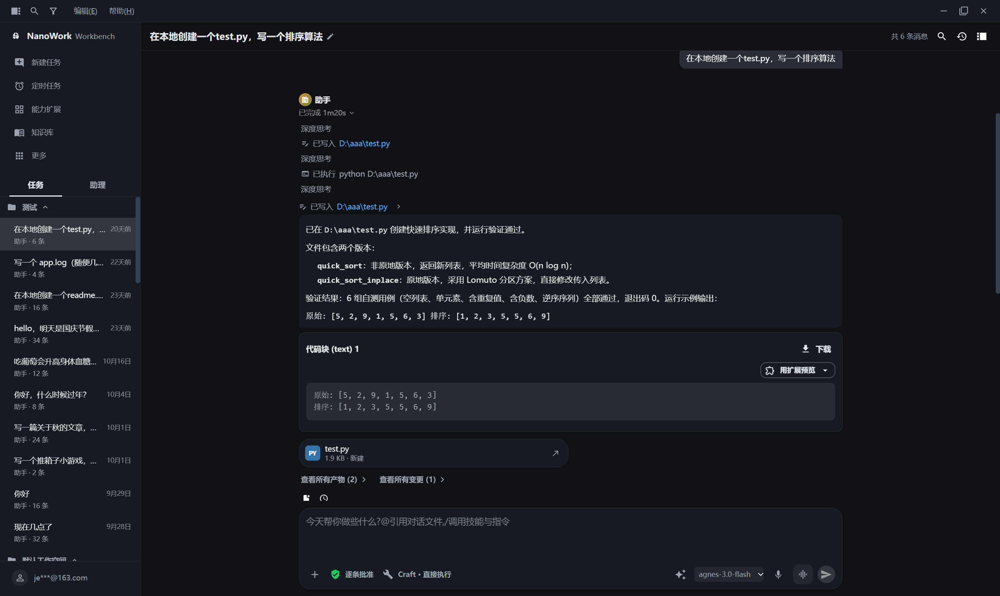

<h1 align="center">nanowork · 智能办公助手</h1>

<p align="center">基于 <a href="https://github.com/HKUDS/nanobot">nanobot</a> 引擎的跨端智能体（Agent）客户端</p>

<p align="center">
  
  
  
  
  
  
  
</p>

## 简介

`nanowork` 是一套跨端智能体客户端：**同一套 React 渲染层既能在浏览器中运行，也能被 Electron 加载为桌面应用**。客户端直连真实 nanobot 网关完成端到端对话，并实时探测连接状态（connected / offline）。

- **引擎契约**：nanobot 暴露 OpenAI 兼容的 `/v1/chat/completions` SSE 接口（`delta.content` 文本流 + 标准 `tool_calls` 增量）。
- **跨端一致**：渲染层零 `import 'electron'`，环境差异统一收敛在 `src/platform/`。
- **本地优先**：会话、专家、技能、任务等数据持久化在本地（Web = `localStorage`，Electron = JSON 文件）。

## 界面预览

<p align="center">
  
</p>

<p align="center"><sub>对话页：左侧会话与任务列表，右侧流式 Markdown 回答、代码块与产物卡片</sub></p>

## 功能

| 模块         | 说明                                                        |
| ---------- | --------------------------------------------------------- |
| 对话         | 多会话流式 Markdown、工具调用卡片、富产物（html / svg / 图片 / mermaid / 代码 / 视频）内联渲染与下载 |
| 权限门控       | 文件 / 终端 / 网络等敏感工具调用前弹窗确认，决策可回溯                            |
| 定时任务       | cron / 间隔调度创建、启停、删除与运行记录                                   |
| 专家（Agents） | 智能体列表、自定义创建、启停、模型与能力绑定                                    |
| 技能         | 内置与自定义技能，支持搜索、启停、能力详情                                     |
| 连接器（MCP）   | MCP 服务器增删改查、连接测试、配置同步                                     |
| 扩展         | 插件式扩展管理                                                   |
| 知识库        | 文档上传、解析与检索（解析由 `cloud/` 云端服务完成）                            |
| 项目 / 组织资产  | 项目空间与组织级资产共享                                              |
| 产物         | 会话产物统一浏览、预览与下载                                            |
| 审计         | 操作与工具调用审计记录                                               |
| 设置 / 账户    | 网关 endpoint / token、模型预设、主题、云端账号登录                        |

## 技术栈

- **构建与语言**：Vite 5、TypeScript 5
- **UI**：React 18、React Router 7、MUI v5、Tailwind CSS
- **状态**：Zustand v4（按域拆分 + `persist` 中间件）
- **富内容**：react-markdown + remark-gfm、mermaid、react-syntax-highlighter、pdfjs-dist、xterm
- **桌面**：Electron 31 + electron-builder（electron-updater 增量更新、node-pty 终端）
- **引擎**：nanobot（Python，`serve` 提供 OpenAI 兼容 SSE 网关）
- **云端（可选）**：FastAPI + SQLModel + Docker（`cloud/`）

## 快速开始

### 环境要求

| 依赖        | 要求                                       |
| --------- | ---------------------------------------- |
| Node.js   | 18+（建议 20 LTS）                           |
| Python    | 3.13（仅运行本地 nanobot 网关需要）                 |
| nanobot   | 网关可执行 `nanobot serve`，默认监听 `127.0.0.1:18900` |

> 下文命令以 Windows PowerShell 为例，macOS / Linux 请替换为对应写法；均在仓库根目录执行。

### 1. 安装依赖

```bash
npm install
# 受限环境可跳过 Electron 二进制下载（不影响 Web 构建）：
# ELECTRON_SKIP_BINARY_DOWNLOAD=1 npm install
```

### 2. 准备 nanobot 引擎

> ⚠️ `nanobot/` 是**独立 git 仓库**（上游 `HKUDS/nanobot`），被本仓库 `.gitignore` 忽略且不是 submodule，
> 因此 clone 本仓库**不会**带来引擎源码，需另行获取。仓库边界与 venv 约定见 [`docs/engine-dev-setup.md`](docs/engine-dev-setup.md)。

引擎运行环境位于 `nanobot/nanobot/.venv`（editable 安装指向源码，改源码即生效，无需重装）：

```bash
python -m venv nanobot\nanobot\.venv
.\nanobot\nanobot\.venv\Scripts\python.exe -m pip install -U pip
.\nanobot\nanobot\.venv\Scripts\python.exe -m pip install -e ".\nanobot[api]"
```

### 3. 配置网关

在仓库根目录创建 `nanowork.config.json`（已被 `.gitignore` 忽略，密钥不出本机）：

```json
{
  "providers": {
    "dashscope": { "api_key": "sk-你的DashScopeKey" }
  },
  "agents": {
    "defaults": { "model": "qwen3-32b" }
  },
  "modelPresets": {
    "qwen-max": { "label": "Qwen Max", "model": "qwen-max" },
    "qwen-plus": { "label": "Qwen Plus", "model": "qwen-plus" }
  }
}
```

- **模型下拉来源**：前端模型选择器的选项来自网关 `GET /v1/models`，即 `modelPresets` 加上隐式 `default`（`agents.defaults.model`，固定首位）。修改预设后重启网关，前端下次打开下拉即刷新。
- **模型名不要带 provider 前缀**：dashscope provider 不会剥离前缀，写 `"dashscope/qwen-max"` 会被原样发给服务端并报「模型不存在」，直接写裸模型名 `qwen-max` 即可，nanobot 按 provider 关键字路由。

### 4. 启动

```bash
# 终端 A：nanobot 网关（API 18900 / 健康检查 18790）
.\nanobot\nanobot\.venv\Scripts\nanobot.exe serve --config nanowork.config.json --host 127.0.0.1 --port 18900 -v

# 终端 B：前端 dev server
npm run dev
# 打开 http://localhost:5176 （端口占用时自动顺延，以终端输出为准）
```

打开页面后，在顶部 **ConnectionBanner** 填入网关地址 `http://127.0.0.1:18900` 并连接，选择助手即可开始对话。

**链路自检**（无需打开浏览器）：

```bash
# 模型目录
curl -s http://127.0.0.1:18900/v1/models
# 端到端对话，期望返回 "content":"ok"
curl -s -X POST http://127.0.0.1:18900/v1/chat/completions \
  -H 'Content-Type: application/json' \
  -d '{"model":"qwen3-32b","messages":[{"role":"user","content":"reply with one word: ok"}],"max_tokens":24}'
```

### 5. 桌面端

```bash
npm run electron:serve    # 构建后用 Electron 打开（静态，无热更新）
npm run build:electron    # 产出可分发包（dist-electron/）
# 带热更新：先 npm run dev，再 npx electron .
```

桌面端启动时会自动尝试拉起本地 nanobot 网关（可用环境变量 `NANOBOT_BIN` / `NANOBOT_HOST` / `NANOBOT_PORT` 或 `userData/nanowork.nanobot.json` 覆盖）。端口被占用时会自动顺延到下一个可用端口，并同步界面中的网关地址。

### 默认端口

| 服务                  | 端口      | 说明                                            |
| ------------------- | ------- | --------------------------------------------- |
| nanobot `serve` API | `18900` | OpenAI 兼容 `/v1/chat/completions`、`/v1/models` |
| nanobot 网关健康        | `18790` | 网关组件健康检查（根路径 404 属正常）                         |
| 前端 Vite dev         | `5176`  | `vite.config.ts` 的 `server.port`               |
| 网关 WebSocket 频道     | `9900`  | `nanowork.config.json` 的 `channels.websocket.port` |

> 网关端口定义在 `src/lib/core/constants.ts`（`DEFAULT_GATEWAY_PORT`），与 `electron/main.ts` 保持镜像，手工启动网关时需与之一致。

## 常用脚本

| 命令                       | 说明                                       |
| ------------------------ | ---------------------------------------- |
| `npm run dev`            | 启动 Vite 开发服务器                            |
| `npm run build`          | 类型检查 + 生产构建 → `dist/`                     |
| `npm run preview`        | 预览生产构建                                   |
| `npm test`               | 运行全部单元测试（vitest）                         |
| `npm run test:watch`     | 单元测试监听模式                                 |
| `npm run verify:gateway` | 网关链路集成测试                                 |
| `npm run electron:serve` | 构建并以 Electron 打开                         |
| `npm run build:electron` | 构建 Electron 可分发包                         |
| `npm run build:installer` | 生成安装包（`build:installer:mac` / `:linux` 区分平台） |

## 目录结构

```
nanowork/
├─ src/                      # 渲染层（Web + Electron 共用）
│  ├─ ai/                    # nanobot 客户端、连接管理、内置专家/技能/MCP
│  ├─ components/            # 通用组件与业务子组件
│  ├─ events/                # 事件总线与事件投影
│  ├─ hooks/                 # 通用 hooks
│  ├─ layout/                # AppLayout / SidebarNav / ConnectionBanner
│  ├─ lib/                   # core / memory / kb / task / artifact / audit / sync / workspace 等领域逻辑
│  ├─ observability/         # 日志与可观测性
│  ├─ pages/                 # chat / agents / skills / mcp / tasks / knowledge / projects / audit / extensions / settings …
│  ├─ platform/              # 跨端适配：storage / bridge / env
│  ├─ router/                # React Router 路由（页面级懒加载）
│  ├─ stores/                # Zustand 按域 store
│  ├─ sync/                  # 云端同步
│  ├─ theme/ types/          # 主题与全局类型
│  └─ App.tsx / main.tsx
├─ electron/                 # 桌面外壳：main / preload / builder 配置 / 本地存储
├─ cloud/                    # 云端服务（FastAPI：认证 + 同步 + 知识库）
├─ tests/                    # vitest 单测与网关集成测试
├─ docs/                     # 设计文档与 ADR
├─ .github/workflows/ci.yml  # CI：类型检查 + 单测 + 构建
├─ nanowork.config.json      # 本地网关配置（gitignore，含密钥）
├─ nanobot/                  # 独立 git 仓库（上游 nanobot），被本仓库忽略，非 submodule
└─ package.json / vite.config.ts / tsconfig*.json / tailwind.config.js
```

## 测试

```bash
npm test                    # 单元测试
npm run verify:gateway      # 网关链路集成测试
npm run typecheck           # 渲染层类型检查
npm run typecheck:electron  # 桌面外壳类型检查
npm run typecheck:tests     # 测试代码类型检查
npm run build               # 类型检查 + 生产构建
```

CI（[`.github/workflows/ci.yml`](.github/workflows/ci.yml)）执行类型检查、单元测试与生产构建，并校验两条平台边界：`window.electronAPI` 只允许出现在 `src/platform/`，引擎 wire 字段只允许出现在 `src/ai/runtime/nanobotHttp/`。

## 云端服务

`cloud/` 提供账号认证、跨端同步与知识库文档解析，生产形态为单个容器（镜像 `nanowork-cloud:0.1.0`，宿主机端口 `8910`）。构建、部署、更新与备份方式见 [`cloud/DOCKER.md`](cloud/DOCKER.md)。

```bash
cd cloud
docker compose up -d --build
curl -s http://127.0.0.1:8910/health
```

## License

本项目基于 [MIT License](LICENSE) 开源，Copyright (c) 2026 bwshark。

你可以自由使用、修改、分发本软件，包括商业用途，但需保留版权声明与许可声明；软件按「现状」提供，不附带任何担保。
