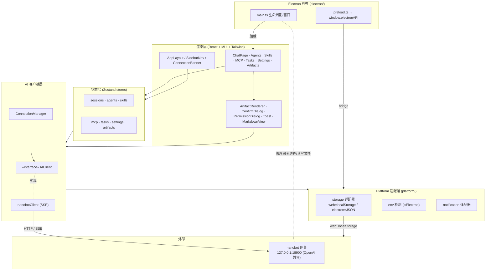
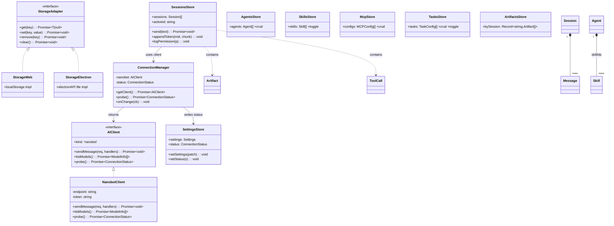
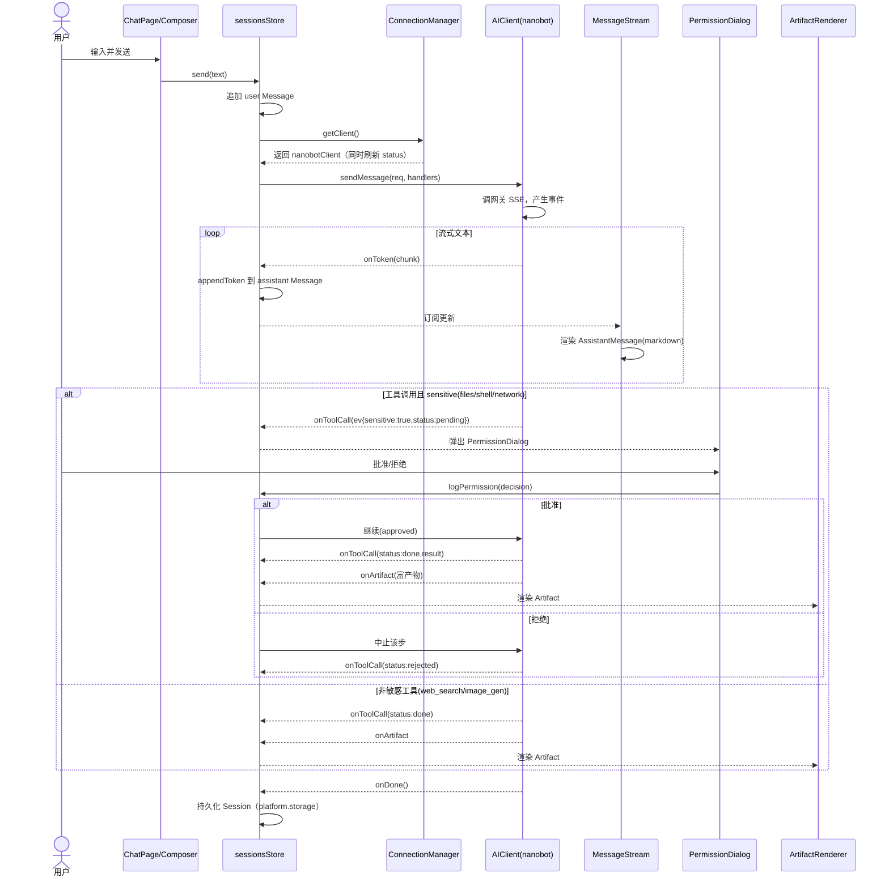
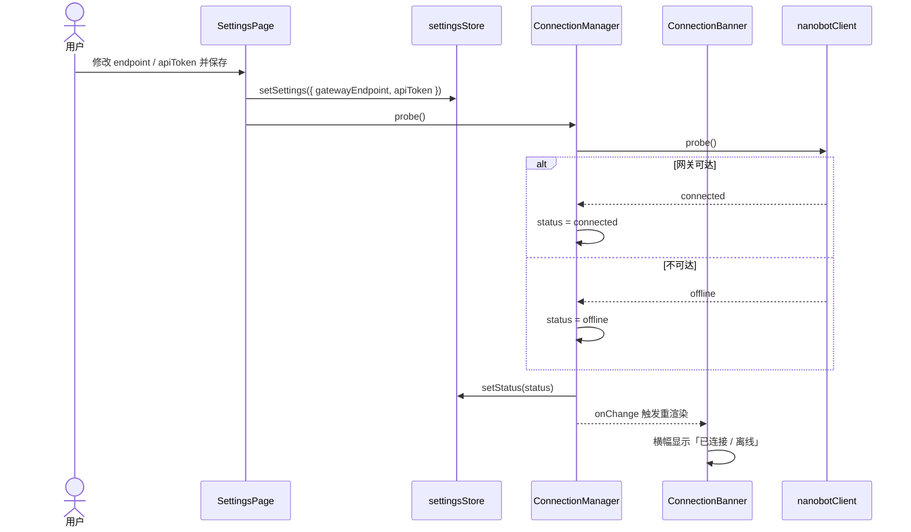
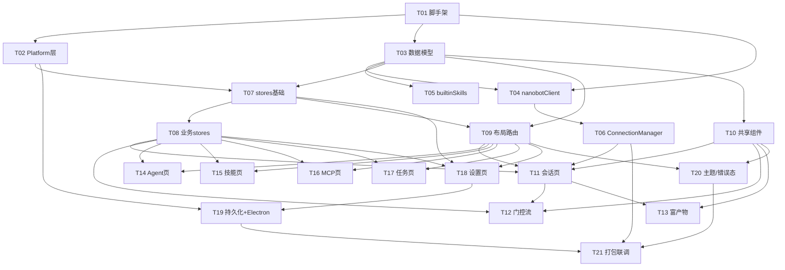

# 系统架构设计文档 — 类 WorkBuddy 智能体客户端助手（基于 nanobot）

> ⚠️ **已取代（历史存档）**：本文为 V1 架构初版，**内容已被 `nanowork-prd-design-v2.md` 第 7 章（五层架构）与第 22 章（目录规划）取代**。下文的分层图与 AIClient / `platform` 约定仍有参考价值，但**文件清单已过期**（缺 `platform` / `nanobotBridge` / `im` / `composer` / `memory` 等），第 3.2 节与 T04 引用的 `src/ai/types.ts` / `nanobotClient.ts` 已在 D1 迁至 `src/ai/runtime/types.ts` / `src/ai/runtime/nanobotHttp/chat.ts`。**以 v2 为准，本文件除本横幅外不再编辑**（治理约定见 `docs/README.md` 第八节）。

> 文档状态：架构初版（对应 PRD v1）
> 架构师：高见远（Gao）｜主理人：齐活林（team-lead）
> 工程师（实现）：寇豆码
> 关联文档：`docs/prd.md`

---

## 0. 设计总览（TL;DR）

本系统是一层「客户端 + 管理 UI」，运行在 **nanobot 引擎**之上。同一份 React 渲染层既可在浏览器运行，也可被 Electron 主进程加载为桌面应用。

- **渲染层**：Vite + React 18 + MUI + Tailwind CSS（Web 与 Electron 共用）。
- **AI 接入**：统一 `AIClient` 抽象，实现为 `nanobotClient`（直连 nanobot OpenAI 兼容 SSE 流式接口）。
- **连接管理**：`ConnectionManager` 探测网关可达性（connected / offline），顶部 `ConnectionBanner` 展示当前状态。
- **跨端隔离**：渲染层**不直接依赖 `electron`**，所有环境差异通过 `platform/` 适配层（storage / env / notification）隔离；Electron 仅通过 `preload` 暴露 `window.electronAPI`，桌面存储用 JSON 文件（首版，预留 better-sqlite3）。
- **状态管理**：Zustand（轻量，store 按业务域拆分并接持久化中间件）。
- **路由**：React Router 7，7 个路由（含 `/artifacts` P2 占位）。

---

## 1. 实现方案 + 框架选型

### 1.1 总体架构（分层）



### 1.2 为什么选这些技术

| 选型 | 理由 |
|------|------|
| **Vite + React 18** | 构建快、HMR 好；`vite build` 可产出纯静态站供 Web 与 Electron 共用。 |
| **MUI (Material UI)** | 开箱即用的企业级组件（抽屉、表格、开关、对话框），与 WorkBuddy 桌面质感一致，减少自研组件成本。 |
| **Tailwind CSS** | 与 MUI 互补：MUI 管组件，Tailwind 管布局/间距/响应式微调，避免写大量 CSS。 |
| **Zustand** | 比 Redux Toolkit 轻量、样板代码少；按域拆分 store，配合 `persist` 中间件即可落地 FR-008；适合渲染层专注数据。 |
| **React Router 7** | 声明式路由，支持 Web 与 Electron 共用；`createBrowserRouter` 便于做懒加载。 |
| **react-markdown + remark-gfm + react-syntax-highlighter + mermaid** | 富产物渲染（FR-007）直接复用成熟库，覆盖 MD / 代码高亮 / Mermaid；HTML/SVG 用受控 `iframe`/`div`，视频用外链 `<video>`/`<a>`。 |
| **Electron + electron-builder** | 桌面外壳（生命周期、本地文件读写、托盘 P2、通知 P2）；与 Web 渲染层分离打包（Q6）。 |
| **nanobot 网关（外部，不纳入依赖）** | 仅作为 OpenAI 兼容 API 的 HTTP/SSE 服务端引用；本客户端不安装 nanobot，运行时由用户自托管或桌面端按需拉起。 |

### 1.3 跨端策略（Web vs Electron 边界）

| 关注点 | Web | Electron（桌面） |
|--------|-----|------------------|
| 渲染层代码 | 同一份 `src/` | 同一份 `src/` |
| 入口 HTML/构建 | `index.html` + `vite build` → 静态站 | 主进程 `main.ts` 加载上述静态资源（或 dev server） |
| 存储 | `localStorage`（首版，结构简单数据） | JSON 文件（首版，落 `userData/` 目录；预留 better-sqlite3） |
| 网关连接 | 浏览器直接 `fetch` nanobot HTTP API | 渲染层仍走 HTTP；主进程可额外管理 nanobot 进程（P2 增强） |
| 通知 / 托盘 | Web Notification（P2 才做） | 主进程 `Notification` + Tray（P2） |
| 进程桥 | 无 | `preload.ts` 暴露 `window.electronAPI`；渲染层**不 import electron** |

> 关键约束：**渲染层通过 `platform/index.ts` 获取适配实现，永远不直接 `require('electron')`**。这样同一份 `src` 在两种环境下零改动构建。

### 1.4 连接管理（对应 FR-006）

- 始终直连：`ConnectionManager` 调 `nanobotClient.probe()` 探测网关可达性。
- 可达 → `connected`；不可达 → `offline`（发送时由 client 报错）。
- `ConnectionBanner` 展示当前状态并支持编辑网关地址、桌面端拉起/停止 nanobot。

---

## 2. 文件列表及相对路径

```
nanowork/
├─ package.json                      # 依赖与脚本（dev / build:web / build:electron / electron:serve）
├─ vite.config.ts                    # Web 构建（react 插件 + tailwind + alias @→src）
├─ tsconfig.json                     # 渲染层 TS 配置
├─ tsconfig.node.json                # vite/electron 构建脚本 TS 配置
├─ tailwind.config.js                # Tailwind 内容扫描 + 主题扩展
├─ postcss.config.js                 # tailwind + autoprefixer
├─ index.html                        # Web 入口 HTML（挂载 #root）
├─ electron/
│  ├─ main.ts                        # 主进程：窗口创建、加载 URL/静态资源、生命周期、网关进程管理(P2)
│  ├─ preload.ts                     # contextBridge 暴露 window.electronAPI（storage/read/write/notify）
│  ├─ electron-env.d.ts             # window.electronAPI 全局类型声明
│  └─ builder.config.ts             # electron-builder 打包配置（asar、平台目标）
├─ src/
│  ├─ main.tsx                       # React 入口：createRoot + RouterProvider + MUI ThemeProvider
│  ├─ App.tsx                        # 顶层壳：AppLayout + 全局 Toast/Provider（或合并进 router）
│  ├─ vite-env.d.ts
│  │
│  ├─ platform/                      # 【跨端适配层】渲染层只依赖这里的接口
│  │  ├─ index.ts                    # 运行时选择 web/electron 实现并导出统一 API
│  │  ├─ types.ts                    # PlatformAdapter / StorageAdapter 接口
│  │  ├─ env.ts                      # isElectron / isWeb 检测（typeof window.electronAPI）
│  │  ├─ storage.web.ts              # localStorage 实现（get/set/remove/clear）
│  │  ├─ storage.electron.ts         # 调用 window.electronAPI 读写 JSON 文件
│  │  └─ notification.ts             # 跨端通知封装（web Notification / electron 桥）
│  │
│  ├─ types/                         # 【全局数据模型】纯类型，无副作用
│  │  ├─ agent.ts                    # Agent 实体
│  │  ├─ session.ts                  # Session + 与 Agent 绑定
│  │  ├─ message.ts                  # Message（user/assistant/tool 角色）
│  │  ├─ toolcall.ts                 # ToolCall 事件 + 敏感标记
│  │  ├─ artifact.ts                 # Artifact 富产物
│  │  ├─ mcp.ts                      # MCPConfig
│  │  ├─ task.ts                     # TaskConfig（cron/间隔）
│  │  ├─ settings.ts                 # Settings（endpoint/token/mode）
│  │  ├─ permission.ts               # PermissionLog 决策记录
│  │  ├─ model.ts                    # ModelInfo
│  │  └─ index.ts                    # 统一再导出
│  │
│  ├─ ai/                            # 【AI 客户端层】
│  │  ├─ types.ts                    # AIClient 接口、ChatRequest、StreamHandlers、事件类型
│  │  ├─ nanobotClient.ts            # OpenAI 兼容 /chat/completions SSE 流式解析
│  │  ├─ builtinSkills.ts            # 内置技能目录（FR-003）
│  │  └─ connectionManager.ts        # 网关可达性探测 + 状态广播
│  │
│  ├─ stores/                        # 【状态层 Zustand】
│  │  ├─ index.ts                    # 聚合导出 + persist 配置
│  │  ├─ settingsStore.ts           # 连接设置 + 当前连接状态
│  │  ├─ sessionsStore.ts           # 会话 CRUD + 消息流 + permission log
│  │  ├─ agentsStore.ts             # Agent CRUD + 启用状态
│  │  ├─ skillsStore.ts             # 技能目录 + 启用状态（首版内置 + 持久化开关）
│  │  ├─ mcpStore.ts                # MCPConfig CRUD + 同步状态
│  │  ├─ tasksStore.ts              # TaskConfig CRUD + 启停
│  │  └─ artifactsStore.ts          # 产物缓存（按 session 归档）
│  │
│  ├─ router/                        # 路由
│  │  └─ index.tsx                   # React Router 7 路由表（7 路由 + 懒加载）
│  │
│  ├─ layout/                        # 布局壳
│  │  ├─ AppLayout.tsx               # SidebarNav + 内容区 Outlet + ConnectionBanner
│  │  ├─ SidebarNav.tsx              # 导航项（会话/Agent/技能/MCP/任务/设置）
│  │  └─ ConnectionBanner.tsx        # 顶部连接模式横幅
│  │
│  ├─ components/                    # 共享组件
│  │  ├─ ArtifactRenderer.tsx        # 按 type 分发渲染（FR-007）
│  │  ├─ ConfirmDialog.tsx           # 通用确认（删除等）
│  │  ├─ PermissionDialog.tsx       # 敏感操作门控弹窗（FR-009）
│  │  ├─ Toast.tsx                   # 轻提示
│  │  └─ MarkdownView.tsx            # 封装 react-markdown + remark-gfm + 高亮
│  │
│  ├─ pages/                         # 业务页面
│  │  ├─ chat/
│  │  │  ├─ ChatPage.tsx             # 会话页容器（组合下列组件）
│  │  │  ├─ SessionListPanel.tsx     # 多 Agent 会话列表（新建/切换/删除）
│  │  │  ├─ ChatHeader.tsx           # 当前 Agent/模型/状态
│  │  │  ├─ MessageStream.tsx        # 消息流列表
│  │  │  ├─ UserMessage.tsx
│  │  │  ├─ AssistantMessage.tsx      # 流式 markdown 渲染
│  │  │  ├─ ToolCallCard.tsx          # 工具调用参数/结果可展开
│  │  │  └─ Composer.tsx             # 输入框 + Agent/模型选择 + 发送
│  │  ├─ agents/AgentsPage.tsx        # Agent CRUD（FR-002）
│  │  ├─ skills/SkillsPage.tsx        # 技能市场（FR-003）
│  │  ├─ mcp/McpPage.tsx              # MCP 管理（FR-004）
│  │  ├─ tasks/TasksPage.tsx          # 定时任务（FR-005）
│  │  ├─ settings/SettingsPage.tsx    # 设置（FR-006）
│  │  └─ artifacts/ArtifactsPage.tsx  # 产物库（P2 占位/基础）
│  │
│  ├─ theme/                         # 主题与样式
│  │  ├─ muiTheme.ts                 # MUI 主题（primary、圆角、字体）
│  │  └─ index.css                   # Tailwind 指令 + 全局基础样式
│  │
│  └─ lib/                           # 工具函数
│     ├─ sse.ts                      # fetch + ReadableStream 解析 SSE（data:/[DONE]）
│     ├─ id.ts                       # 生成唯一 id（crypto.randomUUID 封装）
│     └─ constants.ts                # 路由路径、存储 key、敏感工具集合等常量
```

---

## 3. 数据结构和接口（TS 类型 + 类图）

### 3.1 核心实体类型（节选，完整见 `src/types/`）

```typescript
// types/settings.ts
export type ConnectionStatus = 'connected' | 'offline';

export interface Settings {
  gatewayEndpoint: string;   // 默认 http://127.0.0.1:18900/v1
  apiToken: string;          // nanobot apiToken/key
  theme: 'light' | 'dark';
  memoryEnabled: boolean;    // 记忆注入开关（默认 true）
  autoSummarize: boolean;    // 会话结束自动沉淀摘要（默认 true）
}

// types/agent.ts
export interface Agent {
  id: string;
  name: string;
  systemPrompt: string;
  model: string;             // 首版单模型字符串；P2 多供应商
  skillIds: string[];        // 绑定技能
  workdir?: string;          // 工作目录
  imBinding: boolean;        // IM 绑定开关（FR-010 预留）
  enabled: boolean;
  createdAt: string;         // ISO 8601 UTC
}

// types/session.ts
export interface Session {
  id: string;
  agentId: string;
  title: string;
  messages: Message[];
  permissionLog: PermissionLog[];
  createdAt: string;
  updatedAt: string;
}

// types/message.ts
export type Role = 'user' | 'assistant' | 'tool';
export interface Message {
  id: string;
  role: Role;
  content: string;          // 文本（assistant 流式累积）
  toolCalls?: ToolCall[];   // assistant 触发的工具调用
  artifacts?: Artifact[];   // 消息内富产物
  createdAt: string;
}

// types/toolcall.ts
export type SensitiveCategory = 'files' | 'shell' | 'network';
export type ToolCallStatus =
  | 'pending'      // 等待权限批准
  | 'approved'
  | 'rejected'
  | 'running'
  | 'done'
  | 'error';

export interface ToolCall {
  id: string;
  tool: string;             // web_search | web_fetch | files | shell | image_gen | chat
  args: Record<string, unknown>;
  sensitive: boolean;       // 属 files/shell/network 则 true
  status: ToolCallStatus;
  result?: string;
}

// types/artifact.ts
export type ArtifactType =
  | 'html' | 'svg' | 'image' | 'mermaid' | 'code' | 'markdown' | 'video';
export interface Artifact {
  id: string;
  type: ArtifactType;
  title?: string;
  content: string;          // 文本类内容；video 为外链 url
  language?: string;        // code 高亮语言
  url?: string;             // image/video 外链
  createdAt: string;
}

// types/mcp.ts
export type MCPTransport = 'url' | 'command';
export type MCPStatus = 'idle' | 'syncing' | 'connected' | 'error';
export interface MCPConfig {
  id: string;
  name: string;
  transport: MCPTransport;
  endpoint?: string;        // url 模式
  command?: string;         // command 模式
  auth?: Record<string, string>;
  status: MCPStatus;
}

// types/task.ts
export type TaskSchedule = { kind: 'cron'; expr: string } | { kind: 'interval'; minutes: number };
export type TaskStatus = 'enabled' | 'disabled';
export interface TaskConfig {
  id: string;
  name: string;
  schedule: TaskSchedule;
  prompt: string;
  agentId: string;
  status: TaskStatus;
  createdAt: string;
}

// types/permission.ts
export interface PermissionLog {
  id: string;
  tool: string;
  args: Record<string, unknown>;
  decision: 'approved' | 'rejected';
  at: string;
}

// types/model.ts
export interface ModelInfo { id: string; label?: string; }
```

### 3.2 AI 客户端接口（`src/ai/types.ts`）

```typescript
import type { ChatMessageParam, ModelInfo, ConnectionStatus } from '@/types';

export interface ChatRequest {
  agentId: string;
  messages: ChatMessageParam[];   // role/content/name
  model?: string;
  stream: true;
}

export interface StreamHandlers {
  onToken(chunk: string): void;                 // 流式文本片段
  onToolCall(ev: ToolCallEvent): void;          // 工具调用事件（含 sensitive）
  onArtifact(ev: ArtifactEvent): void;          // 富产物事件
  onStatus(status: 'thinking' | 'reasoning' | 'streaming' | 'tooling' | 'done'): void;
  onDone(): void;
  onError(err: Error): void;
}

export interface ToolCallEvent {
  id: string; tool: string; args: Record<string, unknown>;
  sensitive: boolean; status: ToolCallStatus;
}
export interface ArtifactEvent {
  id: string; type: ArtifactType; title?: string;
  content: string; language?: string; url?: string;
}

export interface AIClient {
  readonly kind: 'nanobot';
  sendMessage(req: ChatRequest, handlers: StreamHandlers): Promise<void>;
  listModels(): Promise<ModelInfo[]>;
  probe(): Promise<ConnectionStatus>;
}
```

### 3.3 Platform 适配接口（`src/platform/types.ts`）

```typescript
export interface StorageAdapter {
  get<T>(key: string): Promise<T | null>;
  set<T>(key: string, value: T): Promise<void>;
  remove(key: string): Promise<void>;
  clear(): Promise<void>;
}
export interface PlatformAdapter {
  env: 'web' | 'electron';
  storage: StorageAdapter;
  notify(title: string, body: string): void;
}
// Electron 额外桥（preload 暴露，渲染层仅经 platform 调用）：
// interface ElectronAPI {
//   storageGet/Set/Remove/Clear, notify, getGatewayStatus
// }
```

### 3.4 类图（Mermaid）



---

## 4. 程序调用流程（时序图）

### 4.1 主链路：发送消息 → 流式回复 + 工具调用 + 权限门控 + 富产物



### 4.2 保存网关配置 → ConnectionManager 重新探测



---

## 5. 任务列表（有序、含依赖、按实现顺序）

> 粒度：每项含 3+ 相关文件，工程师一个 turn 可批量完成。优先级 P0 任务覆盖 PRD 全部 9 项 P0 需求。
> 依赖以任务 ID 表示，尽量并行；T01 为基础设施根。

| 任务ID | 名称 | 涉及文件（节选） | 依赖 | 优先级 | 验收点 |
|--------|------|------------------|------|--------|--------|
| T01 | 项目脚手架与跨端构建配置 | `package.json` `vite.config.ts` `tsconfig.json` `tsconfig.node.json` `tailwind.config.js` `postcss.config.js` `index.html` `src/main.tsx` `src/App.tsx` `src/vite-env.d.ts` | — | P0 | `npm run dev` 起 Vite 站点；MUI+Tailwind 可渲染空壳；TS 编译通过。 |
| T02 | Platform 适配层（storage/env/notification） | `src/platform/index.ts` `types.ts` `env.ts` `storage.web.ts` `storage.electron.ts` `notification.ts` `electron/preload.ts` `electron/electron-env.d.ts` | T01 | P0 | `platform.storage.get/set` Web 走 localStorage、Electron 走 electronAPI；`isElectron()` 正确识别。 |
| T03 | 全局类型与数据模型 | `src/types/*.ts`（agent/session/message/toolcall/artifact/mcp/task/settings/permission/model + index） | T01 | P0 | 所有类型编译通过；`types/index.ts` 统一导出。 |
| T04 | aiClient 接口 + nanobotClient（SSE） | `src/ai/types.ts` `nanobotClient.ts` `src/lib/sse.ts` `src/lib/constants.ts` | T03 | P0 | `nanobotClient.sendMessage` 能解析 OpenAI SSE（`data:`/`[DONE]`）并回调 `onToken/onToolCall/onArtifact`；`probe()` 正确。 |
| T05 | 内置技能目录 | `src/ai/builtinSkills.ts` | T03 | P0 | 内置技能元数据（id/名称/能力描述），供技能页与 Agent 绑定。 |
| T06 | ConnectionManager 与连接状态 | `src/ai/connectionManager.ts` | T04 | P0 | 始终直连：`probe()` 探测网关可达性（connected/offline）；`onChange` 广播状态。 |
| T07 | Zustand stores 基础设施 + settingsStore | `src/stores/index.ts` `settingsStore.ts` `src/lib/id.ts` | T02,T03 | P0 | store 接 `persist` 中间件（经 platform.storage）；settings 读写并持久化。 |
| T08 | 业务 stores（sessions/agents/skills/mcp/tasks/artifacts） | `src/stores/sessionsStore.ts` `agentsStore.ts` `skillsStore.ts` `mcpStore.ts` `tasksStore.ts` `artifactsStore.ts` | T07,T03 | P0 | 各域 CRUD + 持久化；`sessionsStore.send` 接入 ConnectionManager 并分发事件到消息/产物/权限。 |
| T09 | AppLayout 壳 + SidebarNav + 路由 | `src/layout/AppLayout.tsx` `SidebarNav.tsx` `src/router/index.tsx` | T07,T03 | P0 | 7 路由可达；侧栏导航高亮；内容区 Outlet 渲染。 |
| T10 | 共享组件（ArtifactRenderer/ConfirmDialog/PermissionDialog/Toast/MarkdownView） | `src/components/*.tsx` | T03 | P0 | MarkdownView 渲染 MD+高亮；ConfirmDialog/PermissionDialog 可复用；Toast 可触发。 |
| T11 | 会话页 + 消息流（流式 markdown） | `src/pages/chat/ChatPage.tsx` `SessionListPanel.tsx` `ChatHeader.tsx` `Composer.tsx` `MessageStream.tsx` `UserMessage.tsx` `AssistantMessage.tsx` | T06,T08,T09,T10 | P0 | 新建/切换会话；发送后 assistant 流式渲染；断流可重试（FR-001）。 |
| T12 | 工具调用卡片 + 敏感操作门控流 | `src/pages/chat/ToolCallCard.tsx` `src/components/PermissionDialog.tsx` `src/components/ConfirmDialog.tsx` | T11,T08,T10 | P0 | 敏感工具（files/shell/network）弹确认；批准继续/拒绝中止并写 permissionLog（FR-009）。 |
| T13 | 富产物渲染（FR-007） | `src/components/ArtifactRenderer.tsx` `src/pages/chat/MessageStream.tsx`(接入) | T10,T11 | P0 | HTML/SVG/图像/Mermaid/代码/MD 正确渲染；视频外链；产物可下载。 |
| T14 | Agent 管理页（FR-002） | `src/pages/agents/AgentsPage.tsx` | T08,T09 | P0 | Agent 列表 + 增删改抽屉 + 启用停用 + 持久化；可作为会话目标。 |
| T15 | 技能管理页（FR-003） | `src/pages/skills/SkillsPage.tsx` `src/ai/builtinSkills.ts`(技能目录) | T08,T09 | P0 | 技能网格 + 启用停用 + 能力详情 + 搜索；状态持久化。 |
| T16 | MCP 管理页（FR-004） | `src/pages/mcp/McpPage.tsx` | T08,T09 | P0 | MCPConfig CRUD + 连接测试 + 同步状态标签；保存持久化。 |
| T17 | 定时任务管理页（FR-005） | `src/pages/tasks/TasksPage.tsx` | T08,T09 | P0 | 任务 CRUD + cron/间隔 + 启停/删除；列表展示。 |
| T18 | 设置页（FR-006） | `src/pages/settings/SettingsPage.tsx` | T07,T08,T09 | P0 | endpoint/token 输入 + 记忆开关 + 数据管理清空；保存即生效并重新探测。 |
| T19 | 本地持久化补齐 + Electron 集成 | `electron/main.ts` `electron/storage.electron.ts`(完善) `src/stores/index.ts`(persist 接 electron) | T02,T18 | P0 | 桌面重启后数据仍在（JSON 文件）；Web 走 localStorage 一致。 |
| T20 | 主题/样式/错误处理/加载态 | `src/theme/muiTheme.ts` `index.css` `src/components/Toast.tsx`(完善) | T09,T10 | P0 | MUI 主题统一；加载/错误态一致；连接中/失败提示清晰。 |
| T21 | Electron 打包 + 跨端联调 | `electron/builder.config.ts` `package.json`(build scripts) | T19,T20,T06 | P0 | `build:electron` 产出可运行包；Web 与桌面同渲染层；直连网关全流程可演示。 |

> P1/P2（FR-010~FR-015）不在首版实现范围，预留接口：IM 绑定开关（`Agent.imBinding`）、`/artifacts` 路由占位、多模型字段（`Agent.model` 字符串预留扩展）。后续迭代另开任务。

### 5.1 任务依赖图（Mermaid）



---

## 6. 依赖包列表

### 6.1 npm 依赖（渲染层 + 桌面）

```text
# 渲染层
react@^18.3.0
react-dom@^18.3.0
react-router-dom@^7.0.0        # React Router 7
@mui/material@^5.16.0          # 组件库
@mui/icons-material@^5.16.0
@emotion/react@^11.11.0
@emotion/styled@^11.11.0
tailwindcss@^3.4.0
postcss@^8.4.0
autoprefixer@^10.4.0
zustand@^4.5.0                 # 状态管理
react-markdown@^9.0.0          # MD 渲染
remark-gfm@^4.0.0              # GitHub 风格 MD
react-syntax-highlighter@^15.5.0   # 代码高亮
mermaid@^11.0.0                # Mermaid 图
clsx@^2.1.0                    # className 组合

# 桌面外壳
electron@^31.0.0
electron-builder@^24.13.0
# 桌面存储首版用 JSON 文件（经 preload），预留 better-sqlite3@^11.0.0

# 构建
vite@^5.4.0
@vitejs/plugin-react@^4.3.0
typescript@^5.5.0
@types/react@^18.3.0
@types/react-dom@^18.3.0
```

### 6.2 nanobot 相关说明（外部网关，不纳入依赖）

- nanobot 是 HKUDS 的 Python 自托管 Agent 框架，**不安装进本项目**。
- 客户端仅通过 HTTP 访问其 OpenAI 兼容 API：`{endpoint}/chat/completions`（SSE 流式）、`/models`。
- 默认网关地址 `http://127.0.0.1:18900`（gateway 长运行服务）；endpoint 与 apiToken 在设置中可配。**注**：本行原写作 `8765`，2026-09-17 修正为 `8900`，2026-09-21 再迁到 `18900`（`8900` 落在 Windows 保留端口区间内，绑定报 `winerror 10013`；见 `src/lib/constants.ts` 的 `DEFAULT_GATEWAY_PORT`）。
- 桌面端主进程（P2 增强）可负责拉起/管理 nanobot 进程，首版渲染层仅做 HTTP 调用。

---

## 7. 共享知识（跨文件约定）

- **命名规范**
  - 组件/页面：`PascalCase.tsx`；store：`xxxStore.ts`；类型文件：`kebab/小驼峰`，类型名 `PascalCase`。
  - 常量集中在 `src/lib/constants.ts`：路由路径 `ROUTES`、存储 key 前缀 `STORAGE_KEYS`、敏感工具集合 `SENSITIVE_TOOLS = ['files','shell','network']`。
  - 唯一 ID：`lib/id.ts` 的 `genId()`（包装 `crypto.randomUUID`）。
- **目录约定**：`src/` 下按 `platform / types / ai / stores / router / layout / components / pages / theme / lib` 分层；页面代码放 `pages/<域>/`，同域组件就近放该目录。所有环境差异只出现在 `platform/`，渲染层其余处禁止 `import 'electron'`。
- **aiClient 契约**：所有 AI 调用经 `ConnectionManager.getClient()` 拿到的 `AIClient`，禁止页面直接 `new nanobotClient`。事件回调顺序：`onStatus('thinking')` → `onToken*` → `onToolCall*` → `onArtifact*` → `onStatus('done')`/`onDone()`；出错走 `onError`。敏感工具 `sensitive:true` 且 `status:'pending'` 时必须等权限决策再继续。
- **storage 契约**：统一 `get<T>/set<T>/remove/clear` 异步接口；key 由 `STORAGE_KEYS` 统一；store 通过 `persist` 中间件调用 `platform.storage`，不直接读 localStorage。
- **错误与加载态**：所有异步用 `try/catch` 经 `Toast` 提示；连接中显示 `ConnectionBanner` + 按钮 loading；SSE 断流可重试（`sessionsStore.retry()`）。
- **主题/国际化**：MUI 主题在 `theme/muiTheme.ts`；首版中文 UI 文案内联，预留 `i18n` 目录（暂不接库）。日期统一 ISO 8601 UTC 存储，渲染时本地化。
- **状态共享**：跨页共享数据走 Zustand store，禁止 prop 透传跨多层的业务状态；`ConnectionBanner` 读 `settingsStore.status`。

---

## 8. 待明确事项（假设与需拍板点）

1. **持久化介质**（已采纳 Q3 推荐默认「首版 JSON 过渡」）：Web=`localStorage`、Electron=`JSON 文件`；`better-sqlite3` 作为后续可选项已预留接口，未纳入首版依赖。若主理人坚持首版即 SQLite，请告知，将调整 T02/T19 与依赖。
2. **Electron 是否首版即管理 nanobot 进程**：本文档按「渲染层仅 HTTP 调用、主进程 P2 才管进程」设计；若需首版桌面自动拉起 nanobot，请告知（影响 `electron/main.ts` 与 T19）。
3. **SSE 工具/产物事件格式**：nanobot 的 OpenAI 兼容流式接口是否原生下发 tool_call / artifact 事件尚未确认（PRD 未给字段）。本设计在 `nanobotClient` 内预留解析映射层，若网关事件格式不同，仅需改 `nanobotClient.ts` 解析，不影响上层。需联调时以真实响应校准。
4. **MCP「同步到 nanobot 运行时」实现方式**：首版 `McpPage` 仅做本地 CRUD + 同步状态标签（调用网关占位接口/记录），真正的运行时注册依赖 nanobot API，待确认暴露方式。
5. **富产物视频**（已采纳 Q4）：首版仅外链预览，不本地生成。
6. **账号体系**（已采纳 Q5）：首版单机单用户，无登录。
7. **IM 远程控制**（已采纳 Q1）：首版仅 `Agent.imBinding` 字段占位，无 UI/逻辑。
8. **WebSocket 流式**（已采纳 Q7）：首版用 OpenAI 兼容 SSE，WebSocket 增强留作后续（不影响 `AIClient` 接口）。

---

> 落盘路径：`D:\Workspace\Codes\nanowork\docs\architecture.md`
> 配套图（如需要可另存）：时序图见第 4 节，类图见第 3.4 节，任务依赖图见第 5.1 节（均为内嵌 Mermaid，可直接渲染）。
