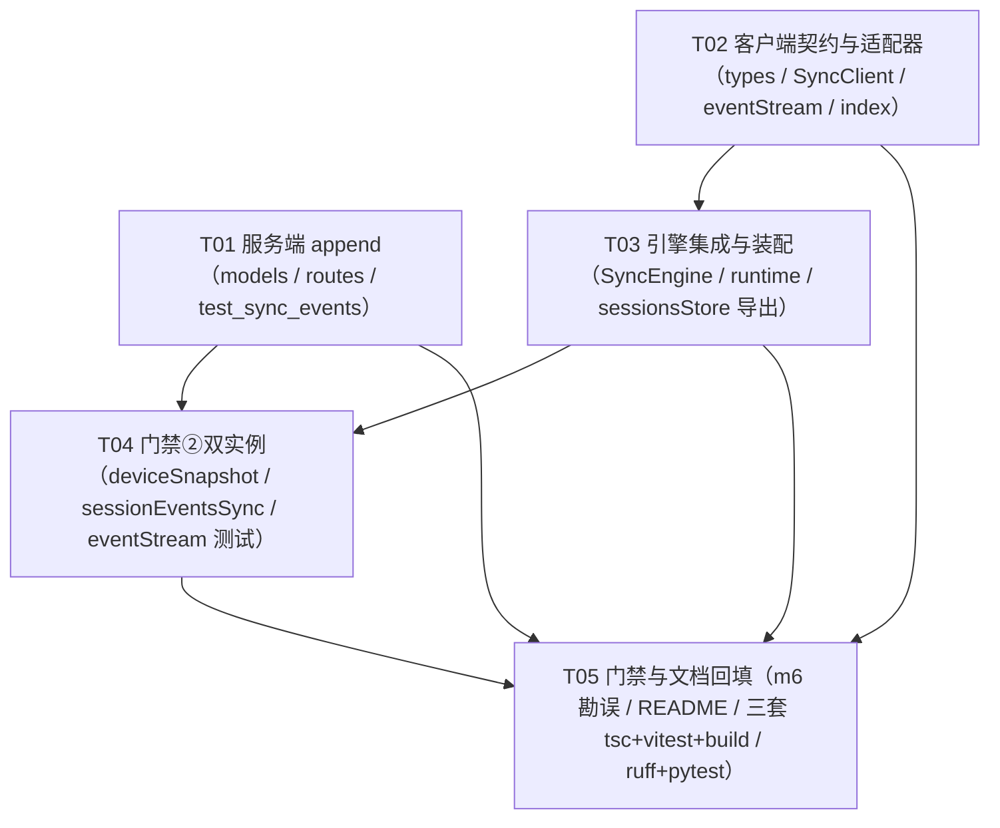

# 批次 5 落地规格 · 会话事件流追加同步（`sessionEvents`）

> **性质**：这是工程实现与 QA 验收的**唯一依据**。每条「裁决」都带理由；每个取舍都给出**可证伪判据**（QA 变异测试按它做；判据一律**点名测试文件 + 用例名**，不写「某某场景」）。
>
> **前置事实（不必重证）**：批次 1（`cloud/` FastAPI + auth + `sync_items` + LWW）、批次 2（`src/sync/` 七件）、批次 3（渠道凭据保险库化 + 排除表 + wire 收口）、批次 4（8 个 LWW collection 接线 + `src/sync/runtime.ts` + 认证 UI + 状态徽章 + 服务端 `updatedAt` 归一/同版幂等跳过）**均已落**。本批**唯一增量**是 `sessionEvents`（会话事件流），且**不能走 LWW**（`architecture-m6-sync.md` §四 末注 / §5.5）。
>
> **本批硬约束**：`src/ai`、`src/stores`、`src/sync`、`tests`、`electron` 用**单引号**；`src/pages` 等 UI 层随该文件现有风格。渲染层**不得 import 'electron'**（走 `src/platform`）。**`SyncEngine.ts` 不得 import 任何 store**（只能经注入的适配器，见 §2.1）。`src/sync/**` 不得 import React、不得 import `electron`。不得执行 git 写操作。不动 `nanobot/`。
>
> **本批是否动 `electron/`**：**不动**（§2.1 的推送水位走 `platform.storage` 的**未登记 key 兜底**，`getEventStore()`/`readEvents`/`append` 已是既有能力）。**因此无需重建 `main.cjs`/`preload.cjs`**。若实施中改为「在 `electron/storageRoutes.ts` 登记新 key」，则**必须重建产物并跑 `-nt` 逐个比对**（见 `§6` 门禁）。

---

## 0. 决策摘要表

| # | 问题 | 裁决 | 一句话理由 |
|---|---|---|---|
| **Q1** | append 语义怎么进入引擎？ | 新增**第二类通道** `SessionEventStreamAdapter`（**不是** `SyncCollectionSpec`），作为**可选依赖注入 `SyncEngine`**；事件通道**全异步**，与 LWW 的**同步 `read()`** 分道；时序沿用「先 pull 后 push」，且 append 是**按事件 `id` 幂等去重**（本集合无「冲突」概念）。 | 事件流没有「被改写」语义，硬塞进 LWW spec 会得到一个撒谎的 `read()`；且事件存储是**异步**的，与 `SyncCollectionSpec.read()` 的**同步**契约天然冲突（批次 4 §A.8 即因此排除它）。 |
| **Q2** | 服务端存储与端点 | 新表 `sync_events`（唯一键 `(user_id, session_id, event_id)`），**与 `sync_items` 共享同一条每用户 `server_seq` 游标**（`_next_seq` 取两表最大值 + 1）；**扩展既有 `push`/`pull`** 各加一个 `events` 字段，**不新增端点**；pull 增量仍靠 `server_seq > since`；事件**不做** `updatedAt` 归一。 | LWW 装不下只会增长的事件流（且归一/裁决会污染不可变事件）；共享 `server_seq` 保住「单游标 + 先 pull 后 push」，扩展端点比新端点少一套游标与客户端方法。 |
| **Q3** | `streamWorkdir` 跨设备重定向 | 落地时**只认接收方本机的分片**：查 `sessionsStore` 里该会话的 `streamWorkdir ?? workdir`；**会话在本机未知或已墓碑 → 跳过该批事件**（不落孤儿文件）。**绝不照抄发送方路径**。 | 与批次 4 `toMetaFromEntity` 的「`workdir` 语义保留、`streamWorkdir` 重定向到本机默认分片」同一条纪律（§5.5 / §六 #11）。 |
| **Q4** | `seq` 撞号的并集裁决 | 确定性规则：**按事件 `id` 去重 → 按 `(seq asc, id asc)` 排序 → 保留并集**。**不做「设备号 tie-break」**（事件体上**没有**设备号字段）——**勘误 §3.1**。门禁② 的「并集不丢」其含义是**事件层并集**，投影层仍只显示**一条** `parentId` 链（**已知限制**，写进文档与用例注释）。 | 事件 `id` 是全局唯一且两端一致，用它做末级 tie-break **确定且跨端一致**；「设备号」需改事件 schema，本批不做。 |
| **Q5** | 门禁②自动化 | 扩展 `tests/sync/integration.twoDevice.test.ts` 的**双实例夹具**：给每台「设备」一份**独立的内存 `EventStore`**（现夹具只有一套）；新增用例「断网追加 N 条 → 联网 → 对端拿到全部 N 条且顺序正确」与「两端并发追加**并集不丢**」，**断言落在原始事件列表（id 集合 / 条数 / 顺序）而非投影消息**。 | 现有夹具用 `snapshotStores`/`restoreStores` 换装 store，但**事件存储是单例**——不隔离就「A 追加即 B 可见」，用例失去鉴别力。 |

> **决策摘要表之外的三个"必做但非问题"**：
> 1. `createDefaultRegistry().entries()` **仍不得含 `'sessionEvents'`**（批次 4 §A.8 的判据必须继续绿）——本批**不碰 registry**。
> 2. `src/sync/SyncEngine.ts` **新增对 `eventStream` 的依赖，但该依赖是可选的**：未注入即为纯 LWW 引擎（批次 2/4 的 59 + 用例不受影响）。
> 3. `cloud/app/sync/routes.py::reset`（清账户数据）**必须同时清 `sync_events`**，否则「删账户」后事件残留（对齐既有 `reset` 语义）。

---

## 1. 全局事实与不变量（读代码确认，非推测）

- **事件流是 append-only**：`BaseEvent.id`（uuid）+ `seq`（会话内从 1 单调，`EventFactory` 分配）；事件**没有** `rev`/`updatedAt`/`deletedAt`/设备号（`src/types/event.ts` 的 `BaseEvent`）。
- **投影不依赖文件顺序**：`activePath`（`src/events/project.ts`）取「max `seq` 的尖端沿 `parentId` 回溯」，`EventFactory.resumeFrom` 明确「传入的事件**不要求有序**（按 `seq` 自行归一）」。→ **因此并集事件可以追加在文件尾部，顺序在文件里不是语义承载物**。这是 Q3/Q4 能落地的关键前提。
- **`EventStore` 全是异步**：`getEventStore()`（`src/events/index.ts`）的 `append`/`readEvents` 返回 `Promise`；`readEvents(sessionId, workdir)` 读**整段** JSONL。
- **引擎同步契约**：`SyncEngine.collectChanges()` 同步调 `spec.read()`；`applyChange()` 同步。→ **事件通道不能复用这两处**（Q1）。
- **服务端 `server_seq`**：`_next_seq = max(server_seq) + 1`，**一次 push 的所有行共用同一个 `seq`**；`pull?since=` 取 `server_seq > since` 并按 `server_seq` 排序（`cloud/app/sync/routes.py`）。
- **`sync_items`** 唯一键 `(user_id, collection, entity_id)`；`updated_at` 是服务端接收时刻、`payload` 是 JSON 文本（`cloud/app/sync/models.py`）。
- **分片解析**：`streamShardOf(s) = s.streamWorkdir ?? s.workdir`（`src/stores/sessionsStore.ts`）；`isEventStreamSession` 排除 IM（`channel`）/只读（`readonly`）/cron（`id` 前缀）会话。
- **落地既有入口**：`useSessionsStore.getState().sessions`（含 `streamWorkdir`）、`getEventStore()`、`enqueueSessionTask()`（记录器每会话写队列，`src/events/recorder.ts`）。

---

## 2. 逐条决策详述 + 可证伪判据

### 2.1 Q1 · append 如何进入引擎：**第二类通道 + 注入**

**形状（新增 `src/sync/eventStream.ts`）**：

```ts
// src/sync/eventStream.ts
import type { SessionEvent } from '@/types/event';

/**
 * 事件流同步适配器——引擎与「事件流」的唯一耦合点。
 * 与 `syncRegistry` 分工：registry 管 LWW 实体（同步 `read()`）；
 * 本适配器管 append-only 事件流（**全异步**）。两者都被 `runtime` 装配、注入引擎。
 */
export interface SessionEventStreamAdapter {
  /** 本机存在事件流的会话（已过滤 IM / 只读 / cron）与其**本机分片** */
  localSessions(): Array<{ id: string; shard: string | undefined }>;
  /** 读该会话本机 `seq > sinceSeq` 的事件（按 seq 升序）；会话未知返回 [] */
  readEventsSince(sessionId: string, sinceSeq: number): Promise<SessionEvent[]>;
  /** 落地远端事件：按 `id` 去重 + 追加到**本机分片**；返回实际新增条数 */
  appendRemoteEvents(sessionId: string, events: SessionEvent[]): Promise<number>;
}

export function createSessionEventStreamAdapter(): SessionEventStreamAdapter { /* … */ }
```

**引擎侧（`src/sync/SyncEngine.ts`）**：

```ts
export interface SyncEngineOptions {
  /* …批次 2/4 既有字段… */
  /** 事件流通道；缺省 undefined = 纯 LWW 引擎（不影响既有行为） */
  eventStream?: SessionEventStreamAdapter;
}

// 类内新增：每会话「已确保上行到服务端」的事件水位（Q1 的 push 游标）
private readonly eventSeqs = new Map<string, number>();
```

`syncNow()`（**只增不改既有 LWW 步骤**）：

```
1. pull(cursor) → applyPull(changes)   // 实体：同步，照旧
                 → applyPulledEvents(events)  // 事件：异步，按 sessionId 分组逐会话落地（不推水位）
                 推进 cursor（含事件行的 server_seq）
2. collectChanges()            // 实体：同步，照旧
   collectEventChanges()       // 事件：异步——每会话 readEventsSince(eventSeqs.get(id) ?? 0)
   若 changes 或 events 任一非空 → push(changes, events)
       · 成功且 accepted_events 有值 → 推进 eventSeqs（**仅在此处推进**，见下）
       · conflicts 循环照旧
       · accepted（实体）非空 → 再 pull 一次（取回归一后的 updatedAt），照旧
3. status = 有冲突 ? conflict : synced
```

**为什么是「第二类通道」而不是塞进 `SyncCollectionSpec`**：
1. `SyncCollectionSpec.read()` 是**同步**的；事件存储**异步** → 塞进去要么让 `read()` 变成假同步（返回空/缓存），要么改全体 LWW spec 的契约（回归面过大）。
2. 事件流**没有墓碑、没有 `rev`/`updatedAt`**：`keyOf`/`tombstones`/`payload(entity)` 三个钩子对它**全是空转**，硬套 = 用错抽象（§四 末注）。
3. 引擎与 store 的唯一耦合点是 registry；事件通道的耦合点是**另一个**适配器，两者都被 `runtime` 装配——`SyncEngine.ts` **依旧不 import 任何 store**。

**「先 pull 后 push」在 append 下的等价物 / 幂等性**：
- append **没有冲突**（同一事件 `id` 重复 = 同一事实），因此「先 pull」**不是**为了避免 LWW 覆盖（那是实体集合的理由）。
- 但**仍保留「先 pull 后 push」**：① 统一时序、单一代码路径；② 先把对端事件落地，本机读到的状态才与即将上行的一致；③ 保住了 §六 #12 的既有裁决，不给后续批次留例外。
- append 的幂等由**两端共同的按 `id` 去重**保证：客户端 `appendRemoteEvents` 读本机既有 id 集合去重；服务端按唯一键 `(user_id, session_id, event_id)` 去重（**已存在则不写、不推进 `server_seq`**，与批次 4 实体「完全同版幂等跳过」同一纪律）。→ 重复推/重复拉都收敛。

**push 游标 = 每会话「推送确认水位」，且**只在 push 成功后推进****（关键裁决）：
- 语义：`eventSeqs[sid]` = 「本机已确保服务端收到、且 `seq ≤ 该值的本机事件都已上行」的最大值。
- **只在 push 成功后**（`accepted_events` 返回时）推进到「本批实际推送的该会话最大 `seq`」。
- **拉取落地时** *不*推进水位。反例（若在拉取时推进就会**丢推**）：设备 A 离线攒了 `seq 1..5`、设备 B 攒了 `seq 1..3` 并先推；A 联网先 pull 到 B 的 `1..3`，若此时把水位推到 3，则 A 本机 `seq 1..3` 的事件**永远不会上行** → 丢。**只认 push 的确认**则该场景下 A 水位仍为 0 → 下一轮把 `1..5` 全推（服务端按 id 去重 B 的那几条），**不丢**。
- 代价（**明确接受**）：每一条**新拉来的**远端事件会被**回推一次**（服务端按 id 去重，无写入），随后水位推进过它。稳态是「每条远端事件回显一次」，**有界**，非无限回环。
- **持久化**：走 `platform.storage` 新 key `nanowork.sync.eventCursor`（值 = `Record<sessionId, number>` 的**字符串 JSON**），沿用 `nanowork.sync.account` 的做法——**不登记** `electron/storageRoutes.ts` 时落 `<userData>/misc/*.json` 兜底（**本批不动 electron**，见 §5 待明确 #1）。**丢了也不影响正确性**（水位归 0 → 全量重推 → 服务端 id 去重），只影响一次重推的开销。

**可证伪判据（点名用例）**：
- **J1-a**：`tests/sync/eventStream.test.ts` ›「`appendRemoteEvents` 对已存在 id 的事件不重复落地」——把去重分支删掉 → **红**。
- **J1-b**：`tests/sync/SyncEngine.batch5.test.ts` ›「拉取落地**不**推进水位（本机未推事件不丢）」——在 `applyPulledEvents` 里加一行 `eventSeqs.set(...)` → **红**。
- **J1-c**：`tests/sync/SyncEngine.batch5.test.ts` ›「push 成功后水位推进到本批最大 `seq`」——把推进挪到 `push` 之前 → **红**。
- **J1-d**：`tests/sync/syncRegistry.test.ts`（既有）›「`createDefaultRegistry().entries()` 不含 `sessionEvents`」（批次 4 §A.8 判据，路径应为 `tests/`）——把事件流注册进 registry → **红**（**保批次 4 §A.8 判据**）。

### 2.2 Q2 · 服务端：新表 + 共享游标 + 扩展端点

**新表（`cloud/app/sync/models.py`）**：

```python
class SyncEvent(SQLModel, table=True):
    __tablename__ = "sync_events"
    __table_args__ = (
        UniqueConstraint("user_id", "session_id", "event_id", name="uq_sync_event"),
    )
    id: int | None = Field(default=None, primary_key=True)
    user_id: str = Field(index=True)
    session_id: str = Field(index=True)
    event_id: str
    seq: int = 0            # 会话内事件 seq（客户端值，供排查/排序参考）
    payload: str = "{}"     # 整条事件 JSON（含 sessionId / seq / type / …）
    server_seq: int = 0     # **与 sync_items 共享**的每用户变更游标
```

**共享游标（`_next_seq`）**：

```python
def _next_seq(session: Session, user_id: str) -> int:
    item_max = session.exec(select(func.max(SyncItem.server_seq)).where(SyncItem.user_id == user_id)).one()
    event_max = session.exec(select(func.max(SyncEvent.server_seq)).where(SyncEvent.user_id == user_id)).one()
    return max(int(item_max or 0), int(event_max or 0)) + 1
```

**端点契约（**扩展**，非新增）**：

| 端点 | 请求增量 | 响应增量 |
|---|---|---|
| `POST /api/sync/push` | `events: list[dict]`（**每条事件自描述**，`sessionId` 在事件体内；缺省 `[]`） | `accepted_events: int`（本次**新增**事件数） |
| `GET /api/sync/pull?since=<cursor>` | —— | `events: list[dict]`（按 `server_seq` 排序；`cursor` = 两表 `server_seq` 的**最大值**） |

**push 事件循环要点**（在既有实体循环**之后**）：

```python
for ev in body.events:
    event_id = str(ev.get("id", ""))
    session_id = str(ev.get("sessionId", ""))
    if not event_id or not session_id:
        continue                       # 缺身份的事件跳过（不整批失败）
    if _find_event(session, user.id, session_id, event_id) is not None:
        continue                       # 幂等跳过：不写库、不推进 seq（对齐批次 4 实体纪律）
    session.add(SyncEvent(user_id=user.id, session_id=session_id, event_id=event_id,
                          seq=int(ev.get("seq") or 0),
                          payload=json.dumps(ev, ensure_ascii=False), server_seq=seq))
    accepted_events += 1
```

**为什么不复用 `sync_items`（`entity_id = <sessionId>:<eventId>`）**：
1. 实体 push 路径会对 `entity['updatedAt'] = iso_z(now)` **归一**并跑 `resolve()`（LWW）——事件**不可改写**，把服务端时间写进事件体是**污染事实**；且事件无 `rev`，LWW 三级比较对它无意义。
2. `sync_items` 的 `rev`/`updated_at`/`deleted_at` 列语义是「实体当前版本」，而行存事件是「一条不可变事实」——混表后 `pull` 的实体流被海量事件行淹没，`_next_seq` 与排序也变得含混。
3. 若要复用则 push 处理器必须**特判** `collection == 'sessionEvents'`——那就等于重新开一条通道，不如显式建表。

**为什么不新增端点 `/api/sync/events`**：会引入**第二条 `server_seq`**（或第二个客户端游标），「先 pull 后 push」要拉两次、出错面翻倍；共享一条游标 + 扩展端点则**一次往返**全覆盖，且 `SyncClient` 的 401 刷新/重试、`syncNow` 时序**均不改**。代价（可接受）：push/pull 载荷同时带实体与事件。

**pull 增量与顺序**：`sync_events` 行与 `sync_items` 行**同属一个 `server_seq` 命名空间**，`since` 过滤天然覆盖两者；实体数组先于事件数组返回，客户端**先落实体（含 `sessionMeta`）再落事件**（保证「会话 meta 先于其事件」被 B 端看到，见 Q3）。

**不做 `updatedAt` 归一**：事件的 `timestamp`（ms）与 `seq` 是**权威事实**，服务端**不重写**（这也是与实体集合的关键差异）。

**`reset` 端点**：同时 `select(SyncEvent).where(user_id==…)` 并 `delete`（对齐「清空账户同步数据」语义）。

**可证伪判据（点名用例）**：`cloud/tests/test_sync_events.py`
- **J2-a**「`test_push_events_then_pull_returns_them`」：push 3 条 → `pull(since=0)` 返回 3 条且按 `seq` 有序、`cursor` 前进。
- **J2-b**「`test_repush_same_events_is_idempotent`」：同批事件推两次 → 第二次 `accepted_events == 0`，且 `pull(since=<第一次后 cursor>)` 返回空。**把幂等跳过删掉 → 红**。
- **J2-c**「`test_events_and_entities_share_cursor`」：push 1 实体 + 1 事件 → `pull(since=0)` 两者都在；再 push 新事件 → `pull(since=旧 cursor)` 只返回新事件。
- **J2-d**「`test_event_payload_is_not_normalized`」：事件体里的 `timestamp`/`seq` 原样返回（服务端**未**注入 `updatedAt`）。**把事件塞进实体归一分支 → 红**。
- **J2-e**「`test_events_isolated_per_user`」：user B 拉不到 user A 的事件。
- **J2-f**「`test_reset_clears_events`」：`DELETE /api/sync/reset` 后 `pull` 无事件。

### 2.3 Q3 · 落地分片：只认接收方本机

**裁决**：`appendRemoteEvents(sessionId, events)` 的分片一律由**本机** `sessionsStore` 决定：

```ts
const s = useSessionsStore.getState().sessions.find((x) => x.id === sessionId);
if (!s || !isEventStreamSession(s)) return 0;     // 未知 / 已墓碑 / 外部来源 → 跳过
const shard = s.streamWorkdir ?? s.workdir;       // = streamShardOf(s)
await enqueueSessionTask(sessionId, () =>
  getEventStore().append({ sessionId, workdir: shard, events: newOnes }),
);
```

- 拉来的会话由批次 4 的 `toMetaFromEntity` 落地，其 `streamWorkdir` **已重定向为接收方本机默认分片**，故这里取到的是 B 机路径，**不含**发送方路径。
- **未知会话直接跳过**：`sessionMeta` 先于其事件被处理（Q2 的顺序保证），故「会话未知」只出现在「事件到了但 meta 没到」的异常场景——此时跳过比落一个指向别处/无主的孤儿文件更安全。**这依赖 `sessionMeta` 一定先于事件到达**（由「同一设备同一 push 内实体先于事件 → 同一批 `server_seq`」、「跨批量则 `server_seq` 天然有序」两条保证）；**若未来出现「只推事件不推 meta」的用法，此处会静默丢事件**（§5 待明确 #4）。
- **并发硬化（不做，记为已知限制）**：若某会话**正在本机实时流式写入**（`hasRecorder(sid)`）时拉到远端事件，本机 `EventFactory` 的 `seq` 不会自动知道远端那几条，可能撞号。本批**不**在 append 后 `primeRecorder` 重对齐（需读整段流 + 重建活跃链，复杂度不划算），记为**已知限制**——与「同一会话不建议两端同时继续」同源。

**可证伪判据（点名用例）**：`tests/sync/eventStream.test.ts`
- **J3-a**「`appendRemoteEvents` 落到**本机**分片」：B 机该会话 `streamWorkdir = '/devB/ws'`，拉来的事件读取路径为 `'/devB/ws'`，且不等于发送方 `'/devA/ws'`。**把分片改成 `event.sessionId` 之外的对端值 / 写死发送方路径 → 红**。
- **J3-b**「会话未知/墓碑 → 跳过且不建文件」：对 `sessionsStore` 里不存在的 `sessionId` 调用 → 返回 0，`getEventStore().readEvents(...)` 为空。

### 2.4 Q4 · `seq` 撞号并集：确定性规则

**规则**：`dedupe(by id) → sort(by (seq asc, id asc)) → keep union`。`appendRemoteEvents` 与任何「合并视图」都按此排序键。

**「设备号 tie-break」不可行 → 勘误 §3.1**：`BaseEvent` **没有**设备号字段（`updatedBy` 只在 `SessionMeta` / 实体元数据上）。要用「设备号」须给事件**新增字段**并迁移既有 JSONL——本批不做。`id` 是 uuid、跨端一致，用 `(seq, id)` 做末级键**确定且两端一致**，满足「并集不丢 + 顺序确定」的全部诉求。

**门禁② 的粒度澄清（勘误 §3.2）**：`activePath` 只沿**单一** max-`seq` 尖端回溯 → 两端**并发**追加同一会话时，并集**在事件层完整保留**，但**投影层只显示一条链**（另一条分支的事件在文件里、不在当前会话视图里）。故：
- 「并集不丢」的判据**断言在原始事件列表**（id 集合 / 条数），**不**断言在 `messages` 投影；
- 界面上「同一会话不建议两端同时继续」作为**已知限制**（§5.5 原文）。

**可证伪判据（点名用例）**：`tests/sync/sessionEventsSync.test.ts`
- **J4-a**「并发追加：两端事件**并集**都在」：两端各造 3 条（不同 id）同会话事件 → 双向同步后，两端 `getEventStore().readEvents(sid, shard)` 的 **id 集合 = 6 条并集**。**把排序/去重改成「只保留一条链」→ 红**。
- **J4-b**「顺序确定」：把同一并集按 `(seq,id)` 排序两次 → 结果一致（幂等）。

### 2.5 Q5 · 门禁②双实例自动化

**夹具改动（`tests/helpers/deviceSnapshot.ts`）**：现夹具只有**一套**全局 `EventStore`（`beforeEach` 里 `__setEventStoreForTest(createMemoryEventStore())`），无法表达「A 追加的事件 B 看不见」。新增「设备」对象，把**每设备一份内存 `EventStore`** 纳入：

```ts
// 形态建议（函数名以实施为准）
export interface Device {
  snap: StoreSnapshot;
  eventStore: EventStore;
}
export function makeDevice(ws: string): Device;          // 空设备 + createMemoryEventStore()
export function activateDevice(dev: Device): void;      // restoreStores(dev.snap) + __setEventStoreForTest(dev.eventStore) + __resetRecordersForTest()
export function captureDevice(dev: Device): void;       // dev.snap = snapshotStores()（eventStore 已在 dev 上累积）
```

**新增用例（`tests/sync/sessionEventsSync.test.ts`，`describe.skipIf(!hasVenv)`）**：

1. **断网追加 N 条 → 联网 → 对端拿到全部 N 条且顺序正确**
   - A、B 已同步（同一账户、同一会话 `s1` 的 meta 已双向落地）。
   - `withA.offline = true`（`fetchImpl` 抛 `TypeError`）→ A 在 `s1` 追加 N 条事件（经 `getEventStore().append` + A 的 `eventStore`）。
   - A 联网 → `engineA.syncNow()` → 断言 A 的 `eventStore` 有 N 条。
   - B 换装 → `engineB.syncNow()` → **断言 B 的 `eventStore.readEvents('s1', DEV_B_WS)` 含全部 N 条、且 `(seq,id)` 顺序正确**。
   - **判据**：`idsB`（过滤出这 N 条的 id 有序数组）`toEqual(idsA)`；把 `collectEventChanges` 里的事件收集删掉 → **红**。
2. **两端并发追加并集不丢**
   - 基线已同步；A、B **各自离线**在同一会话追加不同 id 的事件；A 先 sync → B sync → A 再 sync。
   - 断言**两端**事件 id 集合均为并集（2N 条），并集稳定（重跑幂等）。
   - **判据**：`new Set([...idsA, ...idsB]).size === 2N`；把 `appendRemoteEvents` 的按 id 去重删掉（改追加）→ 条数翻倍 → **红**。

**服务端侧**：`cloud/tests/test_sync_events.py` 覆盖 J2-a..f（含幂等与共享游标）。

---

## 3. 对 `architecture-m6-sync.md` 的勘误与澄清（不默认文档正确）

> 依据批次 4 的先例：文首加「⚠️ 勘误」条，并在 `docs/README.md §九 文档一致性问题看板` **新增一条**（编号以当时看板为准，勿臆造）。以下三条请回填到 m6 文档对应位置。

### 3.1 勘误 · §5.5「按设备号 tie-break」不可实现
- **原文**：「`seq` 会撞……MVP 的裁决：按事件 `id`（uuid）去重 + 按 `seq` 排序，**撞号时按设备号 tie-break**，保留双方事件」。
- **问题**：`BaseEvent`（`src/types/event.ts`）**没有设备号字段**；`updatedBy` 只存在于 `SessionMeta`/实体元数据，不在事件上。要按设备号裁决就必须给事件**加字段 + 迁移既有 JSONL**，超出本批。
- **修正**：末级 tie-break 改为**事件 `id` 字典序**（`(seq asc, id asc)`），确定且跨端一致；真要用设备号则列为后续批次的事件 schema 变更。

### 3.2 澄清 · §5.5 / §七 门禁② 的「并集不丢」是**事件层**语义
- **原文**：§七 批次 5「完成判据：……两端并发追加**并集不丢**」；§5.5「保留双方事件（并集不丢，符合门禁②）」。
- **需补充**：`project.ts::activePath` 只沿**单一** max-`seq` 尖端回溯 → 并发分支在**投影层只显示一条链**。故判据必须落在**原始事件层**，UI 侧「同一会话不建议两端同时继续」为已知限制。**否则 QA 会把「另一分支不出现在消息气泡里」误判成失败。**

### 3.3 澄清 · §四 collection 表「`sessionEvents` 无元数据 / append（按 seq）」的实施含义
- 「无元数据」⇒ 事件**不参与 LWW**、服务端**不归一** `updatedAt`、**不**走 `sync_items`。
- 「append（按 seq）」⇒ **push 游标是每会话「推送确认水位」**（§2.1），**不是**「服务端已知最大 seq」——后者在并发下会**丢推**（§2.1 的反例）。此点文档未明说，须写清，否则实现会选错水位语义。

### 3.4 顺带确认（非勘误）
- §3.1「`server_seq` 每次写入都推进，**例外**：完全同版幂等跳过」——本批**为事件新增同源例外**（事件 id 已存在 → 不写、不推进 seq）。这是纪律的一致延伸，文档 §3.1 备注第 5 条可补一句。

---

## 4. 文件清单（新增 / 修改，相对路径）

### 4.1 新增
| 文件 | 内容 |
|---|---|
| `docs/batch-5-session-events-spec.md` | 本文件 |
| `docs/sequence-diagram.mermaid` | 时序图（双设备离线追加→联网同步） |
| `docs/class-diagram.mermaid` | 类图（引擎 / 适配器 / 端点 / 表） |
| `src/sync/eventStream.ts` | `SessionEventStreamAdapter` 接口 + `createSessionEventStreamAdapter()`（**唯一** import `@/events` + `sessionsStore` 的地方） |
| `cloud/tests/test_sync_events.py` | 服务端事件往返 / 幂等 / 共享游标 / 隔离 / reset |
| `tests/sync/eventStream.test.ts` | 适配器单测（去重 / 分片 / 未知会话 / 排序） |
| `tests/sync/SyncEngine.batch5.test.ts` | 引擎事件通道单测（水位只在 push 后推进 / 收集 / 落地） |
| `tests/sync/sessionEventsSync.test.ts` | 门禁② 双实例（离线 N 条 + 并发并集） |

### 4.2 修改
| 文件 | 改动 |
|---|---|
| `cloud/app/sync/models.py` | 新增 `SyncEvent` 表（唯一键 `(user_id, session_id, event_id)`） |
| `cloud/app/sync/routes.py` | `_next_seq` 跨两表取最大值；`PushRequest.events` + `PushResponse.accepted_events`；push 事件循环（幂等跳过）；`pull` 增 `events` 与跨表 `cursor`；`reset` 清 `sync_events` |
| `src/sync/types.ts` | `PushResponse`/`PullResponse` 增 `events` / `accepted_events`；`SyncRunResult` 增 `pushedEvents` / `pulledEvents`；导入 `SessionEvent`（**type-only**） |
| `src/sync/SyncClient.ts` | `push(changes, events = [])`（body 恒为 `{ changes, events }`）；`pull` 返回体已含 `events`（类型扩展即可） |
| `src/sync/SyncEngine.ts` | `SyncEngineOptions.eventStream?`；`eventSeqs`；`collectEventChanges()`；`applyPulledEvents()`；`syncNow` 串接事件通道（**不改**既有 LWW 步骤语义） |
| `src/sync/runtime.ts` | 装配 `createSessionEventStreamAdapter()` 并注入引擎；导出沿用 |
| `src/sync/index.ts` | `export * from './eventStream'` |
| `src/stores/sessionsStore.ts` | **导出** `isEventStreamSession`（现为模块私有；供适配器过滤本地会话，避免复制判据漂移）。**不动**其它逻辑 |
| `tests/helpers/deviceSnapshot.ts` | 增「每设备一份 `EventStore`」（`makeDevice` / `activateDevice` / `captureDevice`） |
| `tests/sync/integration.twoDevice.test.ts` | `beforeEach` 的事件存储初始化改为**每设备一份**（避免与新增用例共用一套 store 造成串扰；或用例自带设备对象） |
| `docs/architecture-m6-sync.md` | 文首加「⚠️ 勘误」横幅（§3.1–3.4），§四 / §5.5 / §七 就地补注 |
| `docs/README.md` | §九 看板新增一条（§5.5 tie-break 勘误） |

> **不改**：`src/sync/syncRegistry.ts`（**事件流不进 registry**，保批次 4 §A.8 判据）、`electron/**`（不登记新 key）、`src/events/**`（复用既有 `EventStore` 契约；可选 IO 优化见 §5 #5）、`cloud/app/main.py`（端点已注册在同一 router）。

---

## 5. 数据契约汇总（供实现与 QA 对齐）

**推送/拉取负载（新增字段）**
```ts
// 推送：events 为**原始事件**数组（每条自含 sessionId）
interface PushBody { changes: SyncChange[]; events: SessionEvent[]; }
interface PushResponse { accepted: string[]; conflicts: PushConflict[]; cursor: number;
                         accepted_events: number; }        // ← 新增
interface PullResponse { cursor: number; changes: SyncChange[];
                         events: SessionEvent[]; }          // ← 新增
```

**引擎事件通道（`SyncEngine` 新增私有方法）**
- `collectEventChanges(): Promise<{ events: SessionEvent[]; maxSeqBySession: Map<string, number> }>`
- `applyPulledEvents(events: SessionEvent[]): Promise<number>`（按 `sessionId` 分组 → `adapter.appendRemoteEvents`；**不**推进水位）

**适配器（`src/sync/eventStream.ts`）**：见 §2.1。

---

## 6. 依赖图 / 实现顺序 / 任务分解



**任务分解（≤5，首个 = 契约/基础设施）**

| 任务 | 内容 | 依赖 | 优先级 | 源文件（≥3） |
|---|---|---|---|---|
| **T01 服务端 append** | `SyncEvent` 表 + 共享 `_next_seq` + 扩展 push/pull + `reset` + pytest | — | P0 | `cloud/app/sync/models.py`、`cloud/app/sync/routes.py`、`cloud/tests/test_sync_events.py` |
| **T02 客户端契约与适配器** | 类型扩展 + `SyncClient.push(changes,events)` + 事件流适配器 + 桶导出 | — | P0 | `src/sync/types.ts`、`src/sync/SyncClient.ts`、`src/sync/eventStream.ts`、`src/sync/index.ts` |
| **T03 引擎集成与装配** | `SyncEngine` 事件通道 + 水位 + `runtime` 注入 + `sessionsStore` 导出判据 | T02 | P0 | `src/sync/SyncEngine.ts`、`src/sync/runtime.ts`、`src/stores/sessionsStore.ts` |
| **T04 门禁②双实例** | 每设备 `EventStore` 夹具 + 两条门禁② 用例 + 适配器/引擎单测 | T01、T03 | P0 | `tests/helpers/deviceSnapshot.ts`、`tests/sync/sessionEventsSync.test.ts`、`tests/sync/eventStream.test.ts`、`tests/sync/SyncEngine.batch5.test.ts`、`tests/sync/integration.twoDevice.test.ts` |
| **T05 门禁与文档回填** | m6 勘误横幅 + 看板 + 跑全套门禁 | T01–T04 | P0 | `docs/architecture-m6-sync.md`、`docs/README.md`、`docs/batch-5-session-events-spec.md` |

**门禁（沿用 `nanowork-dev-gate`，全绿才算完**）：
- 客户端：三套 `tsc`（`typecheck` / `typecheck:electron` / `typecheck:tests`）0 错误 → `vitest run --maxWorkers=3`（**勿与 dev server 并发**）→ `vite build --emptyOutDir false`。
- 服务端（`cloud/`）：`ruff check` + `ruff format --check` + `pytest`。
- **未动 `electron/`** ⇒ 无需重建 `main.cjs`/`preload.cjs`。**判据**：`electron/` 下**没有任何 `.ts` 比 `main.cjs` 新**（用 `-nt` **逐个**比对，别只看 `main.ts`——esbuild `--bundle` 会把它 import 的模块全打进产物）。**若实施中改为主进程登记新 key，则本条作废、必须重建产物。**

---

## 7. Shared Knowledge（跨任务约定）

- **事件不可改写**：没有 `rev`/`updatedAt`/`deletedAt`/设备号；同步**只有并集**，无冲突；服务端**不归一**事件时间。
- **去重与排序**：一律 `dedupe(by id)` + `sort(by (seq asc, id asc))`。两端同源。
- **单一游标**：`server_seq` 跨 `sync_items` + `sync_events` 共享；`pull(since)` 一次取全；`cursor` = 两表最大值。
- **顺序不变式**：同一 push 内**实体先于事件**（保证「会话 meta 先于其事件」被对端看到）。
- **落地分片**：只认**接收方** `sessionsStore` 的 `streamWorkdir ?? workdir`；未知/墓碑会话**跳过**。
- **引擎边界**：`SyncEngine.ts` **不 import store**（事件通道经注入的 `eventStream` 适配器）；`src/sync/**` **不 import `electron` / React**；`sessionEvents` **不进 `createDefaultRegistry()`**。
- **push 水位**：只在 push 成功后推进；`platform.storage` 字符串 JSON；丢水位不影响正确性（服务端按 id 去重）。
- **代码风格**：`src/sync`、`src/stores`、`tests`、`electron` 用**单引号**；`cloud/` 走 `ruff format`。
- **禁写 git**。
- **无新增第三方依赖**（服务端 `sqlmodel` 已有；客户端零新增）。

---

## 8. 待明确事项（留给主理人 / 用户裁决）

1. **推送水位是否登记进 `electron/storageRoutes.ts`**：本批**不登记**（走 `misc` 兜底，零 electron 改动、不重建产物，与 `nanowork.sync.account` 同款）。若要求「运行时 key 一律显式登记」，则 T05 需追加 electron 改动 + 重建 `main.cjs`/`preload.cjs`——**请裁决**。
2. **§3.1 tie-break 勘误确认**：末级键用事件 `id`（推荐）还是本批给事件加 `deviceId` 字段（会改 `BaseEvent` + 迁移既有 JSONL）？
3. **并发分支的 UI 表现**：门禁② 其「并集不丢」按**事件层**验收（投影只显示一条链）。是否接受？若要求「并发分支也可见」，则需另立「多链投影」设计（本批不做）。
4. **IM / 只读 / cron 会话是否也同步事件流**：本批**不同步**（`isEventStreamSession` 过滤；它们的真值在引擎侧）。确认无异议？
5. **大流量的 IO 优化**：`EventStore.readEvents` 每次读整段 JSONL 再按 `seq` 过滤；是否后续给 `EventStore` 加 `readEventsSince(sessionId, workdir, sinceSeq)`（本批不做，记为后续）。
6. **并发追加时的记录器重对齐**：本批**不做** append 后 `primeRecorder`（已知限制，§2.3）。是否接受？
7. **`sync_events` 的 GC / 保留**：事件随会话墓碑删除（会话删除时**未**级联删服务端事件，批 1 未设计）——是否在批次 6 补「删账户 / 删会话 → 清服务端事件」的级联？本批只在 `reset` 清。
