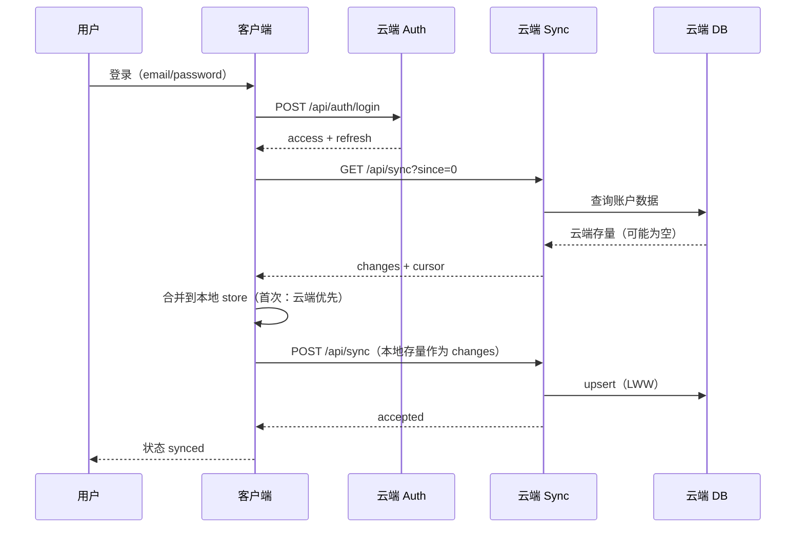
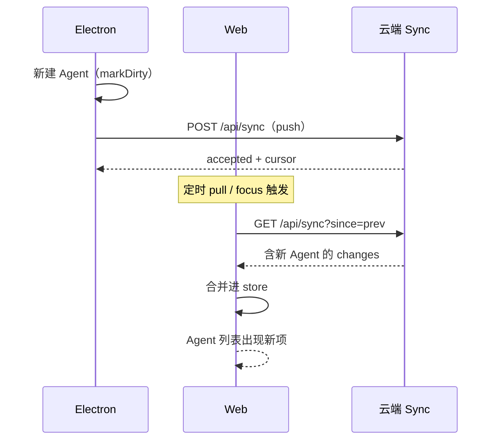
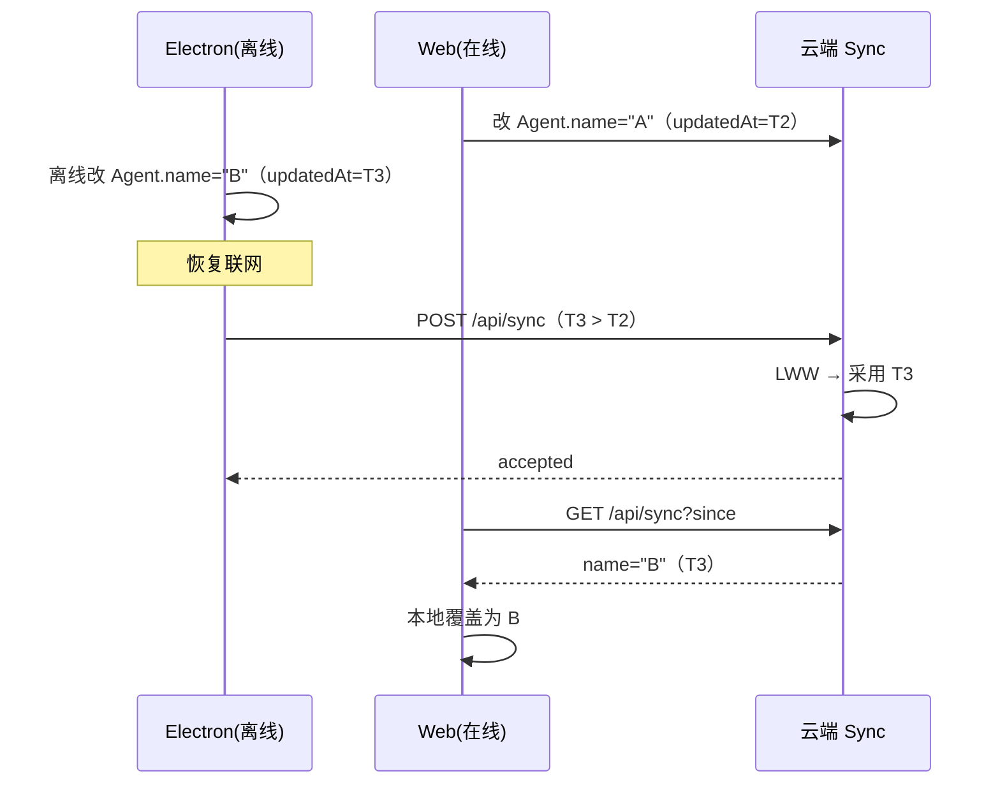

# 跨端 Agent 同步 · 详细设计文档

> 目标：在 nanobot 现有「本地优先（local-first）」架构上，增加云端身份服务与双向同步引擎，
> 使 **Electron 桌面端** 与 **Web 前端** 登录同一账户后，Agent / 会话 / 设置等数据保持一致。
> 本文件为设计文档，不含实现代码。

---

## 1. 背景与目标

### 1.1 现状（根因）
`agentsStore` 等使用 zustand `persist`，底层走 `platform.storage`：

- **Electron**：`ElectronStorageAdapter` → `window.electronAPI` IPC → 主进程写 `userData/nanowork-store.json`
- **Web**：`WebStorageAdapter` → 浏览器 `localStorage`

两端是**相互隔离的存储后端**，没有共享数据源，因此在 Electron 新建的 Agent 不会出现在 Web。

### 1.2 目标
1. 同一账户在任意端登录后，数据双向一致。
2. 离线可用：无网络时本地照常工作，联网后自动合并。
3. 冲突可控：多人/多端并发编辑有明确、可预测的解决规则。
4. 最小侵入：复用现有 `platform.storage` 作为本地缓存，不推翻渲染层。

### 1.3 非目标
- 不做实时协同编辑（同一实体的多人同时打字）。
- 不引入 CRDT（MVP 用 LWW，后续可升级）。
- 不绑定具体云厂商；默认给出可自托管的最小服务。

---

## 2. 设计原则

| 原则 | 说明 |
|---|---|
| Local-first | 本地存储是事实源之一，所有读操作本地完成；同步是后台尽力而为 |
| Account-scoped | 云端按账户隔离命名空间，数据与 token 不跨账户 |
| LWW MVP | 每实体以 `updatedAt` 最后写入获胜；tombstone 处理删除 |
| Append-only 同步日志 | 以 cursor/水印拉增量，避免全量比对 |
| 最小侵入 | `SyncEngine` 包裹现有 store，store 动作只多调一次 `markDirty` |

---

## 3. 架构总览

```
┌──────────────────┐         ┌──────────────────────┐         ┌──────────────────────┐
│ Electron 桌面端   │         │                      │         │                      │
│ 本地存储          │◀─push/pull─▶│  云端同步服务        │◀───────▶│  云端 DB（按账户隔离）│
│ + SyncEngine     │         │  身份 + 双向同步 API  │         │                      │
└──────────────────┘         │                      │         └──────────────────────┘
                             │                      │
┌──────────────────┐         │                      │
│ Web 前端         │◀─push/pull─▶│                      │
│ 本地存储          │         └──────────────────────┘
│ + SyncEngine     │
└──────────────────┘
```

- **本地存储**：沿用 `platform.storage`（Electron 文件 / Web localStorage），作为本地缓存与离线事实源。
- **SyncEngine**：客户端模块，负责 outbox、pull 周期、合并、冲突处理。
- **云端同步服务**：身份 + 同步 REST（可选 WebSocket），持久化到 DB。

---

## 4. 数据模型

### 4.1 通用同步元数据（所有可同步实体共有）
```ts
interface SyncMeta {
  id: string;          // 全局唯一（uuid），创建端生成
  rev: number;         // 该实体版本号，每次本地修改 +1
  updatedAt: string;   // ISO8601，合并裁决依据（LWW）
  deletedAt: string | null; // 软删 tombstone；非 null 表示已删除
  updatedBy: string;   // 账户 id，便于审计/排查
}
```

### 4.2 同步集合（collections）
| 集合 | 实体 | 关键字段（示例） |
|---|---|---|
| `agents` | Agent | `name, systemPrompt, model, tools[], avatar?` |
| `sessions` | Session | `title, agentId, messages[], createdAt` |
| `settings` | Settings | `gatewayEndpoint, mode, theme, memoryEnabled` |
| `memory` | MemoryEntry | `workspaceKey, content, tags[]` |
| `artifacts` | Artifact | `sessionId, type, payload` |

> 说明：`settings` 多为单例，可用固定 `id=local` 当作一个实体同步（覆盖式）。

---

## 5. 云端身份服务

### 5.1 端点
```
POST /api/auth/register   { email, password }                -> { userId, accessToken, refreshToken }
POST /api/auth/login      { email, password }                -> { userId, accessToken, refreshToken }
POST /api/auth/refresh    { refreshToken }                   -> { accessToken }
POST /api/auth/logout     { refreshToken }                   -> { ok }
GET  /api/auth/me         (Authorization: Bearer <access>)   -> { userId, email }
```

### 5.2 Token 存储（安全）
- **Electron**：用 `safeStorage` 加密后落盘（或系统钥匙串），不在 `localStorage`。
- **Web**：`accessToken` 放内存；`refreshToken` 放 httpOnly+Secure+SameSite Cookie，防 XSS 窃取。
- 短时效 access（如 15min）+ 长时效 refresh（如 7d），refresh 轮换并支持撤销。

### 5.3 登录态在各端
- 未登录：SyncEngine 关闭，纯本地（local-first 兜底）。
- 已登录：SyncEngine 启用 push/pull；UI 显示同步状态。

---

## 6. 同步 API

### 6.1 Pull（拉增量）
```
GET /api/sync?since=<cursor>&collections=agents,sessions
Authorization: Bearer <access>

响应 200:
{
  "cursor": "1692...Z",          // 服务端当前水位，下次 pull 作为 since
  "changes": [
    { "collection": "agents", "entity": { ...SyncMeta, "name": "...", ... } },
    { "collection": "agents", "entity": { ...SyncMeta, "deletedAt": "1692..." } }
  ]
}
```
- `cursor` 由服务端基于 `updatedAt` 单调递增生成（如版本号或时间戳+序号）。
- 仅返回 `updatedAt > since` 的实体（含 tombstone）。

### 6.2 Push（推批量）
```
POST /api/sync
Authorization: Bearer <access>
Content-Type: application/json

{
  "changes": [
    { "collection": "agents", "entity": { ...SyncMeta, "name": "牧场助手", ... } }
  ]
}

响应 200:
{
  "accepted": [ "id-1" ],
  "conflicts": [
    { "id": "id-2", "server": { ... }, "client": { ... }, "resolution": "server" }
  ]
}
```
- 服务端逐实体校验：若 `client.rev <= server.rev` 且 `client.updatedAt < server.updatedAt` → 视为冲突，按 LWW 取服务端版本（返回 conflict 供客户端提示）。
- 否则以客户端版本覆盖，并 bump 服务端 `rev`、回写 `updatedAt`。

---

## 7. 冲突策略

### 7.1 LWW 规则（MVP）
对同一个 `id`：
1. 比较 `updatedAt`（ISO8601 字符串可直接比较）：**较大者获胜**。
2. 若相等，比较 `rev`：较大者获胜。
3. 仍相等，比较 `id` 字典序（确定性 tie-break，避免两端各执一词）。

### 7.2 删除
- 删除 = 写 `deletedAt` 并 bump `rev/updatedAt`（软删，不是物理删除）。
- 合并时：若一方 `deletedAt` 非空且另一方为空，且删除方 `updatedAt` 更大 → 最终为删除。
- tombstone 保留一段时间（如 30 天）后由服务端 GC，防止复活。

### 7.3 未来升级
- 若需字段级合并（如同时改 `name` 和 `systemPrompt`），可升级为 CRDT / 字段级 LWW。
- 文档阶段仅定义接口，不实现。

---

## 8. 客户端 SyncEngine

### 8.1 模块划分
```
src/sync/
  SyncClient.ts        // HTTP 封装：鉴权、pull、push、refresh
  SyncEngine.ts        // 单集合引擎：outbox、merge、调度
  syncRegistry.ts     // 注册各 store 的 getter/setter，供引擎读写
  useSyncStatus.ts     // 同步状态（local/syncing/synced/conflict）供 Banner 订阅
```

### 8.2 状态机
```
local ──login──▶ syncing ──ok──▶ synced
  ▲                │  │            │
  │              err│  └─conflict─▶ conflict（toast）
  │                ▼               │
  └─────logout──── offline ◀───────┘
```
- `syncing`：有 outbox 或正在 pull。
- `synced`：最近一次 push/pull 成功且无 pending。
- `conflict`：最近一次出现 LWW 冲突，提示用户。

### 8.3 push 触发时机
- store 动作后调用 `engine.markDirty(collection, id)` → 写入内存 outbox。
- 防抖（如 500ms）后批量 `POST /api/sync`。
- 周期性（如 30s）兜底推送，防止防抖丢失。

### 8.4 pull 触发时机
- 登录后立即全量/增量 pull 一次。
- 定时器（如 30s）`GET /api/sync?since=cursor`。
- 浏览器 `online` / `focus` 事件触发即时 pull。
- Electron `app.on('second-instance')` / 主进程推送通知也可触发。

### 8.5 合并流程（客户端收到 pull changes）
```
for each change:
  local = store.get(collection, change.id)
  if local == null:                       -> 直接采用 change
  else if change.deletedAt && LWW(change, local)==change: -> 本地删除
  else if LWW(change, local) == change:   -> 本地覆盖（bump rev）
  else:                                   -> 丢弃（本地较新，等下次 push）
  更新 cursor
```

---

## 9. 时序图

### 9.1 首次登录 + 存量迁移


### 9.2 在线双向同步（常态）


### 9.3 离线编辑后上线冲突（LWW）


---

## 10. 安全与隐私

- 传输全程 HTTPS（本地开发可用 `http://127.0.0.1` 例外）。
- 云端 DB 按 `userId` 建索引，所有同步查询强制带 `userId` 过滤（防越权）。
- `refreshToken` 可撤销（登出/盗用后失效）。
- 敏感字段（如 `apiToken`）**不进同步集合**，仅留本地。
- 审计：实体带 `updatedBy`，便于排查异常覆盖。

---

## 11. 迁移方案

- **首次登录**：本地存量一次性 `POST /api/sync`（作为 changes），云端 LWW 合并。
- **字段补齐**：旧本地数据缺 `rev/updatedAt` 时，引擎在 markDirty 时补默认值（`rev=1`，`updatedAt=now`）。
- **回退**：登出后本地数据保留，可继续离线使用；重新登录再次合并。

---

## 12. 风险与后续

| 风险 | 缓解 |
|---|---|
| LWW 误覆盖他人编辑 | 冲突 toast + 保留 `client` 快照，可手动还原 |
| 大集合拉取慢 | cursor 增量 + 集合分片 + 服务端分页 |
| 云端不可用 | local-first 兜底，状态显示 offline |
| 多端时钟不同步 | `updatedAt` 以服务端接收时间为准做归一（push 时服务端重算） |

后续可演进：WebSocket 实时、字段级 CRDT、团队空间（多账户共享 Agent）。

---

## 13. 开放问题（待确认）

1. 云端服务是自托管最小 Node 服务，还是复用 nanowork 既有后端？
2. `settings` 是否纳入同步（含 `gatewayEndpoint` 可能含内网地址，需脱敏）？
3. 是否需要「团队/共享 Agent」能力（多账户可见）？本期仅做个人账户。
4. tombstone GC 保留时长（建议 30 天）。
