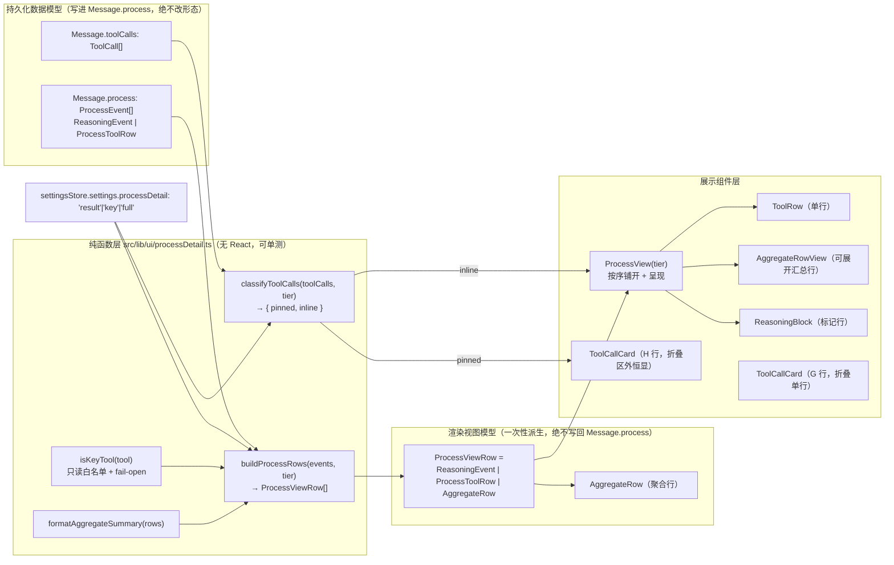
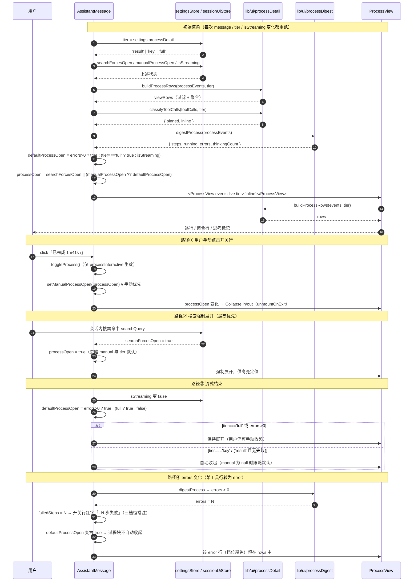

# 增量系统设计：对话内「模型工作步骤」三档细节展示

> 输入：`docs/prd-tool-step-detail.md`（已定稿，含 Q1/Q2/Q3 裁决）。
> 定位：**增量、最小变更**。不重写消息流架构；不改 `Message.process` 持久化形态；零新增依赖。
> 所有裁决以 PRD §3.2 逐元素可见性表为唯一事实源。

---

## Part A：系统设计

### 1. 实现方案总述

#### 1.1 核心难点与思路

| 难点 | 思路 |
|---|---|
| 档位是「渲染」约束，不是「数据」约束 | **绝不改动 `Message.process`**：档位过滤/聚合发生在「读数据之后、渲染之前」的纯函数里，产出一次性视图模型 |
| 过滤 + 聚合逻辑散落 JSX 会难以单测 | 全部收进 `src/lib/ui/processDetail.ts`（纯函数、无 React 依赖），组件只消费结果 |
| 三类非关键工具要聚合成一行且保留顺序 | 单遍扫描、遇到「屏障」（思考段 / 关键工具 / running / error）即 flush 当前连续段 |
| error/running 必须「档位豁免」 | 豁免逻辑写死在纯函数的**唯一一处**（`isRowVisible` / 分段时的优先级），组件不重复判断 |
| 档位、手动、搜索三方共存 | 沿用既有优先级：`searchForcesOpen > manualProcessOpen > defaultProcessOpen(tier,…)`，只把「默认值」从硬编码 `isStreaming` 换成档位状态机 |
| 审批/敏感卡片不能被折叠吃掉 | 把 H 行从 `ProcessView.children` **上移到 `Collapse` 之外**，恒渲染 |

#### 1.2 架构模式

沿用现有 **「纯函数派生层（`src/lib`）+ 展示组件层（`src/pages`）+ 全局 store（`src/stores`）」** 三层结构，不引入新范式。
数据流单向：`Message.process → 纯函数 buildProcessRows(tier) → ProcessView(tier) → ToolRow / 聚合行`。

#### 1.3 数据流总图



**职责边界（硬约定）**
- `src/lib/ui/processDetail.ts`：**唯一的**过滤/聚合/文案出处，纯函数。
- `ProcessView.tsx`：仍只做「按序铺开 + 按 `tier` 决定单行/聚合行呈现」，**自己不做折叠、不设整体限高**（保留现有职责注释）。
- `AssistantMessage.tsx`：装配层，负责读档位、算展开态、把 H 行上移到折叠区外。
- 视图模型（`ProcessViewRow` / `AggregateRow`）是**派生产物**，永不进入 `Message.process`。

---

### 2. 文件清单

#### 2.1 新增

| 文件 | 内容 | 为什么 |
|---|---|---|
| `src/lib/ui/processDetail.ts` | 白名单 `isKeyTool`、`buildProcessRows`、`classifyToolCalls`、`formatAggregateSummary` + 视图模型类型 | 过滤/聚合必须纯函数化、可单测；对齐既有 `src/lib/ui/processDigest.ts` 把派生模型放 lib 的先例 |
| `tests/lib/ui/processDetail.test.ts` | 上述纯函数单测 | 把分类口径与聚合规则钉死（QA 主写，但接口在此固定） |

#### 2.2 修改

| 文件 | 改什么 | 为什么 |
|---|---|---|
| `src/types/process.ts` | 新增并导出 `type ProcessDetailLevel = 'result' \| 'key' \| 'full'` | 档位是 process 域概念；`Settings` 也要引用它（唯一事实源） |
| `src/types/settings.ts` | 新增必填字段 `processDetail: ProcessDetailLevel`（`import type` 自 `./process`） | PRD §6.5 数据契约 |
| `src/stores/settingsStore.ts` | ① `DEFAULT_SETTINGS.processDetail='key'`；② 新增导出 `normalizeProcessDetail`；③ `version: 12 → 13`；④ `migrate` 补 **v13** 分支 | 新字段必须有默认值 + 老用户补齐 + 非法值兜底（对齐 `normalizeTheme`） |
| `src/pages/chat/ProcessView.tsx` | ① 新增**必填** `tier` 属性；② 用 `buildProcessRows` 产出 `rows` 渲染；③ 新增局部 `AggregateRowView`（可展开汇总行）；④ 空判据由 `events.length===0` 改为 `rows.length===0` | 落 PRD §3.2/§4.2；空判据升级以延续「空事件不渲染」不变量 |
| `src/pages/chat/AssistantMessage.tsx` | ① 读 `tier`；② `buildProcessRows`/`classifyToolCalls`；③ 展开态状态机（`defaultProcessOpen`）；④ chevron/可点击性（§5.4）；⑤ 把 H 行（`pinnedToolCalls`）**移到 `Collapse` 之外** | 装配层：档位默认态 + H 行上移 |
| `src/components/settings/sections/GeneralSection.tsx` | 在「外观」卡片之后新增「对话过程」卡片（`ToggleButtonGroup` 三选一） | PRD §6；不新增分区 id |
| `tests/chatProcessTimeline.test.tsx` | `ProcessView` 四处用例补 `tier="full"`；`AssistantMessage` 用例按 PRD §10 调整断言 | 必填属性 + 档位默认改观感 |
| `tests/lib/sync/settingsSync.test.ts` | `fullSettings()` 补 `processDetail`；新增 AC10 断言（同步负载含 `processDetail`） | 字段变必填（编译期）+ 同步契约护栏 |
| `tests/stores/settingsTranscriptionMigration.test.ts` | `beforeEach` 的 settings 字面量补 `processDetail`；新增 v13 迁移用例 | 编译期 + 迁移新范式 |
| `tests/stores/settingsWorkspaceGroups.test.ts` | `resetSettings` 的 settings 字面量补 `processDetail` | 字段必填 → 编译期 |
| `docs/settings-inventory.md` | §2.1 表新增 `processDetail` 一行 | 该文档枚举了 settings 全量字段（维护约定六） |

#### 2.3 明确**不改**（最小变更的证据）

| 文件 | 为什么不改 |
|---|---|
| `src/lib/sync/settingsSync.ts` | `processDetail` 是纯偏好、**不进** `SETTINGS_SYNC_OMIT_KEYS`；`pickSyncable` 浅拷贝未被 omit 的键 → 新字段**自动进入**同步负载，无需改代码 |
| `src/sync/syncRegistry.ts` | `settings` 落地用 `{...state.settings, ...rest}` 浅合并 → 新字段自动落地 |
| `src/lib/ui/processDigest.ts` | `digestProcess` 签名/语义不变；档位过滤是另一条纯函数 |
| `src/types/message.ts` | `Message.process` 是持久化契约，形态不变 |
| `src/pages/chat/ToolCallCard.tsx` | 见 §3.4 —— 现有「默认收起 + 点击展开」已是 PRD §3.2 G 的「折叠单行（可展开）」，无需改 |
| `src/components/settings/SettingsDialog.tsx` / `settingsNav.tsx` / `stores/settingsUiStore.ts` | 不新增分区 id → 三处穷尽性检查不动 |
| `tests/settingsDialogSections.test.tsx` | `general` 锚点 `'外观'` 不变 |
| `docs/chat.md` | 顶部已声明「**历史存档，除横幅外不再编辑**」 |
| `nanobot/` | ⛔ 禁止改动 |

---

### 3. 数据结构与接口

#### 3.1 类型放置裁决（持久化模型 vs 渲染视图模型）

**边界声明（写进代码注释）**
- **持久化数据模型**：`ReasoningEvent` / `ProcessToolRow` / `ProcessEvent`（`src/types/process.ts`）——这就是 `Message.process` 的元素类型，**档位不得改变其形态**。
- **渲染视图模型**：`ProcessViewRow` / `AggregateRow`——由纯函数**就地派生**，只活在一次渲染里，**绝不写回 `Message.process`**。

**裁决**
| 类型 | 落点 | 理由 |
|---|---|---|
| `ProcessDetailLevel` | `src/types/process.ts` | 档位是 process 域的一等值；`Settings` 也引用它 → 放域类型模块，避免 settings↔process 反向依赖 |
| `ProcessViewRow` / `AggregateRow` | `src/lib/ui/processDetail.ts` | ① 它是**派生的渲染模型**，put 进 `types/process.ts` 会让它紧挨 `ProcessEvent`，诱使他人误扩 `ProcessEvent` 联合（即误写回持久化契约）；② 对齐既有先例——`src/lib/ui/processDigest.ts` 的 `ProcessDigest` 接口就定义在 lib 内；③ 类型只被「生产它的纯函数」与 `ProcessView` 使用，就近放置最内聚 |

> 说明：团队分工信息里提到「聚合行类型必须定义在 `src/types/process.ts`」。此处按交付要求第 3 项「给出裁决与理由」作出**明确取舍**：放 `src/lib/ui/processDetail.ts`。若评审坚持集中在 `types/process.ts`，只需把 `AggregateRow`/`ProcessViewRow` 两个导出平移到该文件（`ProcessEvent` 联合**保持不变**），其余设计不变——这是一次纯搬迁，不影响任何调用方。

#### 3.2 类图（Mermaid classDiagram）

```mermaid
classDiagram
  class ProcessDetailLevel {
    <<type>>
    'result' | 'key' | 'full'
  }

  class ReasoningEvent {
    +string id
    +'reasoning' kind
    +string content
    +boolean closed?
  }
  class ProcessToolRow {
    +string id
    +'tool' kind
    +string tool
    +Record args
    +'running'|'done'|'error' status
    +string result?
    +string error?
  }
  class ProcessEvent {
    <<union 持久化>>
    ReasoningEvent | ProcessToolRow
  }

  class AggregateRow {
    <<view 渲染模型>>
    +'aggregate' kind
    +string id
    +ProcessToolRow[] rows
    +string summary
  }
  class ProcessViewRow {
    <<union view 渲染模型>>
    ReasoningEvent | ProcessToolRow | AggregateRow
  }

  class processDetail {
    <<src/lib 纯函数>>
    +NON_KEY_TOOLS readonly string[]
    +isKeyTool(tool) boolean
    +buildProcessRows(events, tier) ProcessViewRow[]
    +classifyToolCalls(toolCalls, tier) {pinned, inline}
    +formatAggregateSummary(rows) string
  }

  class Settings {
    +ProcessDetailLevel processDetail
    +... 既有字段
  }
  class settingsStore {
    +DEFAULT_SETTINGS.processDetail = 'key'
    +normalizeProcessDetail(value) ProcessDetailLevel
    +migrate v13 补齐
  }

  class ProcessView {
    +ProcessEvent[] events
    +boolean live
    +ProcessDetailLevel tier  必填
    +ReactNode children?
    +render()
  }
  class AssistantMessage {
    +tier
    +defaultProcessOpen
    +processOpen
    +processInteractive
    +pinnedToolCalls
    +inlineToolCalls
  }

  ProcessEvent ..> ReasoningEvent
  ProcessEvent ..> ProcessToolRow
  ProcessViewRow ..> ReasoningEvent
  ProcessViewRow ..> ProcessToolRow
  ProcessViewRow ..> AggregateRow
  processDetail ..> ProcessEvent : consume
  processDetail ..> ProcessViewRow : produce
  processDetail ..> AggregateRow : produce
  ProcessView ..> processDetail : use
  AssistantMessage ..> processDetail : use
  AssistantMessage ..> ProcessView : render tier
  AssistantMessage ..> Settings : read processDetail
  Settings --> ProcessDetailLevel
  settingsStore ..> Settings
  Result1 : 持久化模型 ≠ 渲染视图模型
```

#### 3.3 `src/lib/ui/processDetail.ts` 完整导出签名（纯函数，无 React）

```ts
import type { ProcessDetailLevel, ProcessEvent, ProcessToolRow, ToolCall } from '@/types';

/**
 * 非关键工具白名单：纯只读、无副作用的本机信息收集。
 * ⚠️ 判定方向是「只读白名单」而非「关键名单」——不在表里的（含任何未知/新增工具名）
 * 一律按**关键**处理（fail-open），宁可多展示也不静默吞掉一个可能重要的动作。
 */
export const NON_KEY_TOOLS: readonly string[] = ['read_file', 'list_dir', 'find_files', 'grep'];

/** 单个工具行是否「关键」。fail-open：未知工具 → true。 */
export function isKeyTool(tool: string): boolean;

/**
 * 聚合行：把一段**相邻**的非关键工具行压成一行摘要。
 * 这是渲染视图模型，**绝不写回 Message.process**。
 */
export interface AggregateRow {
  kind: 'aggregate';
  /** 稳定 React key：段首原始行 id（段内行 id 变化不影响段身份） */
  id: string;
  /** 段内原始工具行（保持到达顺序；展开时逐行渲染） */
  rows: ProcessToolRow[];
  /** 摘要文案，如「已读取 2 个文件 · 已搜索 1 次」 */
  summary: string;
}

/** 渲染视图行：思考段原样保留；工具行或为单行、或被聚合行替代。 */
export type ProcessViewRow = ProcessEvent | AggregateRow;

/**
 * 档位过滤 + 连续段聚合的**唯一入口**。
 * 纯函数：不读 store、不碰 React、不改入参，可直接单测。
 *
 * 规则（PRD §3.2 / §4.2）：
 * - reasoning：result 丢弃；key/full 保留（正文展开仍由 ReasoningBlock 自理）。
 * - tool(running|error)：§E/F 档位豁免——任何档位都逐行保留，且**不参与聚合**。
 * - tool(done)：
 *     - full → 逐行保留。
 *     - result → 丢弃。
 *     - key → 关键工具逐行保留；非关键工具并入当前连续段，遇屏障 flush 成 AggregateRow。
 * - 屏障 = 思考段 / 关键工具 / running / error。
 */
export function buildProcessRows(
  events: ProcessEvent[],
  tier: ProcessDetailLevel,
): ProcessViewRow[];

/** 固定顺序：已读取文件 → 已浏览目录 → 已查找 → 已搜索；只列 >0 的桶，` · ` 连接。 */
export function formatAggregateSummary(rows: ProcessToolRow[]): string;

/**
 * ToolCallCard 的档位分类（PRD §3.2 G/H）。
 * - pinned（折叠区**之外**、恒渲染）：`sensitive` 为真、或 status ∈ {pending, rejected, error}。
 * - inline（折叠区**之内**）：其余；result 档过滤为空，key/full 档全部保留。
 * ⚠️ error 也归入 pinned 是「异常永不隐身」的延伸（PRD 原文只枚举 pending/rejected，见 §10 待明确）。
 */
export function classifyToolCalls(
  toolCalls: ToolCall[],
  tier: ProcessDetailLevel,
): { pinned: ToolCall[]; inline: ToolCall[] };
```

> `formatAggregateSummary` 只可能收到 4 种白名单工具（非白名单工具永远走「关键」分支、不聚合），无需为未知工具兜底。
> 摘要文案常量**只此一处**（`ProcessView` 不复制任何文案）。

#### 3.4 `ToolCallCard` 是否需改：**不改**

PRD §3.2 G 要求非敏感卡片在 `key`/`full` 下是「折叠单行（可展开看参数/结果）」。现有 `ToolCallCard` 默认即渲染「工具名 + 状态 Chip + 展开箭头」的一行，参数/结果在 `Collapse` 内——**这正是「折叠单行（可展开）」的形态**。因此：
- **H 行**（pinned）：由 `AssistantMessage` 决定挂载位置（折叠区外），组件本身不变。
- **G 行**（inline）：由 `AssistantMessage` 在 result 档过滤掉，组件本身不变。
- 组件无需新增 `tier` 属性或「压缩」变体。

#### 3.5 `ProcessView` 新增 `tier` 属性：**必填**（确认）

```ts
export function ProcessView({
  events,
  live,
  tier,
  children,
}: {
  events: ProcessEvent[];
  live: boolean;
  /** 展示档位（必填）：见 lib/ui/processDetail。不传 tiers 无法决定过滤/聚合。 */
  tier: ProcessDetailLevel;
  children?: React.ReactNode;
});
```

**必填的理由**：档位决定渲染契约，缺省会静默退回「全量铺开」，与 `key`（本需求默认档）不一致——这是最容易被漏测的形态。因此不给默认值，强制每个调用点显式表态。

**对既有调用点的影响（编译期可见，共 5 处）**
1. `src/pages/chat/AssistantMessage.tsx:279` —— 生产调用点，改传 `tier={tier}`。
2–5. `tests/chatProcessTimeline.test.tsx` 的 `describe('ProcessView')` 四处 `<ProcessView …>` —— 补 `tier="full"`（PRD §10 明确：为保留 `t1/t2` 为 read_file 的交错原始断言，需 `full`，否则 `key` 会聚合）。

> 因为 `tier` 必填且类型是联合，**任何漏传/传错都会在 `tsc` 阶段报错**，不会运行期静默降级。

`ProcessView` 内部改动：
- `const rows = buildProcessRows(events, tier);`
- `liveReasoningId` 仍扫**原始 `events`**（key/full 下 reasoning 全量保留，扫描结果与 `rows` 一致；result 下不渲染 reasoning，该值无用）。
- 空判据升级：`if (rows.length === 0 && Children.count(children) === 0) return null;`（延续「空事件 + 空 children 不渲染」不变量，并覆盖「过滤后为空」）。
- `rows.map(...)`：`reasoning → <ReasoningBlock>`；`tool → <ToolRow>`；`aggregate → <AggregateRowView>`。
- 新增**文件内**局部组件 `AggregateRowView({ row })`：一行摘要（旋转 chevron + 文案，样式对齐 `ToolRow`/`ReasoningBlock` 标记行）+ `Collapse` 展开为原始 `ToolRow` 列表；展开态用**组件本地 `useState`**（块内独立、不持久化——PRD §4.2）。保留在 `ProcessView.tsx` 内可复用私有的 `describeTool` / `ToolRow`。

#### 3.6 `AssistantMessage` 最终代码形态（关键片段）

```ts
const tier = useSettingsStore((s) => s.settings.processDetail);

// 折叠区内：cron 卡片行已剔除 → 档位过滤 + 聚合（纯函数）
const viewRows = buildProcessRows(processEvents, tier);
// ToolCallCard 的档位分类：pinned（折叠区外恒显）/ inline（折叠区内）
const { pinned: pinnedToolCalls, inline: inlineToolCalls } = classifyToolCalls(toolCalls, tier);

// error/running 是档位豁免项 → digest 用过滤前的 processEvents 与过滤后等价
const digest = digestProcess(processEvents);
const failedSteps = digest.errors;

const hasProcess = processEvents.length > 0 || toolCalls.length > 0;

// §5.1 状态机：有失败恒开；full 恒开；result/key 跟随流式
const defaultProcessOpen =
  digest.errors > 0 ? true : tier === 'full' ? true : isStreaming;
// §5.2 优先级：搜索强制 > 手动 > 档位默认
const processOpen = searchForcesOpen || (manualProcessOpen ?? defaultProcessOpen);

// §5.4：result 档无 running 且无 error → 退化为一行不可点的状态文案（无 chevron）
const processInteractive =
  hasProcess && (tier !== 'result' || digest.running > 0 || digest.errors > 0);

const toggleProcess = () => {
  if (!processInteractive) return;
  setManualProcessOpen(!processOpen);
};
```

JSX 关键变化（层级见 §5）：
```tsx
{/* 开关行：hasProcess 时渲染；processInteractive 时才可点、才有 chevron */}
{hasProcess && (
  <Box
    role={processInteractive ? 'button' : undefined}
    tabIndex={processInteractive ? 0 : undefined}
    aria-expanded={processInteractive ? processOpen : undefined}
    aria-label={processInteractive ? (processOpen ? '收起执行过程' : '展开执行过程') : undefined}
    onClick={processInteractive ? toggleProcess : undefined}
    /* …原样式不变… */
  >
    {/* 状态 + 耗时 + 失败红字「· N 步失败」恒常驻（三档） */}
    {processInteractive && <ChevronRightIcon /* 原逻辑 */ />}
  </Box>
)}

<Collapse in={processOpen} unmountOnExit>
  <ProcessView events={processEvents} live={isStreaming} tier={tier}>
    {inlineToolCalls.length > 0
      ? inlineToolCalls.map((t) => <ToolCallCard key={t.id} toolCall={t} />)
      : null}
  </ProcessView>
</Collapse>

{/* H 行：审批 / 敏感 ToolCallCard —— 从折叠区内**上移到 Collapse 之外**，恒可见（PRD §3.2 H） */}
{pinnedToolCalls.map((t) => (
  <ToolCallCard key={t.id} toolCall={t} />
))}

{cronCardRows.map((row) => (
  <CronTaskCard key={row.id} row={row} />
))}
```

> 备注：`tier === 'result'` 且无 running/error 时，`defaultProcessOpen=false`、`processInteractive=false` → 开关行是静态文案、`Collapse` 折叠（内容本就为空/仅豁免行）。AC1 满足。

---

### 4. 程序调用流程（时序图）



---

### 5. UI 组件树变化

#### 5.1 变化后的助手消息层级（聚焦「过程块 + H 行上移」）

```
AssistantMessage
├─ 署名头（头像 + 名称）                         (不变)
├─ 过程开关行 (K)   role/aria/click 仅当 processInteractive
│    「已完成 1m41s · N 步失败  ›」              (失败红字恒常驻；result 档无内容时退化为静态文案、无 chevron)
├─ <Collapse in={processOpen} unmountOnExit>    ← 折叠区（可见性由调用方决定）
│    └─ ProcessView(events, live, tier)         ← 只「按序铺开 + 按 tier 呈现」
│         ├─ ReasoningBlock   (A/B, tier∈{key,full})
│         ├─ ToolRow          (C/E/F：关键工具 / running / error)
│         ├─ AggregateRowView (D, tier==='key'：非关键连续段，可展开)
│         └─ children = inline ToolCallCard[]   (G：非敏感 done/approved/running；result 档为空)
├─ pinnedToolCallCard[]   ★ H 行：审批/敏感/pending/rejected/error（从折叠区内**上移**，恒可见）
├─ CronTaskCard[]                               (I：恒可见)
├─ 正文 Paper（Markdown）                        (I：恒可见)
├─ aborted「（已停止）」/ interrupted 警告 (L)    (恒可见，刻意不依赖 hasProcess)
├─ 流式状态行 / 富产物 / MessageArtifacts / PlanCard  (I：恒可见)
└─ 操作按钮区（hover 显示）                       (不变)
```

**关键层级差异**：H 行从 `<Collapse>` 的 `ProcessView.children` 内部，**提升为 `Collapse` 的兄弟节点**（介于过程折叠块与 cron 卡片之间）。这样审批/敏感卡片在**任何档位、任何折叠态**下都恒可见。

#### 5.2 `hasProcess` / 开关行 / `aria-label` 的精确裁决

| 量 | 定义 | 说明 |
|---|---|---|
| `hasProcess` | `processEvents.length > 0 \|\| toolCalls.length > 0` | **与现状完全一致**，不按档位调整：档位过滤在渲染层下游，不改「是否有过程」这一事实。AC「无过程时不渲染开关行」仍成立 |
| 开关行是否渲染 | `hasProcess` | 不变 |
| `processInteractive` | `hasProcess && (tier !== 'result' \|\| digest.running > 0 \|\| digest.errors > 0)` | §5.4：result 档无 running/error → 不可点、无 chevron |
| chevron | `processInteractive` 时渲染 | 否则退化为一行状态文案 |
| `aria-expanded` | `processInteractive ? processOpen : undefined` | 非交互态不挂交互语义 |
| `aria-label` | `processInteractive ? (processOpen ? '收起执行过程' : '展开执行过程') : undefined` | 文案不变；仅交互态存在 |

> 语义提醒：`hasProcess` 为真但 `processInteractive` 为假（result 档、纯 done 行）时，开关行仍会显示「已完成 1m41s」——这正是 AC1 期望的「状态文案」形态。

---

## Part B：任务分解

### 6. 依赖包列表

**零新增依赖。** 全部使用既有栈（React 18 / TS / MUI / Tailwind / zustand / vitest）。`mermaid` 图示仅出现在文档中。

### 7. 任务列表（有序，按实现顺序）

> 粒度说明：本需求是**增量**，无「项目基础设施」可建，故不设脚手架任务；按「数据/纯函数 → 对话渲染 → 设置 UI → 文档/回归」四个可批量一次写完的模块划分。
> 硬约束「每任务 ≥3 文件」在本增量下对 T03 不适用（该模块天然只有 1 个 UI 文件），已合并到最小合理粒度。

| ID | 任务名 | 涉及文件 | 依赖 | 优先级 | 完成定义 |
|---|---|---|---|---|---|
| **T01** | **档位数据契约与纯函数层** | `src/types/process.ts`、`src/types/settings.ts`、`src/stores/settingsStore.ts`、`src/lib/ui/processDetail.ts`(新)、`tests/lib/ui/processDetail.test.ts`(新)、`tests/lib/sync/settingsSync.test.ts`、`tests/stores/settingsTranscriptionMigration.test.ts`、`tests/stores/settingsWorkspaceGroups.test.ts` | — | P0 | `Settings.processDetail` 存在（默认 `key`）、`normalizeProcessDetail` 兜底 `key`、`version=13` 且 migrate 显式补 v13；`buildProcessRows`/`isKeyTool`/`classifyToolCalls`/`formatAggregateSummary` 纯函数就位并单测通过；`tsc` 全绿（含 3 个测试 fixture 补字段）；`processDetail` 出现在同步负载中 |
| **T02** | **对话渲染契约接入** | `src/pages/chat/ProcessView.tsx`、`src/pages/chat/AssistantMessage.tsx`、`tests/chatProcessTimeline.test.tsx` | T01 | P0 | `ProcessView` 新增必填 `tier` 并渲染聚合行；`AssistantMessage` 落 `defaultProcessOpen` 状态机 + §5.4 chevron + H 行移出折叠区；`tests/chatProcessTimeline.test.tsx` 按 PRD §10 全绿 |
| **T03** | **「对话过程」设置卡片** | `src/components/settings/sections/GeneralSection.tsx` | T01 | P0 | 「通用」分区「外观」之后新增「对话过程」卡片（`ToggleButtonGroup` 三选一，文案对齐 §6.2），**不新增分区 id**；`settingsDialogSections.test.tsx` 仍绿 |
| **T04** | **文档同步 + 全量回归** | `docs/settings-inventory.md`、`docs/design-tool-step-detail.md`(本文件) | T01、T02、T03 | P1 | `settings-inventory.md` 补 `processDetail` 行；`tsc` + `vitest` + `build` 三关门禁全绿 |

### 8. 共享知识（跨文件约定）

1. **档位只影响渲染，不影响数据**：`Message.process` / `Message.toolCalls` 形态与内容永不因档位变化。
2. **聚合行不持久化**：`AggregateRow` 是 `buildProcessRows` 的一次性产物，永不写回 `Message.process`；聚合行展开态是块内本地 `useState`，刷新即丢。
3. **error/running 豁免唯一实现点**：豁免判断只在 `src/lib/ui/processDetail.ts`（分段优先级 + `isRowVisible` 语义）里写一次；组件不得重复判断。
4. **文案常量单一出处**：聚合摘要（`已读取/已浏览/已查找/已搜索`）只由 `formatAggregateSummary` 产出；组件只渲染其返回值。
5. **失败红字是开关行的常驻项**：`failedSteps = digestProcess(processEvents).errors` 计算口径不变；三档恒显示。
6. **优先级永不变**：`searchForcesOpen > manualProcessOpen > defaultProcessOpen(tier,isStreaming,errors)`。
7. **新增 settings 字段的三件套**：`types/settings.ts` 类型 + `DEFAULT_SETTINGS` 默认值 + `migrate` 补版本。`processDetail` 是纯偏好 → **必须**参与同步（不进 `SETTINGS_SYNC_OMIT_KEYS`）。
8. **代码风格**：`src/lib` / `src/stores` / `tests` 用**单引号**；`src/pages` / `src/components` 跟随该文件既有风格（`ProcessView.tsx` / `AssistantMessage.tsx` / `ToolCallCard.tsx` / `GeneralSection.tsx` 现均为单引号）。注释只写「为什么」。
9. **不改 `nanobot/`，不做任何 git 写操作。**

### 9. 风险与回滚

| # | 风险 | 影响 | 缓解 / 回滚 |
|---|---|---|---|
| ① | `version: 12 → 13` 迁移对老用户观感的影响 | 默认档为 `key`，老用户会发现「读文件/搜索」从逐行变成一行汇总（PRD §6.3 已**显式承认**这是有意的观感变化） | 迁移只补齐字段、不动其它值；用户可在设置里一键切到 `full` 复刻近现状。回滚：把 `DEFAULT_SETTINGS.processDetail` 改为 `'full'` 即可（但违背本需求默认口径，不推荐） |
| ② | `key` 档把 `read_file` 聚合后，**既有测试断言与用户习惯**双重变化 | `tests/chatProcessTimeline.test.tsx` 的 AssistantMessage 用例断言「`file-t1.ts` 出现」会失败 | PRD §10 已逐条列出改法：改为断言汇总行文案（「已读取」/「1 个文件」），`t2`（running，豁免）仍逐行可见。**必须同步改测试**，不得只改实现 |
| ③ | `ProcessView` 新增**必填** `tier` 的编译期影响面 | 漏传即 `tsc` 报错：1 处生产调用（`AssistantMessage`）+ 4 处测试调用 | 属**预期内**的编译期护栏（优于运行期静默降级）。修复点已在 §3.5 列全 |
| ④ | 同步负载新增字段对端兼容 | 旧版本对端收到未知键 `processDetail` | `Settings` 落地是 `{...local, ...remote}` 浅合并 + 白名单 payload —— 旧端若**不识别**该键：其 `Settings` 类型无此字段，落地时该键被写入对象但不被任何 UI 读取（相当于无害的额外键，下次上行可能被其 `pickSyncable` 携带）；其 `partialize` 整体输出 settings → 会一并落盘但不崩溃。**不产生"设置丢失"或崩溃**。建议在 release note 注明「旧客户端请升级以获得档位同步」 |
| ⑤ | `required` 字段导致的**测试 fixture 编译失败**（未在 PRD 显式列出） | `settingsSync.test.ts` / `settingsTranscriptionMigration.test.ts` / `settingsWorkspaceGroups.test.ts` 的 `Settings` 字面量缺 `processDetail` → `tsc` 红 | 已并入 T01 一起补字段；见 §2.2 表 |
| ⑥ | H 行上移后，`pending` 卡片在流式期间位置跳变 | 审批卡片从折叠区内移到折叠区外，首次出现时位置与旧版不同 | 属**有意变更**（PRD §3.2 H 要求恒可见）；不设「回到旧位」的开关，避免两套布局 |

**回滚策略**：本设计是**纯增量**（新字段 + 新纯函数 + 局部渲染分支）。整体回滚 = 还原 8 个被改文件 + 删除 2 个新文件；无数据迁移回滚负担（`processDetail` 是额外键，旧代码忽略它即可）。

### 10. 待明确事项

1. **非敏感但 `status==='error'` 的 `ToolCallCard` 归属**：PRD §3.2 的 G/H 只枚举了 `pending/rejected/sensitive`。本设计将 `error` 一并归入 **H（pinned，折叠区外恒显）**，理由是「异常永不隐身」原则的延伸。若产品希望 error 卡片也在 result 档隐藏，只需改 `classifyToolCalls` 一处。**建议维持本设计**。
2. **`result` 档下「仅 H 行、无过程行」时的开关行**：`hasProcess` 为真、`processInteractive` 为假 → 显示静态「已完成 1m41s」。若产品希望此态下完全隐藏开关行，需改 `hasProcess` 口径（本设计不采用，因为它会与「无过程时不渲染开关行」的既有测试语义纠缠）。当前设计判定：**保留静态状态文案**。
3. **`digestProcess(filteredEvents)` vs `digestProcess(processEvents)`**：PRD §5.1 字面写「filteredEvents」。本设计用**过滤前**的 `processEvents`，因为 error/running 是档位豁免项，两种取法的 `running`/`errors` **恒等**；用过滤前可复用既有 `failedSteps` 计算、少一次聚合重建。若评审要求逐字对齐 PRD，可改为对 `viewRows`（仅保留工具行）求 digest，结果一致。
4. **聚合行图标**：PRD 未指定。本设计建议聚合行复用「标记行」语言（旋转 chevron + 摘要文字，不额外引入工具图标），以区别于工具单行。若需要图标，建议统一用列表类图标。
