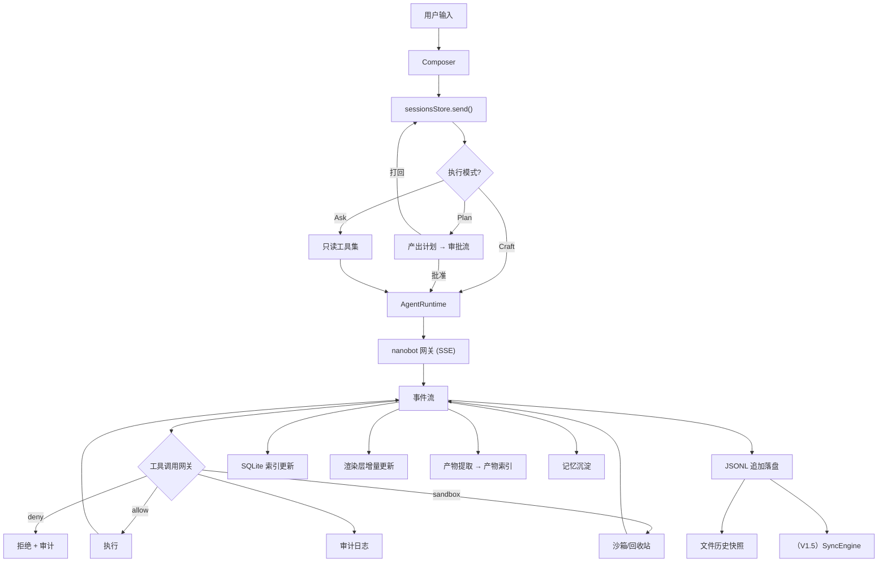
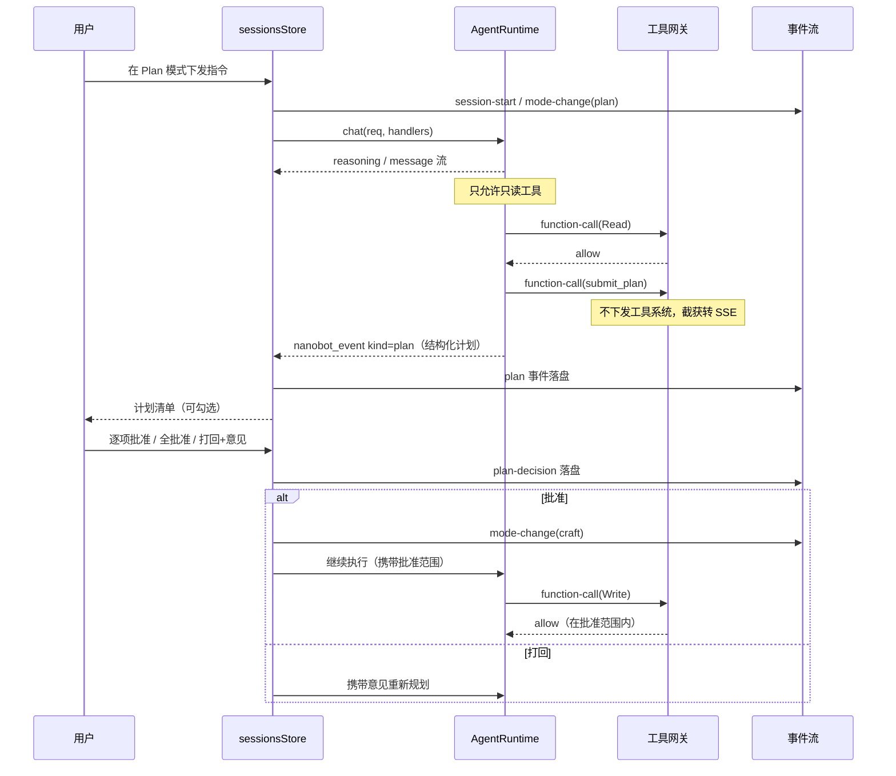
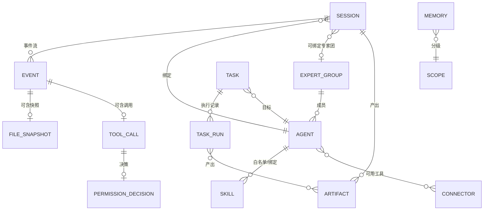

# nanowork 需求与设计文档 v2.0

> **文档性质**：合并版「详细需求 + 系统设计」文档。取代并升级以下三份文档的共同结论：
> - `C:\Users\xinmi\.workbuddy\WorkBuddy-architecture-analysis.md`（WorkBuddy 实现原理分析）
> - `C:\Users\xinmi\.workbuddy\WorkBuddy-install-dir-supplement.md`（WorkBuddy 安装目录补充分析）
> - `docs/nanowork-prd.md`（基于 nanobot 引擎的智能办公软件需求方案 / 代号 WorkPilot）
>
> **不取代**：`docs/prd.md`、`docs/architecture.md`、`docs/architecture-memory.md`、`docs/architecture-tasks.md`、`docs/cross-platform-sync-design.md` 等增量设计文档；它们作为历史增量设计的来源被本文引用与收敛。
>
> **基线**：以仓库**实际代码**为准（截至 2026-09-14）。凡文档与代码冲突处，本文以代码为准并显式标注修订单。
>
> **阅读指引**：第一部分是需求（What/Why），第二部分是设计（How）。只关心排期与范围 → 读第 1、2、3、6 章；只关心技术方案 → 读第 7–23 章；想快速理解「WorkBuddy 哪些机制值得抄、怎么抄」→ 直接跳 **附录 A**。

---

# 第 0 章 修订说明与三点纠偏

## 0.1 纠偏一：WorkBuddy 是腾讯的产品，不是网易有道

`docs/prd.md`、`OVERVIEW.md`、`README.md` 曾标注「对标 WorkBuddy（网易有道）」。这与安装目录证据不符，应予纠正（**已修复**：上述三份文件的归属表述已更正为「腾讯，CodeBuddy Agent 内核」）：

| 证据 | 内容 |
|---|---|
| `app.asar/package.json` | `"name": "@genie/workbuddy-desktop"`，`"version": "5.5.6"` |
| `cli/package.json` | `"name": "@genie/agent-cli"`，描述为 *"Use CodeBuddy, Tencent's AI assistant, right from your terminal"* |
| `cli/product.json` | `"productName": "WorkBuddy"`，`"endpoint": "https://copilot.tencent.com"` |
| 主进程依赖 | `@tencent/drive-sdk`、`@wecom/aibot-node-sdk`、`@tencent/tencent-docs-ai-engine`、`@tencent/aegis-electron-sdk-v2` |

**结论**：WorkBuddy = **腾讯 CodeBuddy Agent 内核（`@genie/agent-cli`）+ Electron 桌面壳 + 腾讯生态集成**。本产品对标的是这套架构方法论，而非某个「网易有道」产品。后续所有文档统一按此表述。

## 0.2 纠偏二：需求文档的定位与代码的真实定位不一致

`docs/nanowork-prd.md`（WorkPilot 方案）把产品定义为一个**企业级多租户私有化 Agent 平台**（租户隔离、SSO、RBAC、审批流、计费、gVisor 沙箱）。

但仓库里真实跑起来的代码是另一个形态：一个**本地优先（local-first）的单用户跨端智能体客户端**——直连本机 nanobot 网关、无账号体系、无租户、无沙箱、数据落在用户自己的 localStorage / JSON 文件。

两者并非矛盾，而是**同一产品路线的首尾两端**。本文的处理方式是：

1. **以代码基线为一期（V1）的事实定义**——不推翻已实现的能力，只做补齐与加固。
2. **把企业级目标编入 V3**，并把 V1 的技术选型（引擎契约层、事件模型、同步元数据）设计成**不阻塞 V3 演进**的形状。
3. 对「一期就写错会阻塞三期」的少数决策（见第 0.3 节），在 V1 就预留接口。

## 0.3 纠偏三：三个「一期必须做对、否则三期重构」的决策

这是本文最重要的架构判断。以下三项如果 V1 不做，V3 必然推倒重来：

| # | 决策 | 为什么必须现在做 | 对应章节 |
|---|---|---|---|
| D1 | **引擎契约层（AgentRuntime 防腐层）** ✅ 已落地（见 8.4.1） | 当前 nanobot 的 HTTP/SSE 契约散落在 `nanobotClient`、`nanobotConfig`、`nanobotChannels`、`nanobotTasks` 四处。nanobot 迭代快、API 不稳（`docs/nanowork-prd.md` 风险表已识别）。一旦要换成「ACP 式协议」或升级引擎大版本，改动会横穿渲染层 | 第 8 章 |
| D2 | **事件化会话存储 + 同步元数据** | 当前会话是 Zustand `persist` 的整块 JSON blob。它天然不支持：回滚、分支、重放、增量同步、大历史性能。WorkBuddy 用 `parentId` 串成的 JSONL 事件 DAG 正是为此。跨端同步设计也依赖 `rev/updatedAt/deletedAt` | 第 9 章 |
| D3 | **三级权限模型（提示词 / 客户端 / 运行时）** | 当前只有「提示词软约束 + 弹窗」，而 WorkBuddy 的结论是**必须代码强制兜底**（shim 劫持 → 回收站 → fail-closed）。企业准入门槛（`docs/nanowork-prd.md` F5.x）全靠这一层。V1 若不建立「工具调用网关」这一收口点，V3 的审批流无处分插 | 第 11 章 |

---

# 第一部分 需求（PRD）

# 第 1 章 产品定义与竞品坐标

## 1.1 WorkBuddy 是什么（抽象后的可对标形态）

抛开腾讯生态细节，WorkBuddy 的架构可概括为一句话：

> **用 ACP 协议把「CodeBuddy Agent CLI」变成一个可被 GUI、IM、定时任务三种入口驱动的后台进程，再用插件/技能/连接器/专家四层生态把它变成平台。**

拆成可对标的五层：

| 层 | WorkBuddy 的做法 | 对我们的意义 |
|---|---|---|
| 1. 桌面壳 | Electron + React 渲染层 + 同时提供 PWA | 已验证「一套 UI 双端」可行 —— 我们已用 `src/platform` 实现 |
| 2. Daemon / App Server | `daemon-bootstrap`、sidecar 独立进程、本地 HTTP 服务 | Agent 内核与 UI 解耦、崩溃隔离、预热身进程池降首字延迟 |
| 3. Agent 内核 | Agent 循环 + 工具系统 + 提示词 + 沙箱 + 模型能力协商 | 我们以 nanobot 承担，**不重写** |
| 4. 扩展生态 | Plugin / Skill / Connector(MCP) / Expert + VS Code Extension | 我们目前只覆盖前三个的部分形态，**缺 Plugin 与市场化** |
| 5. 持久化与运行时 | SQLite + JSONL 事件流 + file-history + 自带二进制 | 我们目前是 localStorage/JSON blob，**能力最薄弱的一层** |

## 1.2 现状代码基线（以仓库为准）

以下是**已经实现**的能力，构成本文档的一期事实定义。

**引擎接入**

- `src/ai/runtime/` —— **引擎契约层（D1）**，渲染层与引擎交互的唯一出口（见第 8 章）：
  - `types.ts` —— `AgentRuntime` 接口、能力声明、配置域与 wire 类型（原 `src/ai/types.ts` 已并入）
  - `index.ts` —— 工厂 `getRuntime()`
  - `nanobotHttp/runtime.ts` —— 当前实现 `NanobotHttpRuntime`
  - `nanobotHttp/chat.ts` —— OpenAI 兼容 `/v1/chat/completions` SSE 客户端；透传 `session_id` / `model` / `workspace` / `access_mode`；支持 multipart 文件上传（`files`）
  - `nanobotHttp/config.ts` / `channels.ts` / `tasks.ts` —— 把前端配置**反向镜像**进 nanobot 的 `config.json` / `cron/jobs.json`；`tasks.ts` 另含 cron 运行审计 → `TaskRunRecord` 映射
  - `nanobotHttp/sseToolCalls.ts` —— 标准 OpenAI `delta.tool_calls` 增量解析（预留，网关下发即生效）
  - `nanobotHttp/artifactExtractor.ts` —— 从完成文本的围栏块启发式提取 code / mermaid / html 产物
  - `codec.ts` —— 引擎配置键名归一（camelCase ⇄ snake_case）统一收口
- `src/ai/connectionManager.ts` + `ConnectionBanner` —— 网关可达性探测（`connected` / `offline`）。
- `src/ai/cronTaskMirror.ts`、`cronMirrorWatcher.ts`、`cronRunsPoller.ts` —— 聊天中 `cron` 工具创建的任务镜像进任务列表、执行留痕轮询（属产品行为，不属引擎契约层）。

**会话与交互**

- `src/pages/chat/*` —— `ChatPage` / `MessageStream` / `AssistantMessage`（流式 markdown）/ `ReasoningBlock` + `ProcessView`（思考过程时间线，`lib/processDigest.ts`）/ `ToolCallCard`（工具调用卡片）。
- `src/components/composer/*` —— 斜杠命令选择器、文件引用选择器、附件栏、内联附件 chip；`useVoiceInput` + `TranscriptionConfig`（OpenAI 兼容 `/audio/transcriptions` 语音输入）。
- `src/pages/chat/heroPresets.tsx` —— 空状态三级联动：**模式（日常办公 / 代码开发 / 设计创意）→ Skill 技能 → 提示词标签 → 提示词**（对应 `docs/chat.md` 的需求，已实现）。

**Agent 与专家**

- `src/pages/agents/AgentsPage.tsx`、`MyAgentsPage.tsx` + `stores/agentsStore.ts` —— Agent CRUD / 启停 / 持久化。
- `src/types/expertGroup.ts` + `ai/builtinExpertGroups.ts` —— **专家团**：`sequential`（顺序流水线）/ `parallel`（并行会诊）/ `coordinator`（主从协调）；内置团用 `builtingroup:` 前缀区分。
- `src/ai/builtinAgents.ts`、`builtinSkills.ts`、`builtinMcps.ts` —— 内置专家 / 技能 / MCP 目录。

**扩展与运维页**

- `/skills` 技能页、`/mcp` MCP 管理（CRUD + 连接测试 + 同步状态）、`/tasks` 定时任务、`/memory` 记忆页（用户级 / 工作区级双层切换）、`/persona` 人格页（身份文件 + 提示词模板外置编辑）、`/artifacts` 产物库、`/im` IM 频道页。
- `src/lib/skillParser.ts` —— SKILL.md 解析。

**IM 通道（超出既有文档记录的部分）**

- `src/types/channel.ts` —— 支持 `dingtalk` / `feishu` / `lark` / `weixin` / `wecom`；字段含 `allowFrom`、`groupPolicy`(open/mention)、`topicIsolation`。
- `src/lib/channelScan.ts` + `components/im/ChannelScanPanel.tsx` —— **扫码接入**，走网关 `settings.channel.connect.*` 认证 WebSocket 帧。
- `electron/channelAllowFrom.ts`、`electron/channelDisconnect.ts` —— 主进程侧白名单写入与断开。
- 同步链路：`ChannelConfig[]` → `toNanobotChannels()` → `platform.syncNanobotChannels()` → 主进程合并进 `config.json` + 重启网关（Web 降级为下载片段）。

**自动化**

- `src/types/task.ts` —— `TaskSchedule` = `cron`(5 段 + tz) | `interval`(分钟) | `once`(ISO 时间)；`TaskRunRecord`（含 `trigger`/`sessionKey`/`runId`/`durationMs`）；`TaskRunOptions`（model / skillIds / fullAccess）。
- `src/lib/cron.ts` —— `validateCron` + `describeSchedule` + `nextCronRunMs`。
- 镜像：`toNanobotJob()` → `{workspace}/cron/jobs.json`，带 `originMetadata.managedBy='smartagent'` 托管标记、`sessionKey='api:cron-{taskId}'` 会话绑定、前端自算 `state.nextRunAtMs`。

**安全与权限**

- 会话级 `fullAccess` ↔ 请求参数 `access_mode: 'full' | 'restricted'`。
- `components/PermissionDialog.tsx` + `types/permission.ts` 的 `PermissionLog` 决策留痕。
- 常量 `SENSITIVE_TOOLS = ['files','shell','network']`。

**记忆**

- `src/lib/memory.ts`（MemoryService）+ `/memory` 页 + `MemoryBar`。
- `MEMORY.md` 文本、`<!-- MEMORY -->` / `<!-- /MEMORY -->` 注入标签、`<!-- SUMMARY:<hash> -->` 幂等去重标记、多工作区 `workspaceKey`。

**跨端与桌面**

- `src/platform/` —— `env` / `storage.web` / `storage.electron` / `nanobotBridge` / `notification` / `types` / `index`；渲染层零 `import 'electron'`。
- `electron/` —— `main.ts` 自动拉起 nanobot 网关（`NANOBOT_BIN/HOST/PORT`、`userData/nanowork.nanobot.json`）、`tray.ts`、`hotkey.ts`、`webuiFrames.ts`、`builder.config.json`。
- 根目录 `llm_usage.sqlite3` —— 用量库已存在（尚未被前端消费）。

**质量**

- `tests/` 30+ 用例文件，vitest；`npm run build` = `tsc --noEmit && vite build`。
- `openspec/config.yaml` —— spec-driven 工作流，已约定**平台归口规则**：所有平台相关代码只能经 `src/platform/index.ts`；任何文件系统/网关能力必须同时提供 electron 实现与 web 降级路径，且降级必须返回 `{ok:false, error}`（不抛异常、不静默空操作）。

## 1.3 三份材料的矛盾点与裁决

| # | 冲突点 | 材料 A | 材料 B | 裁决 |
|---|---|---|---|---|
| 1 | WorkBuddy 归属 | `docs/prd.md`：网易有道 | 安装目录：腾讯 CodeBuddy | **以安装目录为准**（见 0.1） |
| 2 | 默认网关端口 | `docs/architecture.md`：`127.0.0.1:8765` | `lib/constants.ts`：`127.0.0.1:8900/v1` | **以代码为准：8900**（`docs/architecture.md` 需修正） |
| 3 | 产品形态 | `docs/nanowork-prd.md`：企业多租户平台 | 代码：本地优先单用户客户端 | **分期**：V1 客户端 → V1.5 账户同步 → V2 团队 → V3 企业（见第 2 章） |
| 4 | nanobot 引入方式 | `docs/nanowork-prd.md`：Python 依赖 + 防腐层 Adapter | 代码：独立进程 `nanobot serve` + HTTP 直连 | **保持独立进程**（进程隔离更符合 sidecar 思想），但**必须补上防腐层**（第 8 章） |
| 5 | 持久化介质 | `docs/architecture.md`：JSON 过渡，SQLite 预留 | 代码：Zustand persist（localStorage / JSON） | **V1 引入事件日志（JSONL）+ 索引库（SQLite）双轨**（第 9 章） |
| 6 | 账号体系 | `docs/prd.md` Q5：首版单机单用户 | `cross-platform-sync-design.md`：已确认做邮箱+JWT | **V1 不做，V1.5 做**；V1 只补 `SyncMeta` 字段（第 19 章） |
| 7 | IM 通道 | `docs/prd.md` FR-010：首版仅预留 | 代码：5 个渠道 + 扫码接入已实现 | **以代码为准**，FR 中标记为已实现并升级验收标准 |
| 8 | 定时任务 runner | `README.md`：无后台实际调度引擎 | 代码：镜像进 nanobot `cron/jobs.json` 由引擎调度 | **以代码为准**：调度归 nanobot，前端只做配置与留痕 |

## 1.4 差距分析：WorkBuddy / 企业 PRD / 现状 三方对齐

| 能力域 | WorkBuddy | 企业 PRD 要求 | 现状代码 | 差距判定 |
|---|---|---|---|---|
| 会话执行 | Ask / Plan / Craft 三模式 | Ask / Plan / Craft | 仅 `fullAccess` 权限开关 + 空状态三级模式（非执行模式） | **缺 Plan 审批流与执行模式** |
| 事件模型 | JSONL + `parentId` DAG，含 reasoning / function_call / file-history-snapshot | — | Zustand 整块 blob | **缺事件化（D3）** |
| 文件回滚 | `file-history-snapshot` + `*.file-rollback.ndjson` | F1.4 版本 / 回退 | 仅 `lib/undoStack.ts`（UI 级撤销） | **缺文件级回滚** |
| 权限安全 | 三层（提示词 / UI / 运行时 shim 强制） | F5.1–F5.5 全部 | 两层（提示词 / UI），nanobot 侧有 `tools/sandbox.py`、`security/` 未启用 | **缺运行时硬兜底（D3）** |
| 扩展生态 | Plugin / Skill / Connector / Expert 四级 + 市场 | F2.1–F2.4 | Agent / 专家团 / 内置技能 / MCP，无 Plugin 包、无市场 | **缺 Plugin 形态与分发** |
| 提示词工程 | 10 组合（模式×领域）× 7 风格 × 4 层记忆注入，Nunjucks 外置模板 | — | 内置模板 + `~/.nanowork/prompts/<kind>/<key>.md` 外置覆盖（引擎白名单模板同样可覆盖） | ✅ 已补（M3 首轮，见第 13 章进度注） |
| 记忆 | 4 层（云端画像 / 用户级 / 工作区 / 身份文件） | F3.2/F3.3 分级 + 可查看可删除 | 工作区 `memory/<key>.md` + 用户级 `MEMORY.md` + 身份文件四件套，均可在 UI 查看/编辑/删除 | 🟡 已补 3 层（缺 L1 云端画像，V1.5） |
| 自动化 | `automations` 表：rrule / scheduled_at / valid_from-until / cwds / push_to_wechat / outbox / runs | F4.1/F4.2 | cron / interval / once，镜像进引擎；结果不推送 | **缺 rrule、有效期、结果回推、触发器扩展** |
| IM | 6+ 渠道 + 结果回推 + 远程派活 | F1.6 | 5 渠道 + 扫码接入，**无结果回推** | **缺回推链路** |
| 产物 | `artifact-index/` + 版本 + 内联渲染 | F1.4/F1.5 版本、人机双写 | 启发式提取 + 渲染 + 下载 | **缺版本与双写** |
| 可观测 | traces / audit-log / OTel / 成本 | F7.2 全链路 Trace、Token 成本 | `llm_usage.sqlite3` 存在但未消费 | **缺 UI 与审计** |
| 跨端同步 | — | 隐含（多端） | 设计完成，未实现 | **待实现（V1.5）** |
| 企业层 | 企业策略包、私有化多形态 | 全部 M0/M5/M7 | 无 | **V3** |

---

# 第 2 章 产品定位与分期

## 2.1 一句话定位

> **nanowork是一个「引擎可控、数据自持、可私有化」的智能体工作台：桌面与浏览器共用一套渲染层，直连自托管 nanobot 引擎，把长任务执行、专家协作、定时自动化与多渠道派活收进一个看得见的界面里。**

三条护城河（与 WorkBuddy 形成差异化，而非正面竞争）：

1. **引擎可控**：nanobot 是 MIT 的自托管 Python 运行时，不绑定任何云厂商；模型可换（含内网 vLLM）。
2. **数据自持**：默认全部数据留在本机；是否需要上云由用户决定（V1.5 的同步是可选开关，不是前提）。
3. **可私有化交付**：同一份代码从「单机客户端」平滑走到「企业内网平台」，不需要重写。

## 2.2 非目标（V1 明确不做）

- 不做通用 IM 替代品；IM 只作为**指令入口与结果出口**。
- 不做在线文档编辑器；产物通过连接器对接既有文档系统。
- 不 fork nanobot 主干；全部自定义能力走 Skill / MCP / Channel 扩展点。
- V1 不做账号、租户、RBAC、审批流、计费（编入 V3）。
- V1 不做多租户共享沙箱；沙箱走「本机进程 + 目录白名单」的轻量形态（第 11 章）。

## 2.3 四期演进

| 期 | 代号 | 主题 | 核心交付 | 用户价值 |
|---|---|---|---|---|
| **V1** | 工作台成型 | 补齐 WorkBuddy 已验证的基础机制 | 引擎契约层、事件化会话、三级权限、四级扩展骨架、提示词外置、四层记忆、自动化增强、产物回滚、可观测 | 「一个能长期跑、可回滚、可审计的本地智能体工作台」 |
| **V1.5** | 多端一致 | 云端账户 + 双向同步 | FastAPI 认证 + Sync API（LWW）、`SyncMeta` 全量接入、Token 安全存储 | 「换台电脑接着干」 |
| **V2** | 团队协作 | 项目空间与协作 | 项目空间（成员 + 共享知识库 + 共享记忆 + 看板）、知识库 RAG、人机双写、评论 @AI | 「团队资产沉淀，对抗经验流失」 |
| **V3** | 企业私有化 | 企业准入门槛 | 多租户、SSO/OIDC、RBAC、审计 ≥180 天、敏感操作审批、沙箱 gVisor 级、用量计费、可观测接入 Langfuse | 「过内网、过合规、过采购」 |

> **边界原则**：V1 的任何设计只要与 V3 冲突，以 V3 为准重新设计；V1 允许「先浅实现」，但**不允许「错误抽象」**。第 0.3 节的 D1/D2/D3 就是这条原则的三处落点。

## 2.4 目标用户

| 角色 | 期 | 关键诉求 |
|---|---|---|
| 个人专业用户（开发者 / 分析师 / 内容工作者） | V1 | 长任务不中断、产物可回溯、技能可复用、不把数据交给云端 |
| 小型团队负责人 | V2 | 团队共享专家与知识、任务可视化、产出可验收 |
| 企业 IT / 行政（管理员） | V3 | 权限可控、行为可审计、数据不出内网、成本可核算 |
| 交付伙伴（私有化实施方） | V3 | 一套代码多形态部署、环境自包含、可离线升级 |

## 2.5 交付边界：客户端之外的系统清单 ★

2.3 说的是「每期交付什么功能」；本节回答**「每期要交付几个系统、边界画在哪」**——后者才是排期、人力与运维成本估算的直接依据。

> **结论：除客户端外需新增 7 个系统**（含 1 个条件项则 8 个）。客户端本身**算一个**（Electron 与 Web 是同一前端走 `PlatformAdapter` 分叉），不是两个。

### 2.5.1 系统清单

| # | 系统 | 期 | 归口面 | 核心职责 | 承载需求 |
|---|---|---|---|---|---|
| ① | **云核（账户 + 同步）** | V1.5 | 数据面 | FastAPI 单进程：`/api/auth/*` + `/api/sync/push\|pull`；`users` / `sync_items` / `refresh_tokens` 三表 | FR-10.2 / 10.3 / 10.4 |
| ② | **扩展分发服务** | V2 | 分发面 | 市场索引 + 版本化包 + 签名校验；**只提供不可变对象** | FR-3.5 / 3.7 / 3.8 |
| ③ | **知识库 / RAG 服务** | V2 | 数据面 | 文档摄取（解析 → 切片 → 向量化）+ 向量库 + 检索 API | FR-4.7 |
| ④ | **服务端调度器**（条件项） | V2 / V3 | 数据面 | 服务端执行定时任务，不依赖用户开机 | FR-5.4 / 5.6 |
| ⑤ | **企业控制面 + 管理台** | V3 | 控制面 | 多租户 / 组织 / RBAC / SSO / 审批 / 审计 / 计费 + 管理后台 + 多形态部署 | R12 全部 |
| ⑥ | **模型网关** | V3 | 控制面 | 密钥统管、配额限流、用量核算、调用审计 | FR-12.5 / 12.6 |
| ⑦ | **通道接入网关** | V3 | 接入面 | 企微 / 飞书 / 钉钉公网回调 + 验签 + 事件分发 | FR-6.x / FR-12.3 |
| ⑧ | **沙箱执行服务** | V3 | 执行面 | 一次性容器（gVisor / Firecracker）+ 租户网络策略 + 只读挂载 | FR-8.5 |

### 2.5.2 三条硬判据

**判定某能力必须外移为独立系统的唯一依据**（满足任一即不能留在客户端）：

| 判据 | 为什么它决定边界 | 命中的系统 |
|---|---|---|
| 需要**公网可达的回调地址** | 客户端没有稳定公网入口，NAT / 防火墙下不可达 | ⑦ 通道接入网关 |
| 必须**服务端持密钥、终端用户不可见** | 密钥一旦下发到客户端即等同泄露，且无法回收 | ⑥ 模型网关 |
| 要求**用户关机后仍在运行** | 客户端生命周期 == 用户开机时长 | ④ 服务端调度器 |

**反向推论**：不命中这三条的能力，**一律留在客户端**。两个最常见的误判：

- **连接器 OAuth 授权** → 本地 loopback 回跳即可，不需要服务端中转（凭据本就存本地，见 12.7）。
- **IM 通道（V1 / V2）** → 由本地 `nanobot serve` 的 channel 承担（已实现 5 渠道），**只有 V3 因「回调地址必须公网可达」才外移**。

### 2.5.3 四个边界结论

1. **客户端算一个，不算两个；但 V3 会多出第二个前端。** Electron 与 Web 同前端（第 21.4 节收口 5）；V3 的**管理台**受众、权限模型、路由鉴权都不同，**只能共用组件库，不能共用路由与鉴权**——这是做企业版最容易踩的第一个坑。
2. **auth 与 sync 必须是同一个进程。** `cross-platform-sync-design.md` 已论证：Python(FastAPI) 单进程、不引入 Node。拆成两个微服务只多一个运维对象，换不来任何隔离收益——两者的用户集合与数据集合完全重合。
3. **扩展分发服务要按「静态分发」设计，别过早做成应用服务。** 对齐 WorkBuddy 实测形态（12.5.2），它本质是**对象存储桶 + 一份索引 json**，可 COS + CDN 直出、零应用服务器。但有一条硬约束：因 12.6 要求客户端按 `<plugin>/<version>` 做版本隔离，**服务端必须提供不可变对象**（同名不可覆盖，只能新增版本），否则客户端缓存全部失效。
4. **真正躲不开的重资产只有两个：沙箱执行器与模型网关**（均在 V3）。其余五个都能轻量化，前期可寄居在云核进程内——但**知识库的摄取流水线必须独立部署或至少独立工作进程**，否则长任务会拖死同步 API。

### 2.5.4 关于条件项 ④

④ 服务端调度器**不是必然**，判据是：**产品是否承诺「定时任务在用户关机后仍会执行」**。

V1 的方案是把 cron 镜像进本地 `nanobot` 的 `jobs.json`（已实现），这是纯客户端方案，天然不满足该承诺。若不承诺，可整体推迟到 V3，与企业控制面一并做。

> 服务端代码落点见 **22.2**；里程碑与系统的对照见 **第 6 章**。

---

# 第 3 章 需求全景

**编号规则**：`FR-<域>.<序>`。域编码见下表。**优先级**：P0 = 本期必须；P1 = 本期应做；P2 = 后续。**现状**：✅ 已实现（仅需加固）/ 🟡 部分实现 / ⬜ 待建。**环境**：`web` / `electron` / `both`（沿用 `openspec/config.yaml` 的平台归口约定）。

| 域 | 名称 | 承载阶段 |
|---|---|---|
| R1 | 会话与执行模式 | V1 |
| R2 | Agent、专家与专家团 | V1 |
| R3 | 扩展生态（Skill / Connector / Expert / Plugin） | V1–V2 |
| R4 | 知识与记忆 | V1–V2 |
| R5 | 自动化与触发器 | V1 |
| R6 | IM 通道与远程派活 | V1–V2 |
| R7 | 产物与文件回滚 | V1 |
| R8 | 安全、权限与沙箱 | V1–V3 |
| R9 | 模型与能力协商 | V1 |
| R10 | 账户、同步与多端一致 | V1.5 |
| R11 | 可观测性与成本 | V1–V3 |
| R12 | 企业平台层 | V3 |

## R1 会话与执行模式

| 编号 | 名称 | 优先级 | 现状 | 环境 | 验收标准 |
|---|---|---|---|---|---|
| FR-1.1 | 流式会话 | P0 | ✅ | both | 创建/切换会话；流式 markdown 渲染；断流可重试。**加固**：流式期间 token 落盘不得因 UI 阻塞丢失 |
| FR-1.2 | 思考过程可视化 | P0 | ✅ | both | `reasoning` 事件可折叠展示；`ProcessView` 时间线可回看 |
| FR-1.3 | 工具调用卡片 | P0 | ✅ | both | 参数 / 结果可展开；状态机 pending→running→done/error 完整 |
| FR-1.4 | **三种执行模式 Ask / Plan / Craft** | **P0** | ✅ | both | Ask：只读，禁止任何写工具；Plan：先产出结构化计划，**经用户批准后**才进入执行；Craft：直接执行。模式在会话内可切换且落到会话元数据。**已落地**：`session.mode`（事件 `session-start` / `mode-change` + meta），引擎侧由工具网关强制，不靠提示词（见 10.1） |
| FR-1.5 | **计划审批流** | **P0** | ✅ | both | Plan 模式产出的计划以可勾选清单呈现；支持逐项批准 / 全批准 / 打回并附意见；未批准前引擎不得调用写类工具（由工具网关强制，见第 11 章）。**已落地**：引擎新增 `submit_plan` 工具 → `kind=plan` 事件 → 客户端 `PlanCard` 勾选清单 → `plan-decision` 事件（见 10.2） |
| FR-1.6 | 事件化会话记录 | **P0** | ⬜ | both | 会话以 JSONL 追加事件流持久化；事件带 `id`/`parentId`；支持按 `parentId` 重建分支与重放 |
| FR-1.7 | 会话检索 | P1 | 🟡 | both | 支持标题 / 全文 / 时间 / 工作区 / Agent 多条件检索（`lib/taskQuery.ts` 已有雏形，需扩展到事件流） |
| FR-1.8 | 会话导入导出 | P2 | 🟡 | both | `lib/sessionImport.ts` 已有导入；补导出与跨端迁移格式（含事件流） |

## R2 Agent、专家与专家团

| 编号 | 名称 | 优先级 | 现状 | 环境 | 验收标准 |
|---|---|---|---|---|---|
| FR-2.1 | Agent CRUD 与启停 | P0 | ✅ | both | 完整 CRUD + 持久化；可作为会话目标 |
| FR-2.2 | Agent 工具白名单 | **P0** | ✅ | both | 每个 Agent 可声明允许/禁止的工具集；默认最小权限；越权调用被工具网关拦截（不依赖提示词）。引擎侧：`WorkspaceScope.tool_allow/tool_deny` + 纯函数 `agent_blocks_tool` + `AgentToolPolicyHook`（挂在**基线**钩子链上，ephemeral turn 同样绕不过）；客户端：`Agent.toolAllow/toolDeny` + 编辑 UI + 随每轮请求下发 |
| FR-2.3 | 专家（Expert） | P0 | 🟡 | both | 专家 = 系统提示词 + 知识库绑定 + 工具白名单 + 模型绑定；内置招聘 / 法务 / 投研 / 财务 / 写作等模板（`builtinAgents.ts` 已有，需补绑定关系） |
| FR-2.4 | 专家团编排 | P0 | 🟡 | both | `sequential` / `parallel` / `coordinator` 三模式**真实执行**（当前仅持久化与展示）；编排过程在 ProcessView 中可见 |
| FR-2.5 | 子 Agent 委派 | P1 | ⬜ | both | 主 Agent 可委派子任务（nanobot `spawn` 工具）；子 Agent 的工具权限不得超过父级（权限单调递减） |
| FR-2.6 | 组织级资产发布 | P2 | ⬜ | both | 管理员把个人 Skill / 专家 / 提示词模板发布为组织资产，全员可见（V2） |

## R3 扩展生态

| 编号 | 名称 | 优先级 | 现状 | 环境 | 验收标准 |
|---|---|---|---|---|---|
| FR-3.1 | Skill 管理 | P0 | ✅ | both | 目录展示 + 启停 + 能力详情 + 搜索；用户级（`~/.nanowork/skills`）与项目级（`<workspace>/skills`）目录扫描 + `fs.watch` 热加载；`skillOverrides` 三态 `off` / `user-invocable-only` / `on`；`allowed-tools` / `user-invocable` frontmatter 落地（见 §12.4 落地说明） |
| FR-3.2 | Connector（MCP）管理 | P0 | ✅ | both | CRUD + 同步 + **真实连接测试**（主进程探针真实走 `initialize` / `tools/list`，替代原先 `delay(700)` 的假实现）+ **工具级授权**（`disabledTools` 黑名单 → 引擎 `MCPServerConfig.disabled_tools`）+ **凭据加密存储**（`~/.nanowork/connectors/.credentials.v3.json`，Electron `safeStorage` 托管密钥；渲染层只拿 key 名，见 §12.4.2） |
| FR-3.3 | Expert 包 | P1 | 🟡 | both | 专家可打包分发（含头像、初始提示词、绑定技能）（V2） |
| FR-3.4 | **Plugin 形态** | **P1** | ✅ | both | 一个插件 = 清单 + SKILL.md + agents/ + experts/ + hooks/ + mcp/ + prompt/ + commands/ + skills/ + scripts/；安装 / 升级 / 卸载 + 版本区间校验已落地（**市场流程与版本锁定写入未做**，属 FR-3.7/3.8）；激活状态权威在引擎（指纹绑定标记 + `GET /v1/plugins`），客户端只做文件系统那一半，见 §12.2.1 |
| FR-3.5 | 扩展市场 | P2 | ⬜ | both | 远程市场索引 + 一键安装 + 来源可信校验（签名/哈希）（V2） |
| FR-3.6 | 生命周期钩子 | P2 | ⬜ | both | 插件可在会话开始 / 工具调用前后 / 会话结束挂载钩子 |
| FR-3.7 | **市场注册与来源分级** | **P1** | ⬜ | both | 市场注册表含 `type`（directory/zip）/ `isBuiltIn` / `autoUpdate` / `lastSyncAt`；目录型不联网；远程型按 `autoUpdate` 决定启动拉取或按需拉取；**这两字段即「能否离线 / 失败怎么办」的判据**（见 12.5） |
| FR-3.8 | **版本隔离缓存** | **P1** | ⬜ | both | 缓存目录为 `cache/<market>/<plugin>/<version>/`；市场刷新只覆盖 `marketplaces/`，不替换生效副本；活跃会话按 `{plugin, version}` **版本引用集**解析而非取最新版；无引用旧副本可 GC（见 12.6） |
| FR-3.9 | 扩展态同步边界 | P1 | ⬜ | both | 多端同步仅同步**启用态**（`enabledPlugins` + 会话版本引用集），不同步包本体；专家身份资源走云端、失败降级内置默认（见 12.7） |

## R4 知识与记忆

| 编号 | 名称 | 优先级 | 现状 | 环境 | 验收标准 |
|---|---|---|---|---|---|
| FR-4.1 | 工作区记忆 | P0 | ✅ | both | `MEMORY.md` 读写 / 注入 / 幂等去重 / 多工作区（已实现，单测覆盖） |
| FR-4.2 | 用户级长期记忆 | **P0** | ✅ | both | `~/.nanowork/MEMORY.md`（跨项目生效）。**已落地**：`MemoryService` 增加 `scope` 分层——`user` → ① `MEMORY.md`，`workspace` → ① `memory/<key>.md`；`scope` 作为**末位可选参数**接入（40+ 既有调用点语义不变）。**写入方三类**（2026-09-17 修正，原「仅用户显式要求」过窄）：①记忆页手动编辑；②自动沉淀识别出的**身份类**事实（称呼/年龄段/职业/稳定偏好）；③Agent 在用户明确要求下写的 `<memory-save scope="user">`。任务类事实仍只进 L3。记忆页顶部按作用域切换，切层强制重新读盘，并显示**磁盘真实落点** |
| FR-4.3 | 身份文件 | **P1** | ✅ | both | `SOUL.md` / `IDENTITY.md` / `USER.md` 每会话注入 `<identity_context>`；支持 `BOOTSTRAP.md` 一次性引导模式（引导完成后删除）。**已落地**：四文件落 ① 根目录；引擎 `context.py` 把三个身份文件合成**单个** `<identity_context>` 块（`AGENTS.md` 留在块外，按 PRD 13.3）；`IDENTITY.md` 为新增的「我是谁」模板；`BOOTSTRAP.md` **非空**才进引导态（空文件 = 用户自己关掉了流程）；「完成引导」删除该文件；`/persona` 人格页可编辑四者，**空文件与未写过是两种状态**；身份文件**豁免** `storage:clear`（清本地数据不该抹掉人格） |
| FR-4.4 | 记忆分级与命名空间 | P1 | ⬜ | both | 个人 / 项目 / 组织三级；命名空间按「租户 + 用户 + 工作区」隔离；组织记忆由管理员注入 |
| FR-4.5 | 记忆可见可删 | **P0** | ✅ | both | 记忆页可查看 / 编辑 / 删除 / 导出；删除为真实删除（合规要求，见 FR-8.6）。**已落地**：两层（用户级 / 工作区级）各有独立的查看 / 编辑 / 清空 / 导出，导出文件名按作用域区分（两层默认同名 `MEMORY.md`，不带 key 会在下载目录互相覆盖） |
| FR-4.6 | Dream 双阶段记忆 | P1 | ⬜ | electron | 接入 nanobot Dream（短期→长期合并）；合并产物需用户可审查后才生效 |
| FR-4.7 | 组织知识库 | P2 | ⬜ | both | 文档上传（Office/PDF/图片）→ 解析 → 向量检索；按部门/角色设访问范围；**检索前过滤而非检索后过滤** |

## R5 自动化与触发器

| 编号 | 名称 | 优先级 | 现状 | 环境 | 验收标准 |
|---|---|---|---|---|---|
| FR-5.1 | 定时任务 CRUD | P0 | ✅ | both | cron / interval / once + 启停 / 删除（已实现） |
| FR-5.2 | 任务镜像到引擎 | P0 | ✅ | electron | 合并进 `cron/jobs.json` + 热加载，无需重启网关（已实现，含托管标记） |
| FR-5.3 | 执行留痕 | P0 | 🟡 | both | `TaskRunRecord` 已有；**补**：运行详情页、成功率统计、失败原因分类 |
| FR-5.4 | **RFC 5545 循环规则** | **P1** | ⬜ | both | 支持 `RRULE`（如「每月 1、15、28 日 09:00」）、`valid_from` / `valid_until` 有效期窗口（对齐 WorkBuddy `automations` 表语义） |
| FR-5.5 | 自然语言建任务 | P0 | ✅ | both | 对话内 hover → 创建定时任务（已实现）。**补**：语义推荐调度（如「每周一早上」→ 自动生成 cron） |
| FR-5.6 | **结果回推渠道** | **P1** | ⬜ | both | 任务可配置推送到企微 / 微信 / 飞书；投递失败进 outbox 重试（对齐 WorkBuddy `automation_delivery_outbox`） |
| FR-5.7 | Webhook / 邮件触发器 | P2 | ⬜ | both | 除定时外支持外部事件触发（V2） |
| FR-5.8 | 工作目录上下文 | P1 | 🟡 | both | 任务可绑定 `cwds`（工作目录）；会话按工作空间分组（已实现） |

## R6 IM 通道与远程派活

| 编号 | 名称 | 优先级 | 现状 | 环境 | 验收标准 |
|---|---|---|---|---|---|
| FR-6.1 | 渠道配置与镜像 | P0 | ✅ | both | 5 渠道（钉钉/飞书/Lark/微信/企微）+ 白名单 + 群策略，镜像进 `config.json`（已实现） |
| FR-6.2 | 扫码接入 | P0 | ✅ | electron | 扫码完成应用创建与凭据回写（已实现） |
| FR-6.3 | **结果回推 IM** | **P0** | ⬜ | both | 任务完成 / 长任务关键节点 → 通过原渠道回推结果；复用 `payload.deliver` 投递字段 |
| FR-6.4 | **远程派活 → 会话归档** | **P0** | 🟡 | both | IM 指令驱动本地 Agent 执行，执行记录在客户端可见（`channelSessionsStore` 已有数据通道；补「IM 来源」会话筛选与只读呈现） |
| FR-6.5 | IM 内审批 | P1 | ⬜ | both | 敏感操作可在 IM 里一键批准/拒绝，无需回桌面（对齐 WorkBuddy `Approval`） |
| FR-6.6 | 渠道健康与告警 | P1 | 🟡 | both | 渠道掉线检测与提示（`channelDisconnect.ts` 已有）；补自动重连与告警 |

## R7 产物与文件回滚

| 编号 | 名称 | 优先级 | 现状 | 环境 | 验收标准 |
|---|---|---|---|---|---|
| FR-7.1 | 富产物渲染 | P0 | ✅ | both | html / svg / 图片 / mermaid / 代码 / md / 视频 渲染 + 下载（已实现） |
| FR-7.2 | 产物索引 | **P0** | 🟡 | both | 产物按会话 / 时间归档可检索（`artifactsStore` 已有）；**补**：独立索引（对齐 WorkBuddy `artifact-index/`），跨会话检索与去重 |
| FR-7.3 | **文件级回滚** | **P0** | ⬜ | electron | 每次写类工具执行前建立快照；可按会话 / 按步回滚到任意 `commitSeq`；实现对齐 WorkBuddy 的 `file-history/` + `*.file-rollback.ndjson` |
| FR-7.4 | 产物版本 | P1 | ⬜ | both | 同源产物多版本可对比与回退 |
| FR-7.5 | 人机双写 | P2 | ⬜ | both | 产物内可圈选局部让 AI 改写，改动留版本（V2） |

## R8 安全、权限与沙箱

| 编号 | 名称 | 优先级 | 现状 | 环境 | 验收标准 |
|---|---|---|---|---|---|
| FR-8.1 | 敏感操作门控 | P0 | ✅ | both | 副作用工具（写文件/执行命令/MCP 调用）执行**前**弹确认并记录决策；**收口在引擎**（挂起 + 裁决回传，见 11.1.1）。只读工具自动放行；超时未响应按拒绝（fail-closed） |
| FR-8.2 | **工具调用网关（唯一收口）** | **P0** | ✅ | both | 收口**落点在引擎**（`before_execute_tool` 否决通道 + `POST /v1/tool-approvals/{id}`，见 ADR-021）：所有副作用工具调用必经此裁决，绕过即缺陷。三档决策（`allow` / `sandbox` / `deny`）由纯函数 `decide_tier` 给出并逐条穷举单测；Agent 白名单校验（FR-2.2）、`sandbox` 档（FR-8.3）、决策审计（FR-8.9）均已接线 |
| FR-8.3 | **运行时硬兜底** | **P0** | ✅ | both | 删除类操作改道系统回收站而非真删；回收站失败时 **fail-closed**（报错而非降级为真删）；临时目录例外。**归属由 electron 修正为引擎**：删除发生在引擎进程内（`shell.py` 的 `rm` / `apply_patch` 的写入），Electron 主进程拦不住。落地：`security/trash.py`（回收站纯逻辑 + 批量阈值 + 留痕）+ `delete_file` 工具（唯一删除入口）+ `shell.py::_guard_command` 收口（裸 `rm`/`del`/`Remove-Item`/`unlink` 一律拦下并指回 `delete_file`，临时目录例外）。浏览器端因此**无需**降级——强制点在引擎，Web 与 Electron 同强度 |
| FR-8.4 | **默认拒绝写入策略** | **P0** | 🟡 | both | 白名单制：未在允许列表中的路径默认禁止写入；`.ssh` / `.gnupg` 等凭据目录为 `no_access`（连读也禁止）。**已落地（引擎侧）**：凭据 `no_access` 为**无条件**守卫（读+写、`full` 模式亦不可越过、allow-list 无法覆盖）；写默认拒绝以 `file.default_deny_write` 开关承载。**归属由 electron 修正为引擎**：客户端拦不住工具在引擎进程内的实际读写 |
| FR-8.5 | 沙箱执行 | P1 | 🟡 | electron | 执行类任务在受限上下文中运行：nanobot 已有 `tools/sandbox.py` 与 `security/`，需显式启用 + 目录白名单 + 子进程树强杀（对齐 WorkBuddy Job Object） |
| FR-8.6 | 数据防泄漏 | P1 | ⬜ | both | 检索前按权限过滤；提示词注入检测；记忆可彻底删除（不出租户边界） |
| FR-8.7 | 敏感操作审批 | P2 | ⬜ | both | 外发邮件/消息、删除文件、访问敏感目录、超额 API 调用 → 人审批后执行（V3） |
| FR-8.8 | 内容审计 | P2 | ⬜ | both | 输入输出敏感词/合规扫描，支持自定义规则（V3） |
| FR-8.9 | 审计日志 | P1 | 🟡 | both | 全量操作留痕（谁/何时/对哪个 Agent/什么指令/什么工具/触达什么数据）；append-only；含命令哈希（对齐 WorkBuddy `audit-log/*.jsonl`）。**已落地（引擎侧）**：`security/audit.py` 在工具执行的唯一收口点写 `audit/tool-gateway.ndjson`，逐行 append-only，含 `timestamp / tool / tier / outcome / approved_by / args / args_digest(sha256) / session_key / channel / approval_mode / agent_id / reason`；写失败静默吞掉（审计不得反向影响执行）。**未做**：客户端检索/导出 UI、非工具类操作（技能启停、配置变更）的留痕 |

## R9 模型与能力协商

| 编号 | 名称 | 优先级 | 现状 | 环境 | 验收标准 |
|---|---|---|---|---|---|
| FR-9.1 | 模型目录 | P0 | ✅ | both | 从网关 `GET /v1/models` 拉取；`modelPresets` + 隐式 `default`（已实现） |
| FR-9.2 | 会话级模型覆盖 | P0 | ✅ | both | 每请求下发模型，网关按请求级解析（已实现） |
| FR-9.3 | **能力协商** | **P1** | ⬜ | both | 模型元数据声明 `supportsToolCall` / `supportsImages` / `supportsReasoning`；不具备 tool-call 的模型自动降级为纯对话（禁用工具卡片与 Skill 挂载） |
| FR-9.4 | 多供应商与故障转移 | P1 | 🟡 | electron | provider / fallback 配置（nanobot 侧支持）；前端需展示当前 provider 与回退链 |
| FR-9.5 | 私有模型与内网部署 | P1 | ✅ | both | OpenAI 兼容 endpoint 可指向内网 vLLM（已支持，需补「完全离线」验收：无外网时全链路可用） |

## R10 账户、同步与多端一致

| 编号 | 名称 | 优先级 | 现状 | 环境 | 验收标准 |
|---|---|---|---|---|---|
| FR-10.1 | 同步元数据 | **P1** | ⬜ | both | 所有可同步实体带 `id` / `rev` / `updatedAt` / `deletedAt` / `updatedBy` |
| FR-10.2 | 云端账户 | P1 | ⬜ | both | 邮箱+密码 + JWT；refresh 轮换；Electron 用系统钥匙串，Web 用 httpOnly Cookie |
| FR-10.3 | 双向同步 | P1 | ⬜ | both | `/api/sync/push` + `/api/sync/pull`；LWW + tombstone（已定设计见 `cross-platform-sync-design.md`） |
| FR-10.4 | 离线优先 | P1 | ⬜ | both | 无网络时本地照常工作，联网自动合并；状态 `local/syncing/synced/conflict/offline` |
| FR-10.5 | 同步范围控制 | P1 | ⬜ | both | `settings` 只同步用户偏好，**机器专属字段（网关地址、本地路径）排除在同步负载之外** |
| FR-10.6 | 数据主权 | P1 | ⬜ | both | 一键导出全部数据；彻底删除账户 |
| FR-10.7 | 端到端加密 | P2 | ⬜ | both | 可选开启；云端只存密文（V2） |

## R11 可观测性与成本

| 编号 | 名称 | 优先级 | 现状 | 环境 | 验收标准 |
|---|---|---|---|---|---|
| FR-11.1 | 用量与成本 | **P0** | 🟡 | both | `llm_usage.sqlite3` 已存在；**补**：前端消费 → 按会话 / Agent / 模型 / 日期的 token 与成本报表 |
| FR-11.2 | 全链路 Trace | P1 | ⬜ | electron | 单次请求 trace 落盘（对齐 WorkBuddy `traces/<pid>/trace_*.json`） |
| FR-11.3 | 运行日志分级 | P1 | ⬜ | electron | 按模块分文件；`logs/<date>/`；支持一键打包诊断 |
| FR-11.4 | 健康监控告警 | P2 | ⬜ | electron | 渠道掉线 / 队列积压 / 模型失败率超阈值告警（V3） |
| FR-11.5 | Langfuse 集成 | P2 | ⬜ | electron | 可选接入（nanobot 侧已支持）（V3） |

## R12 企业平台层（V3）

| 编号 | 名称 | 优先级 | 验收标准 |
|---|---|---|---|
| FR-12.1 | 多租户 | P2 | 租户数据隔离（库 / Schema 级）；支持私有化单租户模式 |
| FR-12.2 | 组织与 RBAC | P2 | 部门树 + 用户 + 角色（普通成员 / 部门管理员 / 租户管理员 / 平台运营） |
| FR-12.3 | 认证与 SSO | P2 | 企微 / 飞书 / 钉钉扫码、OIDC、LDAP/AD |
| FR-12.4 | 审计留存 | P2 | 审计日志 ≥180 天，防篡改 |
| FR-12.5 | 模型统管 | P2 | 租户级模型接入，密钥由管理员统管、终端用户不可见 |
| FR-12.6 | 计费与成本分摊 | P2 | 模型额度、调用量统计、成本分摊报表 |
| FR-12.7 | 项目空间 | P2 | 项目 = 成员 + 共享知识库 + 共享记忆 + 任务看板 + 产物库 |
| FR-12.8 | 多形态部署 | P2 | 公有云 / 私有化 / 内网 / 自托管多套产品形态配置 |

---

# 第 4 章 关键用户故事

| # | 角色 | 用户故事 | 关联需求 |
|---|---|---|---|
| US-01 | 个人用户 | 我希望在 Ask / Plan / Craft 之间切换，让「只想问」和「放手干」有明确边界，避免误改文件 | FR-1.4, FR-1.5 |
| US-02 | 个人用户 | 我希望 AI 改错了文件时能回滚到某一步，而不是只在编辑器里撤销 | FR-7.3 |
| US-03 | 个人用户 | 我希望删文件时它进回收站而不是被真删——即使提示词被绕过 | FR-8.3 |
| US-04 | 个人用户 | 我希望我的技能和专家能像插件一样装上、升级、卸载 | FR-3.1, FR-3.4 |
| US-05 | 个人用户 | 我希望在微信里发一句「跑一下昨天的销售日报」，结果自动回到微信 | FR-6.3, FR-6.4 |
| US-06 | 个人用户 | 我希望「每周一、周四早上 9 点」这种说法能直接变成任务 | FR-5.4, FR-5.5 |
| US-07 | 个人用户 | 我希望知道这个月烧了多少 token、是哪个 Agent 烧的 | FR-11.1 |
| US-08 | 个人用户 | 我希望在两台电脑上用同一个账户看到同样的 Agent 和会话 | FR-10.2, FR-10.3 |
| US-09 | 个人用户 | 我希望在没有外网的环境里也能完整使用（内网模型） | FR-9.5 |
| US-10 | 团队负责人 | 我希望把某人的专家与技能发布成团队资产，人走了经验还在 | FR-2.6, FR-12.7 |
| US-11 | 企业管理员 | 我希望每一次 Agent 动作都能审计到「谁、何时、做了什么、碰了哪些数据」 | FR-8.9, FR-12.4 |
| US-12 | 企业管理员 | 我希望敏感动作需要人在 IM 里点一下才执行 | FR-6.5, FR-8.7 |

---

# 第 5 章 非功能需求

| 类别 | 指标 | 备注 |
|---|---|---|
| 性能 | IM 指令首响应 ≤ 3s（排队除外）；长任务支持小时级运行；会话列表 1000 条内渲染 ≤ 200ms | 首字延迟可借 WorkBuddy 的「CLI 预热身进程池」思路优化 |
| 性能 | 事件流追加写为 O(1)；会话详情按 `parentId` 懒加载，不整树加载 | 需索引库配合 |
| 可用性 | 本机单点：进程崩溃不丢已落盘事件；V3 私有化交付 99.9% | 事件先落盘再更新 UI 是硬要求 |
| 一致性与恢复 | 断流可重试；工具调用幂等性标记；崩溃后可恢复未完成 turn | 事件模型天然支持 |
| 可移植性 | 同一份 `src/` 在 web / electron 零改动构建；渲染层零 `import 'electron'` | 由 `openspec/config.yaml` 规约 |
| 平台降级 | 任何文件系统 / 网关能力必须同时有 electron 实现与 web 降级；降级返回 `{ok:false,error}`，不抛异常、不静默空操作 | 强制 |
| 安全 | 三层防御（提示词 / 客户端网关 / 运行时兜底）；凭据静态加密；命令审计含 SHA256 | 见第 11 章 |
| 合规 | 记忆可导出 / 可删除；数据不出用户边界；支持完全离线部署 | 个保法对齐 |
| 成本 | 单次任务 token 成本可核算到会话 / Agent / 模型 / 租户 | 见第 20 章 |
| 可维护性 | `tsc --noEmit` 零错误为构建门禁；单一能力单一收口（工具网关、引擎适配、存储适配） | 禁止双实现漂移 |

---

# 第 6 章 里程碑与验收门禁

| 阶段 | 范围 | 交付物 | 验收门禁 |
|---|---|---|---|
| **M1 引擎与事件地基** | D1 引擎契约层、D2 事件化会话与索引库、D3 工具网关骨架、**18.2 用户数据目录收敛** | `AgentRuntime` 接口 + `NanobotHttpRuntime`；JSONL 事件流 + JSON 索引（由 SQLite 改，见 9.4）；事件类型定义；`sessionsStore` 读写切至事件流（D2 A–E）；渲染层持久化迁出 `<userData>` 单文件；修复 `MEMORY.md` 落盘静默失败 | 全部旧功能经新契约跑通；`npm run build` 绿；单测不回退；`MEMORY.md` 在 Electron 下真实落盘且有测试覆盖；实时视图与事件投影等价（`tests/events/equivalence.test.ts`） |
| **M2 安全与执行模式** | FR-1.4/1.5、FR-8.2/8.3/8.4、FR-2.2 | Ask/Plan/Craft、计划审批、工具网关 + 回收站改道 + 默认拒绝写入 + Agent 工具白名单 | 绕过路径审计为 0；越权调用被拦截有测试；删除类操作 100% 进回收站 |
| **M3 扩展与提示词** | FR-3.1/3.2/3.4、FR-4.2/4.3、P-提示词外置 | Skill 目录扫描 + 三态覆盖、Plugin 包格式、用户级记忆、身份文件、模式×领域×风格模板 | 装一个示例 Plugin 端到端可用；提示词可外置修改不重编译 |
| **M4 自动化与产物** | FR-5.4/5.6、FR-6.3/6.4、FR-7.2/7.3 | RRULE + 有效期、结果回推 IM、IM 会话归档、产物索引、文件回滚 | 任务结果能推回企微；回滚能恢复指定步前的文件状态 |
| **M5 可观测** | FR-11.1/11.2/11.3、FR-8.9 | 用量成本报表、trace、日志分级、审计日志 | 能回答「这个会话花了多少钱、每一步调了什么工具」 |
| **M6 多端同步** | R10 全部 | FastAPI 认证 + Sync API + SyncMeta 全量接入 | 两端登录同账户后 Agent/会话双向一致；离线编辑联网合并无丢失 |
| **M7 团队（V2）** | FR-2.6、FR-4.7、FR-7.5、FR-12.7 | 项目空间、知识库 RAG、人机双写 | 团队共享资产可用；知识库检索权限过滤生效 |
| **M8 企业（V3）** | R12 全部 | 多租户、SSO、RBAC、审批、计费、沙箱强化 | 过等保二级对齐检查；私有化一键部署 |

**跨阶段门禁**：每个 M 结束必须满足——(a) `npm run build` 绿；(b) 新增能力有单测；(c) 新增平台能力有 web 降级路径并写明；(d) 本文档与 `openspec` spec 同步更新。

> **进度（2026-09）**：M1 中的「**18.2 用户数据目录收敛**」「**D1 引擎契约层**」「**D2 事件化会话（A–E 全部）**」已完成；**工具调用逐条批准**（FR-8.1 + FR-8.2 的收口落点）已落地（D3）。
>
> - **18.2 用户数据目录收敛**：渲染层持久化从 `<userData>/nanowork-store.json` 单文件拆为**一 key 一文件**并按归属路由（① 用户资产 / ② 运行时），旧数据一次性可回滚迁移，`MEMORY.md` 落盘缺陷修复（见 18.2.5）。`storageRoutes` 单测覆盖路由归属与路径安全。
> - **D1 引擎契约层**：四个散落的引擎模块搬进 `src/ai/runtime/nanobotHttp/`，渲染层改为只经 `AgentRuntime` 与引擎交互；`src/ai/types.ts` 并入 `runtime/types.ts`；键名归一并入 `codec.ts`；顺带清掉 5 处死代码/重复实现（见 8.4.1）。
> - **D3 工具调用逐条批准**：给引擎的 `before_execute_tool` 加**否决通道**，引擎可在副作用工具执行前挂起、经 SSE 下发审批请求、由 `POST /v1/tool-approvals/{id}` 接收裁决；客户端新增 `capabilities.toolApproval` / `approvalMode` / `onApprovalRequest` / `respondApproval()`，并把原先**纯本地的假门控**（拦不住引擎、工具照常执行，见 FR-8.1）替换为真实回环。会话级开关与 `fullAccess` 为**正交两轴**，`full` 覆盖之（见 10.3.1 / 11.1.1 / ADR-021）。
> - **D2 事件化会话（A–E 全部完成）**：`sessionsStore` 的读写路径已整体切到事件流——`send()` 派发事件落盘、列表读索引、消息按需从 JSONL 重建、旧 `persist` 与 `nanowork.sessions` 键已移除。事件模型（16 种 + `EventFactory`）+ 存储抽象（路由 / 索引纯逻辑 / IO / IPC / 契约 / 双实现）+ 投影（`project` / `activePath`）+ 记录器（`recordFor`）见 9.6。索引层由 SQLite 改为 **JSON 索引**（零原生依赖，见 9.4）。**两条推导路径的等价性由 `tests/events/equivalence.test.ts` 守卫**（ADR-023）。
>
> - **M2 首轮：Ask / Plan / Craft + 计划审批（FR-1.4 / FR-1.5）**：
>   - **引擎侧**：执行模式与工作空间 / 权限 / 逐条批准同处会话级 `WorkspaceScope`（第四根轴 `session_mode`，未知取值报错而非静默降级）；`SessionModeHook` 在工具执行前 deny 被模式禁止的调用，并在 Plan 模式下把 `submit_plan` 的结果经 SSE（`kind=plan`）下发（新增 `progress_events.invoke_plan_event` 通道）。子代理补上模式/审批组合，避免成为旁路。
>   - **客户端**：契约层新增 `ChatRequest.sessionMode` / `StreamHandlers.onPlan` / `capabilities.executionModes`；`sessionsStore` 新增 `setSessionMode`（落 `mode-change` 事件）、`handlePlan`、`resolvePlan`；`ComposerControls` 的模式选择器受能力门控（不支持就隐藏，不留点了不生效的开关）；计划随 `plan` / `plan-decision` 事件落盘，`PlanCard` 提供勾选 / 批准并执行 / 仅批准 / 打回带意见四种出口。
>   - **标注范围内的取舍**：批准 → 会**顺带切到 Craft**（否则批准的语义是空的：Plan 下引擎依旧拒绝写工具）；「按选中项执行」把批准范围**显式写成一条用户消息**发出，而不是隐式指令，便于事后审计「当时批准了什么」。
>
> 三套 `tsc`、`vitest`（**42 文件 / 649 用例**）与 `npm run build` 全绿；引擎侧 `pytest` 相关用例全绿（另有 11 条**环境类**红：Windows symlink 权限 / 沙箱 DNS 解析 / httpx 重定向，与本次改动无交集）。
>
> **M2 续做（FR-8.4，引擎侧）**：凭据 `no_access`（读+写、`full` 模式不可越过）+ 写默认拒绝开关已落地，详见 11.2.1。
>
> **M2 收尾（2026-09-16，全在引擎侧 + 客户端透传）——M2 里程碑闭合**：
>
> - **FR-8.3 回收站改道**：新增 `security/trash.py`。`delete_path` 在临时目录外一律走系统回收站（Windows `SHFileOperationW` + `FOF_ALLOWUNDO`；macOS `osascript`；Linux `gio trash` / `trash-put`），**回收站不可用时抛错而不是降级成真删**（fail-closed）；`count_entries` + `check_bulk_threshold`（阈值 10）挡批量误删；每次操作写 `safe-delete-report.ndjson` 留痕。新增 `delete_file` 工具作为**模型唯一的删除入口**（复用写解析路径，因此 FR-8.4 的默认拒绝写入与凭据 `no_access` 同样覆盖删除——否则删除就是写策略的旁路）。`shell.py::_guard_command` 收口所有删除动词，临时目录例外；被拦下时提示词明确指向 `delete_file` 而不是报成「路径越界」（否则模型会换路径重试，而不是改道）。
> - **FR-8.2 三档决策**：`decide_tier` 把调用归入 `allow`（只读）/ `sandbox`（删除类 → 回收站）/ `deny`（其余，含 `mcp__*` 与未知工具——**默认不放行**，denylist 会静默放过上游新增的每个工具）。纯函数、无 IO，逐条穷举单测。
> - **FR-8.9 审计留痕**：新增 `security/audit.py`，在工具执行的唯一收口点写 `audit/tool-gateway.ndjson`。四条不变量：append-only（从不改写既有行）、绝不影响执行（写失败静默吞）、含 `args_digest`（sha256，参数摘要被截断时仍能关联同一指令）、可重定向/可关闭（`NANOBOT_TOOL_AUDIT_LOG`）。记录含「对哪个 Agent」（`agent_id`）——没有它就只能说「有东西被拦了」，说不清是谁越的权。
> - **FR-2.2 Agent 工具白名单**：`WorkspaceScope` 新增第五根轴 `tool_allow` / `tool_deny`（`None` = 未声明不限制，**空集 = 声明了一个都不许**，两者不可混）；纯函数 `agent_blocks_tool` 给出拒绝原因（黑名单**永远压过**白名单）；新钩子 `AgentToolPolicyHook` 挂在**基线**链上（ephemeral turn 同样绕不过）。审批门同步学会识别白名单——否则「白名单外 + ask 模式」会弹出一个「批了也执行不了」的框。客户端：`Agent.toolAllow/toolDeny` + 编辑 UI（可自由输入 MCP 工具名，写死列表会让 MCP 工具永远无法被授予）+ 卡片策略徽标 + 随每轮请求下发（JSON 与 multipart 两条路径都发，避免「带附件的那一轮」成为最小权限的旁路）。
>
> **M2 补丁（2026-09-16，在 M3 门禁中发现的真缺陷）**：`security/audit.py` 的 `append_audit_record` 只捕 `OSError`，
> 而 `json.dumps` 对不可序列化字段抛的是 `TypeError`——它会**从工具网关一路逃出去，把工具调用打成失败**，
> 直接违反该模块自己声明的「审计绝不影响执行」（不变量 2）。触发场景是真实的：执行链在 mock 会话作用域下
> 运行时，`session_key` 等字段是 truthy 的 `MagicMock`，被原样写进记录。
> 修法是两道防线——`build_audit_record` 的文本字段一律过 `_text()` 强制成 `str`（**记录构造本身必须是全函数**，
> 不能只靠写盘那一步兜底），`append_audit_record` 的 `except` 写宽成 `Exception` 并给 `json.dumps` 加 `default=str`。
> 补 3 条回归用例（`nanobot/tests/security/test_audit.py`）；`nanobot/tests/agent` 里原有的 `test_dream` 一条红
> 随之转绿（`tests/agent` 单跑 1646 passed / 2 failed，剩两条均为 Windows symlink 环境性失败）。
>
> **M3 首轮：提示词与注入层（2026-09-16，FR-4.2 / FR-4.3 + P-提示词外置；引擎侧 + 客户端）**：
>
> - **提示词模板外置（可运营 / 可审计）**：引擎 `render_template()` 新增 `override_root`——白名单模板（`agent/identity.md`、`agent/tool_contract.md`、`agent/skills_section.md`、`agent/platform_policy.md`、`agent/subagent_system.md`）可被 `<workspace>/prompts/<name>` 覆盖，**坏覆盖 fail-open**（解析失败回退内置，不让用户改坏模板就等于会话发不出去）；`sync_workspace_templates` 种子默认副本且**不覆盖**用户已改的版本。客户端新增 `PromptLibrary`（`nanowork.prompt.<kind>.<key>` → ① `prompts/<kind>/<key>.md`），内置 3 模式 × 3 领域 × 7 风格槽位；回退链「有覆盖且非空 → 用覆盖，否则 → 内置」，因此「恢复默认」= **删文件**而不是写空文件。
> - **统一注入装配器**：新增 `assemblePromptSections()`，固定顺序 agent-persona → identity → product-identity → tone-style → mode → domain → user-instructions → memory → skills → local-time。**身份必须排在记忆之前**——记忆块的边界指令写着「以上方系统提示定义的身份为准」，顺序反了那句护栏就指向了空处。
> - **同步快照 + 异步加载**：装配发生在 `streamAssistantReply` 的同步段（那里 `await` 会破坏「`send()` 同步进入流式态」这条有测试钉住的性质），所以 `PromptLibrary` / `IdentityService` 都是「启动时 `loadAll()` 读盘 + 运行时 `resolveSync()` 读内存快照，未加载则回退内置」。这是与 `MemoryService` 同一套模式。
> - **Agent 级覆盖**：`Agent.promptDomain/promptStyle`（**省略 = 跟随全局**，不可用默认值填充）+ 两个 Agent 编辑弹窗的共享选择器 + 设置页全局默认；顺带修掉 `createAgent` 白名单式构造漏写这两个字段导致的「新建时选的覆盖在保存瞬间消失」。
> - **端到端可验证**：客户端 `vitest` **53 文件 / 797 用例**全绿（新增 4 个文件 / 25 例），三套 `tsc` 与
>   `vite build`（15320 modules / 35s）全 0；引擎 `ruff check nanobot/ tests/` 全清、
>   `tests/utils` + `tests/agent` 合跑 **1980 passed / 4 failed**（4 条红全是既有环境性/串扰：3 条 Windows
>   symlink 权限 + 1 条 `test_consolidator` 的合跑串扰，单跑 `tests/agent` 即绿；基线已记入 skill 门禁清单），
>   其中提示词 / 上下文相关用例 **112 passed**。
> - **`electron/main.cjs` 已重建**：`electron/storageRoutes.ts`（身份文件 / 提示词 / 用户级记忆三条新路由）
>   被 esbuild 打包进 `main.cjs`，只改 `storageRoutes.ts` 不同步重建，产物就会缺这三条路由——已用
>   `grep -c` 校验产物确实含 `nanowork.identity.soul` / `nanowork.prompt.` / `nanowork.userMemory`。
> - **M3 第二批：技能目录扫描与三态覆盖（2026-09-16，FR-3.1；引擎侧 + 客户端）**：
>   - **三态覆盖（`skillOverrides`）**：`on` / `user-invocable-only` / `off` 三档在**两个生效点**上落地——
>     引擎 `SkillsLoader.list_skills` 摘掉 `off`，`build_skills_summary` 再摘掉 `user-invocable-only`，
>     但 `load_skill` / `$skill` 显式调用仍解析得到后者。这就是「用户能唤起、模型不能自己伸手」的全部含义。
>     **未知取值一律收敛为 `off`（fail-closed）**：覆盖表是限制性配置，读成 `on` 等于悄悄撤销用户的限制。
>   - **用户级技能目录进引擎**：`SkillsLoader` 新增 `user_skills_dir`（默认产品路径 `~/.nanowork/skills`，
>     `NANOWORK_HOME` 可改基址），扫描顺序为 `workspace → plugins → user → builtin`——
>     与 PRD §12.4 的优先级链**反向**，因为引擎靠 `skip_names` 实现「先到先得」。
>     参数默认 `None`（不扫描），只在 `from_config` 这条生产装配路径上注入：兜默认值会让每个单测都去读
>     开发者宿主机上真实的技能目录，断言随本机装了什么而变。
>   - **子代理同源**：`SubagentManager` 同步接收 `skill_overrides` / `user_skills_dir`。只给主代理套限制、
>     子代理仍全量列出，等于给模型开了一条「把被禁的技能交给子代理去用」的旁路。
>   - **客户端三态数据层**：新增 `src/lib/skillOverrides.ts`（与引擎同构的归一与判定函数）、
>     `Skill.override / scope / allowedTools / userInvocable`、`skillParser` 解析 `allowed-tools` 与
>     `user-invocable`（key 正则要支持连字符，否则整行被静默丢掉）；`skillsStore` 持久化版本 v1 → v2，
>     老数据的布尔 `enabled` 迁移为 `off` / `on`，**不猜中间档**；`enabled` 收紧为 `override` 的派生值
>     （`enabled === (override !== 'off')`），只在一处派生，避免两处状态漂移。
>   - **扫描与热加载**：主进程 `scanSkillsDir` 同时扫用户级与项目级（`<workspace>/skills`——引擎真正读的目录），
>     结果带 `scope`；`fs.watch` 监听技能根目录并防抖推送 `skills:changed`，渲染层订阅后自动重扫。
>   - **推送链路**：`platform.syncNanobotSkills` → `mergeSkillOverridesIntoConfig` 合并进
>     `config.json` 的 `agents.defaults.skillOverrides`（**camelCase**：引擎 pydantic 挂了 `alias_generator=to_camel`，
>     写 snake_case 会被当成未知字段静默忽略），按需重启网关。**只推非默认档**，「调回启用」表现为从表里消失。
>     推送失败在技能页显示告警——界面显示「已停用」而模型照旧在用，是用户永远不会自己发现的不一致。
>   - **UI**：技能卡片的三态选择器（Switch 表达不出中间档）+ 来源层级徽标 + `allowed-tools` / `user-invocable`
>     真实字段展示；内置与项目级技能不给删除入口（删了会「复活」，真实删除动作不在界面上）。
>   - **未做**（仍属 M3 范围）：FR-3.4（Plugin 包格式，见下一批）、FR-3.7/3.8（市场注册表与版本化缓存）
>     未开工，因此 **M3 仍未闭合**。
>
> - **M3 第三批：连接器连接测试、工具级授权与凭据加密（2026-09-16，FR-3.2；引擎侧 + 主进程 + 客户端）**：
>   - **修掉一句谎话**：原 `mcpStore.testConfig` 是 `delay(700)` → `connected`，**不发任何请求**。
>     现在是主进程真实探针（`electron/mcpProbe.ts`）：stdio 走 spawn + 行分隔 JSON-RPC
>     （`initialize` → `notifications/initialized` → `tools/list`），http 走 POST 并**同时解析
>     JSON 与 SSE 两种响应**（streamableHttp 两种都可能回），老式 `GET /sse` 仅在 POST 明确
>     失败时降级一次。探针**绝不抛异常**，且**回传子进程 stderr 摘要**——MCP server 连不上的
>     原因几乎都写在 stderr。
>   - **工具级授权用黑名单**（新增引擎加法字段 `MCPServerConfig.disabled_tools`，`[LOCAL PATCH]`）：
>     上游 `enabled_tools` 是白名单且**一旦收窄就连带停掉 resources/prompts**；复用它做
>     "禁用单个工具"会让用户禁一个工具却失去整台 server 的 resources。黑名单只作用于 tools、
>     对未来新增工具默认放行，与白名单并存（白名单先裁、再裁黑名单）。写错名字只警告不报错。
>   - **凭据加密（`safeStorage` 保险库）**：`~/.nanowork/connectors/.credentials.v3.json`（0600），
>     密钥由 OS 凭据库托管。渲染层的持久化副本被**消灭**（`partialize` 剔除 `auth`，`auth` 退化为
>     编辑草稿）；IPC **只回 key 名**、密钥值永不出主进程；`safeStorage` 不可用时**拒绝写入**
>     （fail-closed，绝不悄悄降级成明文）；保险库写失败时**不更新 `authKeyNames`**。
>     引擎配置那份仍是明文且必须明文（见 §12.4.2 ③ 的三份副本边界）。
>   - **同步链路改为主进程注入凭据**：渲染层提交的条目不再携带密钥值，主进程按 server 名从保险库
>     补齐（stdio → `env`；http → `token` → `Authorization: Bearer`），删除条目时一并清理凭据。
>   - **测试**：新增 `tests/electron/mcpProbe.test.ts`（真的 spawn 子进程 / 真的起 HTTP 服务器，
>     **不 mock 传输层**）、`tests/credentialVault.test.ts`、`tests/mcpToolAuth.test.ts`、
>     `tests/mcpPageToolAuth.test.tsx`；引擎侧新增 7 条 `disabled_tools` 用例钉住
>     「黑名单不连带停 resources/prompts」这条与白名单分叉的语义。
>
> 三套 `tsc`、`vitest`（**61 文件 / 947 用例**）与引擎侧 `pytest` 全绿（`tests/security` 165、审批链与 utils 370、`tests/agent/test_agent_tool_policy.py` 36）。`ruff check nanobot/ tests/` 全清。**环境类红 8 条**（`tests/tools` 的 mcp 探测/连接走网络、`fitz` 缺失、web_fetch 重定向 3 条；本次改动前后 failed 数均为 8，无回归）。
>
> - **M3 第四批：Plugin 包格式与插件页（2026-09-16，FR-3.4；引擎侧 + 主进程 + 客户端）**：
>   - **一份清单、两个读者**（§12.2.1 有完整取舍）：不再为插件造第二套 schema。包根
>     `plugin.json` 同时满足两边——引擎读它认得的子集（`$schema` / `name` /
>     `description` / `extensions.dev.nanobot.*`），nanowork 读扩展字段（`version` /
>     `category` / `main` / `permissions` / `engines`）。位置仍兼容 PRD 写的
>     `.nanowork-plugin/plugin.json` 作为**回退**，且顺序即优先级，与引擎
>     `_PLUGIN_MANIFEST_RELPATHS` 逐字一致。
>   - **引擎侧补用户级插件目录**：原先插件只能从 `<workspace>/plugins` 发现，
>     用户级 `~/.nanowork/plugins` 完全够不着。现在 `default_user_plugins_dir()`
>     （`NANOWORK_HOME` 可改基址）贯通 `discover_agent_plugins` /
>     `set_agent_plugin_enabled` / MCP 与技能装配全部调用点；扫描顺序
>     `workspace → user`（**先到先得**，与 PRD 优先级链反向，同技能目录的既有结论）。
>   - **`GET /v1/plugins` + `POST /v1/plugins/{name}`（`[LOCAL PATCH]`）**：插件启停原先只挂在
>     WebUI 通道上，渲染层走 `/v1` **够不到**。现在开一条最小入口：读只给
>     `name/displayName/description/category/enabled/mcpServers`（**不含包路径**——不泄漏
>     文件系统布局），写只接受 `enable/disable`。非法动作 400、未知插件 404、
>     **包在启用过程中被改动 → 409**（引擎拒绝签发激活标记，这不是服务端故障，别报 500）。
>     workspace 取自 AgentLoop 而非请求体：激活要往 `plugin-data/` 落盘，让请求方指定
>     工作区等于让它决定往哪写。
>   - **客户端只做「文件系统那一半」**：主进程扫 / 装 / 卸（`electron/pluginPackage.ts`），
>     激活状态一律问引擎。**客户端不复刻指纹哈希**——那套标记与包内容绑定，
>     复刻一遍就变成「两份可能不一致的真相，且无法裁决谁对」。
>   - **插件页表达三件事，刻意不合并成一个开关**：装了什么（磁盘）、引擎激活没有（事实）、
>     想不想启用（意图）三份输入各存各的，不一致显式算成 `PluginDrift` 摆在卡片上。
>     「装了 + 想启用 + 引擎没激活」（`intent-only`）是这个功能**最常见的状态**而不是异常
>     ——改了包内容指纹就失效。静默对齐会让它变成一次无痕的自我治愈，问题从此查不出来。
>   - **写操作顺序：引擎先行、意图后写**。引擎拒绝时 `settings.enabledPlugins` 一个字都不动，
>     否则界面会显示一个不成立的「已启用」；失败时两处都不动并把原因摆上界面。
>   - **`plugins` 刻意没有 storage key**：`pluginsStore` 里全是**事实**（磁盘 / 引擎），
>     每次从权威重读即可，落盘只会制造第二份可能过期的真相。唯一需要持久化的用户意图
>     落在 `settings.enabledPlugins`。同时 `~/.nanowork/plugins/` 属用户资产，
>     被 `knownRouteFiles` 的不变量排除在「清空数据」之外（该用例本次真的拦下了一版错误实现）。
>   - **顺带修掉的既有缺陷**：`preload.ts` 的 `loadUserSkills` **丢掉了 `workspace` 参数**，
>     导致 Electron 下项目级技能（`<workspace>/skills`）**从未被扫描**——界面上看不出任何异常；
>     另修 `installPluginPackage` 的自拷贝守卫顺序（原先排在 `already-installed` 之后，
>     `overwrite: true` 时会先 `rm` 掉目标再从一个已被删除的来源复制，是数据丢失路径）。
>   - **测试**：`tests/electron/pluginPackage.test.ts`（51）、`tests/pluginIntent.test.ts`（27）、
>     `tests/pluginsRuntime.test.ts`（15，**真起 HTTP 服务器**验线格式，不 mock fetch）、
>     `tests/pluginsStore.test.ts`（15）；引擎侧 `tests/test_api_plugins.py`（11）+
>     `tests/agent/test_agent_plugins.py` 追加用户级目录 / 优先级 / 位置回退用例。
>   - **未做（仍属 M3 范围）**：FR-3.7/3.8（市场注册表与版本化缓存）未开工，
>     因此**市场安装流程与版本锁定写入**都还没有——当前版本只解析并展示 `engines`
>     区间与版本号，安装来源是本地目录。**M3 仍未闭合**。
>
> 三套 `tsc`、`vitest`（**65 文件 / 1055 用例**）与 `vite build` 全绿。引擎侧 `pytest`：`tests/agent` + `tests/config` + `tests/command` + `tests/api` 全绿；`tests/tools` 环境类红 8 条（同上一批，无回归），另有 2 条 Windows 符号链接权限用例（环境性）。
>
> **D2 遗留**：附件内容仍不入事件流（附件库属 R7/M4，见 9.6 的「已知范围差异」）。
>
> **⚠️ 与上游的刻意分歧**：`tests/tools/test_exec_security.py` 与 `test_tool_validation.py` 中「`rm <ws路径> 2>/dev/null` 应当放行」的三条断言（含上游 #3599 回归）已被**改写为断言拦截**，并以 `[LOCAL PATCH]` 标注。上游关心的是「重定向不该触发路径越界告警」，nanowork 关心的是「删除必须能进回收站」——两条需求叠加后结论相反。合并上游时这三处会冲突，属预期。

**系统交付对照**（对应 2.5 的清单）：M1–M5 全部落在**客户端**（0 个新系统）；**M6 交付系统 ①**（云核）；**M7 交付 ②③**（若承诺关机执行则含 ④）；**M8 交付 ⑤⑥⑦⑧**。

---

# 第二部分 设计（How）

# 第 7 章 总体架构

## 7.1 五层架构（与 WorkBuddy 对照）

```
┌──────────────────────────────────────────────────────────────────────┐
│ L1 接入层（多处入口，同一内核）                                        │
│   Web 工作台 │ Electron 桌面 │ 企微/微信/飞书/钉钉 │ 定时任务 │ 本地 API │
│   ← 对标 WorkBuddy：桌面 GUI / IM / 定时 三入口                        │
├──────────────────────────────────────────────────────────────────────┤
│ L2 客户端服务层（渲染层 + 平台桥）                                     │
│   React 渲染层（src/）│ platform 适配层 │ Electron 主进程（tray/hotkey）│
│   ← 对标 WorkBuddy：Electron 壳 + preload + 渲染层                     │
├──────────────────────────────────────────────────────────────────────┤
│ L3 引擎契约层 ★（本文新增，见第 8 章）                                 │
│   AgentRuntime 接口 │ NanobotHttpRuntime │ （未来）NanobotAcpRuntime    │
│   ← 对标 WorkBuddy：ACP（Agent Client Protocol）                       │
├──────────────────────────────────────────────────────────────────────┤
│ L4 引擎内核（外部依赖，不改主干）                                       │
│   nanobot（Python）：Agent 循环 │ 工具系统 │ Dream 记忆 │ Cron 调度      │
│   │ MCP Client │ 模型路由 │ 子 Agent 委派 │ 17 个 IM Channel            │
│   ← 对标 WorkBuddy：@genie/agent-cli                                   │
├──────────────────────────────────────────────────────────────────────┤
│ L5 扩展与持久化层                                                      │
│   四级扩展：Skill / Connector / Expert / Plugin                        │
│   持久化：事件流 JSONL │ 索引库 SQLite │ 文件历史 │ 产物索引 │ 用量库    │
│   ← 对标 WorkBuddy：plugins/skills/connectors/experts + sqlite + jsonl  │
└──────────────────────────────────────────────────────────────────────┘
```

> **边界说明**：上图是**客户端**的五层结构。2.5 列的 7 个云侧系统**不在此图内**——它们不参与客户端分层，只通过 **HTTP 契约**（第 21.3 节）与 L2 / L3 交互。V1.5 才有云侧（仅 ① 一个进程），V3 才有完整云侧。**不要把云侧服务塞进这个分层图**，否则会诱导出「客户端直连数据库」「客户端持有密钥」这类越界实现。

## 7.2 关键架构决策（ADR 摘要）

| # | 决策 | 备选 | 选择理由 |
|---|---|---|---|
| A1 | 引擎以**独立进程**接入（`nanobot serve`），不走 Python in-process 依赖 | 进程内 import | 崩溃隔离、可独立升级、语言边界清晰、可换引擎；代价是需契约层 |
| A2 | 契约层用**自研 `AgentRuntime` 接口**而非直接暴露 OpenAI 兼容 API | 直接依赖 OpenAI 协议 | OpenAI 协议表达不了 reasoning 事件、工具审批、产物、会话 DAG；直接依赖会把引擎细节泄漏到 UI |
| A3 | 会话持久化用**事件流 JSONL + SQLite 索引**双轨 | 单一 SQLite；单一 JSON blob | JSONL 追加写 O(1) 且人类可读可 diff；SQLite 负责检索与列表性能。单 blob 无法增量同步 |
| A4 | 权限**三级防御**，收口在工具网关 | 仅提示词；仅 UI 弹窗 | 前两层均可被绕过；企业准入要求代码强制 |
| A5 | 跨端只共享 `src/`，环境差异全部收口 `src/platform` | 分叉两套代码 | 已实现且有效；分叉必然漂移 |
| A6 | 云端同步用 **LWW + tombstone**，不上 CRDT | CRDT | MVP 复杂度可控；接口预留字段级升级空间 |
| A7 | 沙箱 V1 用**目录白名单 + 回收站 + 进程树强杀**，V3 升级到 gVisor | V1 直接上 gVisor | V1 目标用户是本机单用户；过早引入容器化会拖死迭代 |
| A8 | 扩展用**文件式目录 + 声明清单**，不用数据库注册 | DB 注册 | 文件式便于版本控制、便于用户审计、便于打包分发（与 WorkBuddy 一致） |

## 7.3 端到端主链路（Mermaid）



---

# 第 8 章 引擎契约层：`AgentRuntime` 防腐层 ★

## 8.1 问题

当前引擎契约散落四处，任何一处 nanobot 变更都会引发横向改动（下表落点为 **D1 迁移前**的位置，迁移后对应 `src/ai/runtime/nanobotHttp/` 下的同名文件）：

| 落点（迁移前） | 现状 | 耦合内容 | 迁移后 |
|---|---|---|---|
| `ai/nanobotClient.ts` | SSE / multipart 请求 | URL 形状、`access_mode`、`session_id`、字段命名 | `nanobotHttp/chat.ts` |
| `ai/nanobotConfig.ts` | 生成 `mcpServers` 片段 | 配置文件结构、落盘位置、重启要求 | `nanobotHttp/config.ts` |
| `ai/nanobotChannels.ts` | 生成 `channels` 片段 | 5 渠道的字段命名（camelCase vs snake_case）、feishu `instances[]` 结构 | `nanobotHttp/channels.ts` |
| `ai/nanobotTasks.ts` | 生成 `cron/jobs.json` 片段 | `CronSchedule` 三形态、`sessionKey` 绑定语义、`nextRunAtMs` 计算 | `nanobotHttp/tasks.ts` |

其中 `nanobotChannels.ts` 的注释已经暴露了这种耦合的代价——为了兼容 `allowFrom` / `allow_from` 两种键名、为飞书实例身份漂移做兜底归一，代码里堆了大量防御逻辑。**这类归一现已全部收口到 `runtime/codec.ts`**（`readStr` / `readBool` / `readStrArray` / `readEnum`），域模块只负责「哪个领域字段映射到哪个引擎键」。

## 8.2 设计

引入单一接口 `AgentRuntime`，**所有**引擎交互从它出发：

```ts
// src/ai/runtime/types.ts —— 已实现形态（与初稿的差异见下方「落地修订」）
export interface AgentRuntime {
  readonly kind: string;                  // 'nanobot-http'
  readonly capabilities: RuntimeCapabilities;

  /** 流式对话（唯一对话入口）。Promise 在流结束（正常/出错/被中断）后解析，
   *  不以 reject 表达协议错误——错误经 handlers.onError 上报 */
  chat(req: ChatRequest, handlers: StreamHandlers): Promise<void>;
  /** 中断进行中的流式响应（按会话寻址，无活跃请求时静默 no-op） */
  abort(sessionId: string): Promise<void>;

  /** 模型目录 */
  listModels(): Promise<ModelInfo[]>;
  /** 可达性探测 */
  probe(): Promise<ConnectionStatus>;

  /** 配置类镜像（写侧）：入参是**领域对象**，不是引擎片段字符串 */
  sync<S extends RuntimeSection>(
    section: S,
    payload: RuntimeSyncPayload[S],
  ): Promise<SyncResult>;
  /** 配置类读取（回显侧）：返回领域对象；不支持的域抛 RuntimeSectionUnsupportedError */
  read<S extends RuntimeSection>(section: S): Promise<RuntimeReadResult[S]>;

  /** 会话运行态查询（定时任务留痕、IM 会话归档） */
  listRuns(query: RunQuery): Promise<TaskRunRecord[]>;
  /** 语音转录。方法存在性即能力声明；不具备的实现不定义此方法 */
  transcribe?(req: TranscribeRequest): Promise<string>;
}

export type RuntimeSection = 'connectors' | 'channels' | 'tasks' | 'models' | 'memory';

/** 各域的写入载荷（never = 该方向不支持，编译期拦截） */
export interface RuntimeSyncPayload {
  connectors: MCPConfig[];
  channels: ChannelConfig[];
  tasks: TaskConfig[];
  models: never;
  memory: never;
}
/** 各域的回读结果（tasks 用 listRuns()；memory 在产品自有目录，见 18.2） */
export interface RuntimeReadResult {
  connectors: MCPConfig[];
  channels: ChannelConfig[];
  models: ModelInfo[];
  tasks: never;
  memory: never;
}

export interface SyncResult {
  ok: boolean;
  message: string;         // 必填：每次同步都要能解释「写到哪 / 要不要重启 / 有没有降级」
  changed?: boolean;
  needsRestart?: boolean;
}

export interface RuntimeCapabilities {
  /** 事件能力协商：不具备则 UI 降级 */
  reasoning: boolean;      // 下发 reasoning 事件
  toolCalls: boolean;      // 下发标准 tool_calls 增量
  artifacts: boolean;      // 下发 artifact 事件
  hotReload: boolean;      // 配置热加载（无需重启）
  toolApproval: boolean;   // 逐条批准：引擎可挂起等待裁决（false 时 UI 隐藏该开关）
  executionModes: boolean; // 执行模式与计划投递（ask / plan / craft；false 时隐藏模式选择器）
  channels: ChannelKind[]; // 支持的 IM 渠道（取值域与产品侧一致，不是裸 string[]）
  sessions: boolean;       // 支持会话级隔离
}
```

**实现划分**（与初稿的差异：多出 `codec.ts` 的读/写两侧读取器、`sseToolCalls` 与
`artifactExtractor` 一并移入；`chat.ts` 承载 transport 原语）：

```
src/ai/runtime/
  types.ts                    # 契约：AgentRuntime / 能力 / section / wire 类型（原 ai/types.ts 并入）
  codec.ts                    # 键名归一（camelCase ⇄ snake_case）统一收口于此
  index.ts                    # 工厂 getRuntime()（惰性单例）+ 测试替换点
  nanobotHttp/
    runtime.ts                # NanobotHttpRuntime：编排（inflight 登记、section 分派、能力声明）
    chat.ts                   # transport：SSE / multipart / 转录（迁移自 nanobotClient）
    config.ts                 # connectors 域（迁移自 nanobotConfig）
    channels.ts               # channels 域（迁移自 nanobotChannels）
    tasks.ts                  # tasks 域 + cron 运行审计映射（迁移自 nanobotTasks）
    sseToolCalls.ts           # OpenAI tool_calls 增量聚合（随域迁入）
    artifactExtractor.ts      # 围栏块 → artifact 启发式提取（随域迁入）
```

### 8.2.1 落地修订（2026-09）

契约初稿有四处需要修订，均已按「修契约而非将就实现」处理：

| 初稿 | 落地形态 | 原因 |
|---|---|---|
| `sync(section, payload: unknown)` / `read(section): Promise<unknown>` | 泛型 + `RuntimeSyncPayload` / `RuntimeReadResult` 映射表 | `unknown` 让调用点全靠断言；映射表把「每个域该传/该收什么」变成编译期事实，不支持的方向用 `never` 直接拦住 |
| `transcribe?(blob, cfg: TranscriptionConfig)` | `transcribe?(req: TranscribeRequest)`，配置由实现自读 | 转录 endpoint / token / model 属实现细节。让 UI 组装 `cfg` 等于把服务地址泄漏到渲染层；`TranscriptionConfig` 也随之不必进契约 |
| `channels: string[]` | `channels: ChannelKind[]` | 渠道取值域产品侧已有枚举，用 `string[]` 会放过拼错的渠道名 |
| `SyncResult.message?` | `message: string`（必填） | 强制每次同步给出可展示说明，同时与 platform 侧 `MCPSyncResult` / `ChannelSyncResult` / `TaskSyncResult` 结构兼容，实现可零转换透传 |

`ChatHandle`（`done` + `abort()`）**不进契约**：它是 transport 原语，只存在于
`nanobotHttp/chat.ts` 与 `NanobotHttpRuntime` 内部。对外只暴露 `chat()` + `abort(sessionId)`，
避免把「句柄生命周期」这种传输细节泄漏给 store。

## 8.3 三个收益

1. **升级只改 Adapter**：nanobot 大版本变更时，改动被限制在 `nanobotHttp/` 内。
2. **能力协商落地**（FR-9.3）：`capabilities` 让 UI 主动降级。「`sseToolCalls` 已实现但网关不下发标准 tool_calls」过去是散在注释里的隐式假设，现已固化为 `capabilities.toolCalls === false` 的显式声明——UI 无需猜测。
3. **为 ACP 化预留**：若未来 nanobot 或其替代品提供 ACP 式双向协议，只需新增 `NanobotAcpRuntime`，UI 与 store 零改动。这正是 WorkBuddy 的核心解耦手法。

## 8.4 迁移策略

采用**绞杀者模式（Strangler Fig）**，不做大爆炸重构：

1. 建立 `AgentRuntime` 接口与 `nanobotHttp` 实现，内部先转调现有模块（`nanobotClient` 等），行为完全等价。
2. 逐一把调用点从裸模块改为 `runtime`（`sessionsStore` → `connectionManager` → 各页面/store）。
3. 全部切换后删除旧模块的直接导出，只保留 runtime 出口。
4. 补能力协商分支与降级 UI。

**验收**：`gateway.integration.test.ts` 等既有集成测试在迁移前后均通过，且不修改测试语义。

### 8.4.1 落地记录（2026-09）

**边界规则（本节的验收口径，ADR-020）**：`src/ai/runtime/nanobotHttp/**` 是**唯一**
允许知道 nanobot wire 格式（`session_id` / `access_mode` / `mcpServers` / `jobs.json` /
`delta.nanobot_event`）的地方。渲染层只允许 import `@/ai/runtime`（及其 `./types`）。

迁移采用**直接搬迁**而非「先转调再删除」：因为四个旧模块的公开面就是新实现的下层，
若先做转调层，第三步删除旧模块时等于重写一遍，白做一轮。搬迁过程中逻辑逐字保留。

| 动作 | 结果 |
|---|---|
| 6 个文件 `git mv` 进 `nanobotHttp/`（保留历史） | `chat.ts` / `config.ts` / `channels.ts` / `tasks.ts` / `sseToolCalls.ts` / `artifactExtractor.ts` |
| `src/ai/types.ts` 并入 `runtime/types.ts` 后删除 | 契约层从两个门收敛为一处；`@/ai/types` 全仓 0 引用 |
| 调用点切换 | `connectionManager`（持 `AgentRuntime`，惰性取实现）、`sessionsStore`、`lib/memory`、`mcpStore`、`channelsStore`、`tasksStore`、`useVoiceInput`、`lib/attachments` |
| 键名归一收口 | `codec.ts` 提供 `readStr` / `readBool` / `readStrArray` / `readEnum` / `putIf` / `parseCommand` / `joinCommand`；channels / config 两域不再各写一遍 `allowFrom ?? allow_from` |

**迁移中顺带清掉的死代码与重复实现**（均为 0 引用或同知识抄两遍，删除不改行为）：

1. `nanobotConfig.buildNanobotMcpConfigPatch` / `buildNanobotConfigFragment` —— 0 引用。
2. `nanobotConfig.syncToNanobotRuntime` —— 只被 `mcpStore.syncMcpViaPlatform` 的兜底分支调用，而该分支条件是「platform 未提供 `syncNanobotMcp`」，但 platform 的 web 实现早已提供（降级为下载），**兜底永不触发**。两处一并删除。
3. `nanobotTasks.syncTasksToNanobotRuntime` 自带的 `isElectron()` web 分支 —— 与 `platform.syncNanobotTasks` 的 web 降级重复，且下载文件名不一致（`nanobot.jobs.json` vs 其余两域的 `nanowork.<域>.json`）。删掉本地分支后三域命名统一。
4. `tasksStore.cronRunToRecord` —— 与运行审计映射同源，已上移到 `nanobotHttp/tasks.ts` 的 `toTaskRunRecord`，`tasksStore.fetchCronRuns` 改经 `runtime.listRuns()` 取数。
5. `mcpStore.MCPSyncResult` —— 与 platform 侧同名接口重复（且无人 import），统一用契约层的 `SyncResult`。

**两个环境陷阱（沿用本节经验）**：

- **`platform.env` ≠ `isElectron()`**：`isElectron()` 直接查 `window.electronAPI`，而
  `platform.env` 是 platform 层在加载时定下的字段（测试会改写它来模拟环境）。
  「是否有文件系统权限」必须用 `platform.env !== 'electron'` 判断——用 `isElectron()`
  会让 `mcpStore` 的 electron 空集用例（改写 `platform.env` 但无 `electronAPI`）判错分支。
  环境判定现已收敛到 adapter 一处（`syncMcpToRuntime` / `readMcpFromRuntime` /
  `readChannelsFromRuntime`），三个 store 不再各写一遍。
- **`kind` 语义变更**：`getClient()` 返回的由 `NanobotClient`（`kind='nanobot'`）变为
  `AgentRuntime`（`kind='nanobot-http'`），`connectionManager.test.ts` 的两处断言随之更新；
  渲染层无任何分支依赖该值，它只用于日志与诊断。

**中断语义（FR-中断）的连带简化**：`sessionsStore.SessionStream` 的
`handle: ChatHandle | null` 收敛为 `active: boolean`，中断改为 `runtime.abort(sessionId)`。
顺带修掉一个竞态窗口：旧实现要在 `await getClient()` 之后才 `patchStream({ handle })`，
这段 await 期间点「停止」是空的；新实现里 `active` 与请求登记同处一个同步节拍。


---

# 第 9 章 事件模型与会话存储 ★

## 9.1 为什么必须事件化

当前 `Session.messages: Message[]` 是整块持久化的。这带来四个不可解问题：

| 问题 | 现象 |
|---|---|
| 增量同步困难 | 改一条消息要整体覆盖；两端并发必然冲突 |
| 无法回滚到「第 N 步」 | 只有消息数组，没有「哪一步改了哪个文件」的关联 |
| 大历史性能 | 1000 条消息的会话每次加载都全量反序列化 |
| 无法分支/重放 | 不能从某个中间节点重新走 |

WorkBuddy 的做法是：**每个会话一个 JSONL，逐行追加事件，事件用 `parentId` 串成 DAG**。实测事件类型分布（一次完整会话）：

```
message                11   ← 用户/助手消息
reasoning              15   ← 模型思考
function_call          30   ← 工具调用
function_call_result   28   ← 工具结果
file-history-snapshot   2   ← 文件快照（可回滚）
ai-title                1   ← 自动生成的会话标题
```

## 9.2 事件类型定义

```ts
// src/types/event.ts
export type EventType =
  | 'session-start'          // 会话开始（记录 agent / workdir / mode / model）
  | 'message'                // 用户或助手消息
  | 'reasoning'              // 模型思考过程
  | 'function-call'          // 工具调用请求
  | 'function-call-result'   // 工具执行结果
  | 'permission-decision'    // 权限决策（allow/deny + 策略来源）
  | 'plan'                   // Plan 模式产出的计划
  | 'plan-decision'          // 计划审批结果
  | 'artifact'               // 产物
  | 'file-history-snapshot'  // 文件快照（回滚锚点）
  | 'commit'                 // commitSeq 推进（回滚边界）
  | 'ai-title'               // 自动标题
  | 'usage'                  // token / 成本
  | 'error'                  // 错误
  | 'mode-change'            // 模式切换
  | 'session-end';           // 会话结束

export interface BaseEvent {
  id: string;                // 事件唯一 id（uuid）
  sessionId: string;
  parentId: string | null;   // DAG 父节点；根事件为 null
  seq: number;               // 会话内单调递增
  type: EventType;
  timestamp: number;         // 毫秒
  /** 引擎侧链路信息，便于排查 */
  provider?: {
    model?: string; requestModelId?: string; traceId?: string; agent?: string;
  };
}

export interface FunctionCallEvent extends BaseEvent {
  type: 'function-call';
  callId: string;
  name: string;              // 工具名（对齐 nanobot 工具名）
  args: Record<string, unknown>;
  /** 网关决策结果（第 11 章） */
  policy?: { decision: 'allow' | 'sandbox' | 'deny'; reason?: string };
}

export interface FileSnapshotEvent extends BaseEvent {
  type: 'file-history-snapshot';
  commitSeq: number;
  files: Array<{ path: string; hash: string; backupRef: string }>;
}
```

**关键点**：`provider` 里的 `traceId` / `requestModelId` **逐事件落盘**——这正是 WorkBuddy 的做法，可观测性不需要额外埋点，因为 trace 信息本来就随事件走。

## 9.3 落盘布局

```
<userData>/projects/<cwd-slug>/
  <sessionId>.jsonl            # 事件正文（逐行一个 JSON）
  <sessionId>.meta.json        # 会话元数据（agentId / workdir / mode / permissionMode / model）
  <sessionId>.file-rollback.ndjson  # 回滚记录（commitSeq → 备份引用）
<userData>/index/
  sessions.db                  # SQLite 索引库
<userData>/file-history/
  <hash>.bak                   # 文件内容备份（内容寻址，天然去重）
<userData>/artifact-index/
  <artifactId>.json
```

**内容寻址的 `file-history`**：以文件内容 hash 命名备份文件。同一文件多次快照若内容相同则复用同一备份——WorkBuddy 也是这么做的（`file-history/` 里 1735 个 shell 快照与备份复用）。这比「每次复制一份」节省一个数量级的磁盘。

> **V1 落地修订（2026-09，D2）**：索引层由 `index/sessions.db` 改为 `index/sessions.json`
> （理由见 9.4 开头）。`<sessionId>.file-rollback.ndjson` 与 `artifact-index/` 属 R7 / M4 范围，
> 尚未落地。其余路径与本节一致——落点规则集中在 `electron/eventRoutes.ts`，
> 由 `tests/electron/eventRoutes.test.ts` 守住「布局」与「越界」两类问题。

## 9.4 索引层：JSON 索引（V1）／SQLite（目标态）

> **V1 落地修订（2026-09）**：本项目 V1 **不用 SQLite**。索引是**可再生派生物**
> （权威在 JSONL 与 meta），而 Electron 31 = Node 20 **没有内置 `node:sqlite`**，
> 当前仓库又是**零原生依赖**——引入 `better-sqlite3` 需要 electron-rebuild 与按平台
> 分发二进制，打包链路复杂度陡增。用 JSON 索引换来的跨端一致与打包稳定收益更高。
> 代价是列表线性扫描、无 FTS5；接口留位（`readIndex` / `rebuildIndex` 返回
> `SessionIndexFile`），日后可无痛替换回 SQLite。**下面的 DDL 保留为目标态参考。**

```sql
-- 会话列表（避免扫描所有 JSONL）
CREATE TABLE sessions (
  id            TEXT PRIMARY KEY,
  title         TEXT,
  agent_id      TEXT,
  group_id      TEXT,
  workdir       TEXT,
  mode          TEXT,       -- ask | plan | craft
  model         TEXT,
  permission_mode TEXT,     -- restricted | full
  channel       TEXT,       -- 来源 IM 渠道，NULL 为本地
  readonly      INTEGER DEFAULT 0,
  pinned        INTEGER DEFAULT 0,
  event_count   INTEGER DEFAULT 0,
  last_seq      INTEGER DEFAULT 0,
  created_at    TEXT,
  updated_at    TEXT,
  -- 同步元数据（第 19 章）
  rev           INTEGER DEFAULT 1,
  deleted_at    TEXT,
  updated_by    TEXT
);

-- 事件全文检索（FTS5）
CREATE VIRTUAL TABLE events_fts USING fts5(
  session_id UNINDEXED, event_id UNINDEXED, text, content=''
);

-- 工具调用统计（成本与成功率分析）
CREATE TABLE tool_calls (
  id TEXT PRIMARY KEY, session_id TEXT, call_id TEXT, name TEXT,
  decision TEXT, status TEXT, duration_ms INTEGER, created_at TEXT
);

-- 用量（对齐根目录已有的 llm_usage.sqlite3，可迁移或视图化）
CREATE TABLE usage (
  id INTEGER PRIMARY KEY AUTOINCREMENT,
  session_id TEXT, agent_id TEXT, model TEXT,
  input_tokens INTEGER, output_tokens INTEGER, cost REAL,
  created_at TEXT
);

-- 同步元数据（所有可同步实体共用）
CREATE TABLE sync_metadata (
  entity_type TEXT, entity_id TEXT,
  local_version INTEGER, server_version INTEGER,
  local_modified_at TEXT, server_modified_at TEXT,
  sync_status TEXT,      -- synced | pending_push | conflict
  checksum TEXT,
  PRIMARY KEY (entity_type, entity_id)
);
```

## 9.5 与现有 store 的关系

**不推翻 Zustand**，而是改变它的角色：

| 之前 | 之后 |
|---|---|
| `sessionsStore` 是事实源（persist 到 localStorage/JSON） | 事件流是**事实源**（落盘 `<sessionId>.jsonl` + meta）；`sessionsStore` 是**内存视图** |
| `send()` 直接改 `messages` | `send()` 派发事件 → 落盘 → 更新视图（同一批事件对象，**构造一次、两处消费**） |
| 列表来自全量反序列化（含全部消息与 base64 附件） | 列表来自**索引**（每会话一条投影），消息按需从 JSONL 重建 |

迁移三步（M1）：**① 双写 → ② 切读 → ③ 清理**，三步**均已落地**（见 9.6 Phase C/D/E）。
关键取舍：不做「双写一段时间再切」的双轨过渡，而是让事件流**从第一天起就是唯一落盘形态**
（①与②在同一次改造内完成）——因为历史会话已由用户清空，不存在需要兼容的旧数据，
双轨反而会留下两套读取路径互相打架。清理阶段只做一件事：删掉遗留的
`nanowork.sessions` 快照键（不可读的孤儿数据）。

**降级路径（web）**：Web 端无文件系统，事件流写入 `platform.storage`（按会话分片）。
`EventStore.capabilities.fileBacked === false` 时**没有**内容寻址文件备份能力，
因此 Web 上不提供文件级回滚（UI 不展示该入口）。若存储不可用，仅表现为写入失败提示，
内存视图仍是本次会话内的权威。

## 9.6 落地记录（2026-09，D2 事件化会话）★

D2 分五阶段推进，**A 事件模型 / B 存储抽象 / C 双写 / D 切读 / E 清理全部完成**：
`send()` 派发事件、视图读事件、旧 `persist` 已移除。下表是**已落地**的分界与落点，
改这块前请先读它。

### Phase A：事件模型（`src/types/event.ts` + `src/events/factory.ts`）
- 16 种事件 + `BaseEvent`（`id` / `sessionId` / `parentId` / `seq` / `timestamp` / `provider`），
  联合以 `type` 判别；另有 `SessionMeta` / `SessionIndexEntry` / `SessionIndexFile`。
- `EventFactory`：`seq` 单调分配、`parentId` 成链、`now` / `genId` 可注入（便于单测），
  并支持从历史事件 `resumeFrom` 续写——打开旧会话继续追加时序号不重置。
- **归属字段 `MessageScoped.messageId`**：助手正文是流式累积的，`message` 事件只能在
  **回合结束时**以终值落盘，于是同回合的思考 / 工具 / 产物事件 `seq` 都**小于**它。
  靠「就近归属」会算到上一条消息头上，故一律走显式 `messageId` 关联。
- **命名坑**：本文件的 `ReasoningEvent` 与 `src/types/process.ts` 的同名类型**不同层**
  （前者是持久化事件节点，后者是渲染聚合视图）。故事件模型**不进 `types/index.ts`
  barrel**，一律以 `@/types/event` 直达，避免 barrel 歧义。

### Phase B：存储抽象（三层 + 双实现）

| 层 | 位置 | 职责 |
|---|---|---|
| 路由（纯） | `electron/eventRoutes.ts` | 参数 → 绝对路径 + 单层片段安全校验（越界**拒绝**，不静默清洗） |
| 索引（纯） | `src/events/indexFile.ts` | 解析/规范化/投影/重建/排序；**主进程与 Web 共用同一份** |
| IO | `electron/eventStore.ts` | JSONL 追加、meta 读写、索引落盘、内容寻址备份 |
| 桥 | `electron/main.ts` + `electron/preload.ts` | `events:*` / `meta:*` / `index:*` / `file-backup:*` IPC |
| 契约 | `src/events/store.ts` | `EventStore` 接口 + **内存参照实现** |
| 桌面实现 | `src/events/electronStore.ts` | 薄转发（IPC）；`fileBacked` / `fileHistory` 均为 true |
| Web 实现 | `src/events/webStore.ts` | 分片落 `platform.storage`；两项能力均为 false |
| 入口 | `src/events/index.ts` | `getEventStore()` 惰性单例（结构与 `getRuntime()` 同构） |

**为什么 IO 独立成 `electron/eventStore.ts`**：它只依赖 `node:fs`、**不 import electron**，
因此可以用临时目录把「追加 → 索引 → 重建」整条链路在普通单测里跑通（15 例）。
`main.ts` 只做一件事——把它的方法挂到 IPC 上。

**为什么纯索引逻辑住在 `src/events/indexFile.ts`**：Electron 落盘与 Web 分片**共用**
同一套索引语义，放 `src/` 才能被两侧同时 import 而不重复实现。
`electron/eventIndex.ts` 退化为对它的再导出。

### Phase C：双写（`sessionsStore` 写路径接入）

事件流的写入收敛到一个出口 `recordFor(sessionId, build)`：**构造同步、写盘异步**。

| store 动作 | 产生的事件 |
|---|---|
| `createSession` | `session-start` + 落 meta |
| `send` / `resendFromMessage` | `message`(user)（+ 占位标题变更时 `ai-title`） |
| `appendReasoning` → `closeReasoning`/正文开始/工具开始 | `reasoning`（**闭合时落一条终值**，不逐 chunk 写盘） |
| `handleProcessTool` | `function-call` / `function-call-result` |
| `handleApprovalRequest` → `resolveApproval` | `permission-decision`（未裁决**不落**，见下） |
| `handleArtifact` | `artifact`（V1 内联内容，见 `ArtifactEvent`） |
| 回合结束（done / error / abort） | `message`(assistant 终值，带 `createdAt`/`durationMs`/`aborted`) + `session-end` |
| `rename` / `pin` / `setModel` / `setFullAccess` / `setToolApproval` | 只落 meta（非事件型变更） |
| `deleteSession(s)` | `removeSession`（排进该会话写队列，避免删后又被追加复活） |
| `setSessionWorkdir` | 事件文件**随作用域搬迁**（读旧 → 删旧 → 写新 → 写 meta，同一队列保序） |

**哪些会话不写**：IM 频道会话（`channel`）、只读留痕（`readonly`）、定时任务执行
（`cron:` 前缀）——它们的真值在引擎侧，本地落盘只会制造两份互相打架的数据。

**为什么构造必须同步**：`recordFor` 在调用方栈上同步完成 `id` / `seq` / `timestamp` 的
分配，只有写盘异步入队。这样既能保持 store 动作同步返回（约 20 个调用点不必改造），
又能让内存视图与磁盘事件**来自同一批事件对象**——后者才是漂移的根源。

### Phase D：切读（水合）

- `loadSessions()`：只读**索引**（每会话一条投影）→ `readMeta` → 建出消息留白的会话列表；
  `activeId` 从 `nanowork.ui.activeSession` 恢复。索引缺失/损坏时重建一次。
- `loadSession(id)`：按需读 JSONL → `primeRecorder` → `project` → 就地填消息；
  并发去重（`hydrating`），已水合直接返回；本进程内新建的会话**不读盘**（否则会把
  记录器的 `seq` 重置回 0）。
- 外部来源会话（频道 / cron）不落本地事件流，`loadSession` 直接标记就绪。

### Phase E：清理

- 移除 `zustand/middleware` 的 `persist` 与 `zustandStorage` 依赖，`STORAGE_KEYS.sessions`
  改名为 `legacySessions`（**仅用于清理遗留快照**，无任何读取方）；
- `electron/storageRoutes.ts` 同步去掉该键的落点（`RUNTIME_FILES`）；
- 启动时删除遗留 `nanowork.sessions` 键（历史会话已被用户清空，无需迁移）。

### 四个不变量（改这块前必读）
1. **append-only**：事件流只追加（`fs.appendFile`），不读全文重写、不改既有行——
   `seq` 才能当稳定游标，并发追加才安全（同文件由写队列串行化）。
2. **索引可再生**：权威在 JSONL + meta；索引损坏 / schema 不符一律**丢弃重建**，
   不做「尽力抢救」。故索引写入失败**不应**影响事件正文。
3. **格式归主进程**：IPC 两侧只传领域对象；JSONL 编码与容错解析封在
   `electron/eventStore.ts`。渲染层因此**无法**绕过契约去拼磁盘格式。
4. **平台分派唯一入口**：渲染层只经 `getEventStore()`；直连 `electronStore` /
   `webStore` 会绕过降级分支（Web 上会拿到依赖 `window.electronAPI` 的实现）。

### 两条推导路径必须同源（`src/events/project.ts`）

视图有**两个产地**：实时增量（流式中就地更新 store）与批量重放（打开会话时从事件流重建）。
两者必须对同一批输入给出同一结果，否则「刷新前 / 刷新后」会看到不同的东西。为此：

- **投影是纯函数**（不碰 IO / store / 平台），穷举边界可测；它是读路径的**唯一形状定义**。
- **`activePath`（DAG 回溯）**：「编辑后重发」作废被替换消息之后的全部内容，但事件流只增
  不改。新事件从被替换处**分叉**（`parentId` 指向它），于是「从最大 `seq` 的尖端沿
  `parentId` 回溯到根」这条活跃时间线天然跳过废弃分支。
- **`project()` 的两处取值范围不同，这是刻意的**：
  - `messages` 只取**活跃时间线**——作废的分支不得出现；
  - `permissionLog` 取**全量事件**——它是敏感操作的审计记录，一次裁决发生过就该留痕，
    不因后续重发/回滚而消失（与 append-only 同义）。
- **`messageId` 归属而非顺序**：见 Phase A 的说明。
- 视图侧的派生值（消息 `createdAt`、权限日志 `id`/`at`、产物 `createdAt`）一律**取自事件**
  而非各自 `nowIso()`/`genId()`，否则两条路径会给出不同的时间与 id。

**已知范围差异（非缺陷，勿当 bug 修）**：
1. `Session.updatedAt` 每次 `updateMessage` 都刷新，而 meta 只在非事件型变更时落盘，两者
   本就不同步——`projectSession` 的 `updatedAt` 来自 meta。
2. 附件 `dataUrl` / `previewUrl` 是**视图态**，刻意不入事件流（逐行 JSON 塞 base64 会让
   单个 JSONL 膨胀到不可读，且 object URL 不可跨端复原）。**V1 缺口**：小图在当前会话能看
   缩略图，刷新后只剩图标；附件库（内容寻址 + 事件只存引用）属 R7 / M4。
3. 未裁决的审批请求在视图里有 `pending` 卡片，但**不落事件**——引擎侧悬空请求会被判超时
   拒绝，持久化一个 `pending` 无意义（重载后该卡片消失与引擎状态一致）。

### 验证
- `tests/electron/eventRoutes.test.ts`（13）：布局与越界。
- `tests/electron/eventIndex.test.ts`（20）：索引投影 / 重建 / 排序 / meta 解析。
- `tests/electron/eventStore.test.ts`（15）：IO 全链路（临时目录，含容错与幂等）。
- `tests/events/contract.test.ts`（24）：**同一组契约断言跑在内存 + Web 两个实现上**。
- `tests/events/electronStore.test.ts`（7）：IPC 转发与桥缺失 fail-fast。
- `tests/events/factory.test.ts`（9）：`seq` / `parentId` / `resumeFrom`。
- `tests/events/project.test.ts`（19）：`activePath` 分支废弃、归属、审计日志。
- `tests/events/recorder.test.ts`（16）：写队列保序、失败不阻断、分支点索引。
- `tests/events/equivalence.test.ts`（5）：**实时增量视图 ≡ 批量重放投影**——用 store 的
  真实动作跑完一轮会话（思考 / 工具 / 产物 / 审批 / 中断 / 编辑后重发）再投影比对，
  是这条不变量唯一的自动化守卫（三处刻意差异各有一条用例显式钉住）。

---

# 第 10 章 执行模式与权限模型

## 10.1 三种执行模式（FR-1.4 / FR-1.5）

对齐 WorkBuddy 的 `cli` / `Explore` / `Plan` 与 PRD 的 Ask / Plan / Craft：

| 模式 | 工具集 | 行为 | 对应 WorkBuddy |
|---|---|---|---|
| **Ask** | 只读：Read / Glob / Grep / WebSearch / WebFetch | 禁止任何写类工具（Write / Edit / Bash / MCP 副作用工具）。**由工具网关强制，不靠提示词** | `Explore`（只读探索） |
| **Plan** | 只读 + 产出计划 | 先产出结构化计划 → 用户逐项批准 → 才切到 Craft 执行 | `Plan` |
| **Craft** | 全量（受 Agent 白名单与权限约束） | 直接执行 | `cli`（Standard） |

**模式落点**：`session.mode`（事件 `session-start` 与 `mode-change` 中记录）。模式是一等公民，写入会话元数据并随同步元数据跨端一致。

**UI 上有两处差异现在的形状已定**：① Composer 的模式选择器由 `capabilities.executionModes` 门控——引擎不支持时**隐藏**，不留一个点了不生效的开关；② 计划卡片（`PlanCard`）挂在助手消息下，四种出口分别是「按选中项执行」「批准」「批准并开始」「打回并附意见」。

### 10.1.1 模式强制落地（M2，2026-09）★

落地时最关键的一条：**模式不是提示词里的形容词，而是引擎会话作用域的一根轴**。原有三根轴是 `project_path` / `access_mode` / `tool_approval`，第四根是 `session_mode`：

```python
# nanobot/nanobot/security/workspace_access.py（LOCAL PATCH）
class WorkspaceScope(BaseModel):
    project_path: ...
    access_mode: ...        # 作用域：能碰哪里
    tool_approval: ...      # 询问：要不要先问
    session_mode: SessionMode = "craft"   # 模式：能做什么
```

取值 `ask` / `plan` / `craft`，**未知取值抛 `WorkspaceScopeError` 而不是静默降级**——「用户以为在 Ask、实际能写文件」是不可接受的失效模式，宁可请求失败。

强制发生在工具执行前（`before_execute_tool`），与审批门是**两条独立的门**，都要过：

| 模式 | 放行集合 | `submit_plan` |
|---|---|---|
| `ask` | `READ_ONLY_TOOLS`（复用既有只读集） | deny |
| `plan` | `READ_ONLY_TOOLS` + `submit_plan` | 截获 → SSE `kind=plan` → 回 ack |
| `craft` | 全量（受白名单与权限约束） | deny（不在该模式下使用） |

deny 的实现是**回注一条工具结果**（写明被拒的工具名与当前模式），而不是中断回合：模型看到「这条写操作在 Ask 模式下被拒」后会自行改道（改成只读探索或直接询问用户），不会卡死。子代理走的是另一条装配路径（`subagent.py` 直接给 runner 传 hook），所以也显式组合了 `SessionModeHook`，否则子代理会成为模式约束的旁路。

最后是责任边界的确认：**执行模式唯一的强制点是引擎。** 客户端能把模式写进请求、能把计划渲染成可勾选清单，但「拦住那一次写文件」只能发生在工具真正要执行的那一刻——也就是引擎侧；其余地方的模式都是描述性的。

**与现有「空状态三级模式」的关系**：`heroPresets.tsx` 的「日常办公 / 代码开发 / 设计创意」是**入口预设**（决定展示哪些 Skill 与提示词标签），**不是执行模式**。两者正交：

```
入口预设（office/code/design）  ×  执行模式（ask/plan/craft）
     ↓ 决定展示什么                    ↓ 决定能做什么
```

UI 上：入口预设留在欢迎页；执行模式在 Composer 的模式选择器里，会话内随时可切。

## 10.2 计划（Plan）的事件流



**关键约束**：Plan 模式下即便模型「想」调用写类工具，工具网关也会 `deny` 并回注一条工具结果说明拒绝原因——引擎会因此重新规划。这是「软约束 + 硬兜底」的配合：提示词让它不该做，网关让它做不了。

### 10.2.1 计划如何产出：走工具，不走「解析回答」（M2，2026-09）

计划的结构化产出有两种候选载体：

| 方案 | 做法 | 问题 |
|---|---|---|
| 解析最终回答 | 约定一段 ```plan 代码块 / JSON，客户端正则提取 | LLM 输出结构不可靠：包裹形式随模型漂移，格式坏了计划就没了，且**无法在引擎侧校验** |
| **工具提交（采纳）** | 模型调用 `submit_plan`，引擎截获 → SSE `kind=plan` | 需在工具表里多一个工具；换来 **schema 校验 + 可拒重来 + 与模式联动**（仅 Plan 模式放行） |

采纳后者。落地链路（对应上图「R-->>S: plan 事件」这一步的真实实现）：

```
模型 tool_call(submit_plan, {steps:[...]})
   ↓ SessionModeHook.before_execute_tool
   ├─ 模式校验：非 plan → deny（附带模式说明，让模型知道改怎么走）
   ├─ 步骤归一化：str / {text} / {title} 等写法统一为 {id, text, status}
   ├─ 无可用 SSE 通道 → 如实报错（不让计划停在用户看不见的地方）
   └─ invoke_plan_event → SSE delta.nanobot_event{kind:"plan", plan_id, steps}
客户端 onPlan → 写 plan 事件 → PlanCard 渲染 → 用户裁决 → plan-decision 事件
```

两个刻意的取舍，都写在这里以免日后被「顺手优化」掉：

1. **批准后顺带切到 Craft**（`mode-change` 事件），并写入计划执行范围。否则批准的语义是空的——留在 Plan 模式下，引擎依旧会deny 写类工具。
2. **执行范围以一条用户消息发出**（而非隐式内部指令）。代价是多一轮用户消息的观感，收益是「当时批准了什么」留在会话历史里可追溯，重放时也能复现。

计划随 `plan` / `plan-decision` 事件落盘，因此刷新后卡片仍在、未裁决的计划仍可继续裁决——这条同样被 `tests/sessionsPlanMode.test.ts` 的等价性用例钉死（实时视图 ≡ 重放投影）。

## 10.3 权限模型（三层权限，与 WorkBuddy 对齐）

WorkBuddy 的 `sessions` 表有 `permission_mode` 与 `use_sandbox_cli` 两个字段。我们的对应：

```ts
export type PermissionMode = 'restricted' | 'full';   // 会话级（已实现：fullAccess）
export type ToolApprovalMode = 'auto' | 'ask';        // 会话级：要不要逐条问（D3 落地）
export type ToolDecision  = 'allow' | 'sandbox' | 'deny';
```

| 层级 | 机制 | 能否被绕过 | 生效范围 |
|---|---|---|---|
| L1 提示词 | 系统提示词声明模式约束与安全规则 | 能 | 全局 |
| L2 客户端网关 | 工具调用网关按策略裁决 | 不能（唯一收口） | 本客户端 |
| L3 运行时兜底 | 回收站改道 / 默认拒绝写入 / 进程树强杀 | 不能（系统调用级） | 本机 |

`full` 模式的语义：**只跳过 L2 的交互确认，不跳过 L3 的物理兜底**。即「完全访问」下 AI 仍不能真删文件——它只能把文件送进回收站。这是本产品与「无脑全权限」的关键区别，也是企业准入的底气。

### 10.3.1 收口落点纠偏：L2 在**引擎**，不在客户端（2026-09，D3）

上表把 L2 写成「本客户端」，这是**落地时被推翻的假设**。真实链路是：

> 客户端只收到一条**单向 SSE 流出**。工具的真实执行在 nanobot 引擎进程内，
> 客户端既看不见调用、也拦不住它——把门控写在客户端，等于给一扇没有门的墙装锁。

因此 L2 的唯一收口必须落在**引擎的工具执行前**（`nanobot` 的
`before_execute_tool`），客户端只承担「呈现请求 + 回传裁决」。这带来两条正交的
会话级轴，取值都随请求透传、按 turn 生效：

| 轴 | 字段 | 语义 | 客户端落点 |
|---|---|---|---|
| 作用域 | `access_mode` | `restricted`=沙箱内 / `full`=放开工作空间限制 | `session.fullAccess` |
| 询问 | `tool_approval` | `auto`=直接执行 / `ask`=副作用工具执行前逐条授权 | `session.toolApproval` |

两轴正交，但 `full` 是**更粗的开关**：它已经表达了「别问我」，因此开启后不再叠加逐条审批。
实现细节见 11.1.1，决策记录见 ADR-021。

---

# 第 11 章 工具、安全与沙箱 ★

## 11.1 工具调用网关（FR-8.2）

**设计原则：所有工具调用必须经过唯一收口。**

> **收口落点在引擎，不在客户端**（2026-09 纠偏，见 10.3.1 与 11.1.1）。
> 下面这段 `src/security/toolGateway.ts` 是最初的**客户端网关**设计草案：
> 它假设客户端能看见并裁决每一次工具调用。实测后该假设不成立（工具在引擎
> 进程内执行，客户端只见单向 SSE），因此这一层被**引擎侧审批门**
> （`before_execute_tool` 否决通道）取代。本代码块保留为**V3 企业版**的
> 参考形态——届时的多租户策略、审批留痕、租户级白名单仍需一个可穷举单测的
> 纯函数 `decide`，只是它会被下推到服务端/引擎侧执行。

```ts
// src/security/toolGateway.ts
export interface ToolCallRequest {
  sessionId: string;
  callId: string;
  tool: string;                      // nanobot 工具名：Read/Write/Edit/Bash/WebFetch/mcp__*
  args: Record<string, unknown>;
  context: {
    mode: SessionMode;               // ask | plan | craft
    permissionMode: PermissionMode;
    agentToolPolicy: ToolPolicy;     // Agent 白名单（FR-2.2）
    approvedPaths?: string[];        // Plan 已批准范围
    workdir?: string;
  };
}

export interface ToolDecisionResult {
  decision: 'allow' | 'sandbox' | 'deny';
  reason?: string;
  /** 需交互确认时为 true，UI 弹 PermissionDialog */
  requiresUserConfirm: boolean;
}

export interface ToolGateway {
  /** 决策（纯函数优先，可单测） */
  decide(req: ToolCallRequest): ToolDecisionResult;
  /** 执行（含沙箱、回收站改道、快照预备份） */
  execute(req: ToolCallRequest, decision: ToolDecisionResult): Promise<ToolResult>;
}
```

**为什么「纯函数 `decide` + 独立 `execute`」**：决策逻辑必须可穷举单测（这是安全能力的底线），副作用集中在 `execute` 便于审计。WorkBuddy 的做法是把决策拆到独立脚本（`broker-program-policy-check.cjs`），我们把它内化为可测的纯函数。

决策优先级（从高到低）：

```
1. 工具在 Agent 黑名单 / 不在白名单        → deny
2. 模式 = ask 且工具为写类                 → deny
3. 模式 = plan 且工具为写类且未获批准范围    → deny
4. 路径命中 no_access（凭据目录）           → deny
5. 路径不在 extraAllowWrite 且为写操作      → 需确认（或 full 模式下 allow）
6. 删除类（rm/rmdir/unlink）                → sandbox（回收站改道）
7. 网络出口不在白名单                       → deny
8. 其余                                    → allow
```

### 11.1.1 逐条批准落地（D3，2026-09）★

**目标（FR-1.5）**：用户逐条批准工具调用——副作用工具（写文件 / 执行命令 /
MCP 调用等）执行**前**必须由用户裁决；只读工具自动放行。

**为什么不能用「配置护栏」凑合**：在引擎侧配置「哪些工具禁用」只能得到
*静态白名单*，给不了「**逐次授权**」——同一个 `write_file`，用户可能这次允许、
下次拒绝。要拿到逐条能力，只有一条路：给引擎的工具执行前加**否决通道**
（方案 B），让它能挂起等人。

#### 四层链路

| 层 | 落点 | 职责 |
|---|---|---|
| ① 引擎·策略与注册表 | `nanobot/security/tool_approval.py` | `ToolApprovalPolicy.requires_approval()`（**只读白名单**，未知工具默认需审批）；`PendingApprovals` 注册表（`asyncio.Future`，按 callId 会合） |
| ② 引擎·审批门 | `nanobot/agent/hooks/tool_approval.py` | `ToolApprovalHook.before_execute_tool()`：读会话级 `tool_approval` 轴 → 下发请求 → await Future → 超时/异常按**拒绝** |
| ③ 引擎·协议面 | `nanobot/api/server.py` | 请求解析 `approval_mode` 并入 scope；`_on_progress` 把请求经 `delta.nanobot_event` 下发；`POST /v1/tool-approvals/{id}` 接收裁决 |
| ④ 客户端 | `src/ai/runtime/**` + `sessionsStore` + `PermissionDialog` | 契约层 `capabilities.toolApproval` / `ChatRequest.approvalMode` / `onApprovalRequest` / `respondApproval()`；store 维护**运行时**待裁决队列；弹窗呈现并回传 |

反向通道是必需的：SSE 只出不进，而引擎此刻阻塞在工具执行前，所以裁决必须走
**独立的一次 POST**（`POST /v1/tool-approvals/{id}`，body `{decision, reason?}`）。

#### 三个不变量（改这块前必读）

1. **fail-closed**。裁决路径**不能复用** `CompositeHook._for_each_hook_safe`——
   它是 fail-open（逐个吞异常只记日志），用在门控上等于「策略出错就静默放行」。
   审批走 `CompositeHook._decide_for_each_hook`：钩子抛错 → 转为拒绝，但**仍继续
   调用其余钩子**（观察型钩子共享此方法，契约是「每个钩子都收到事件」）。
   写成「遇 deny 短路」会打挂 `test_composite_error_isolation_all_async`。
2. **收口要装配在两处**，否则是策略旁路：`agent/turn_hooks.py` 的基线链路
   （覆盖 normal + **ephemeral** turn）**以及** `agent/subagent.py`（子代理直接给
   runner 传 `hook=`，不走 `build_agent_turn_hook`）。
3. **拒绝必须走软错误载荷**（`agent/tools/execution.py`），不能抛异常——与
   `_classify_violation` 的既有范式一致，让模型改道而不是把整轮会话打崩。
4. **审批门不等于模式的执行场所**。`CompositeHook._decide_for_each_hook`
   的语义是「deny 优先且不可被后续 allow 覆盖」，且**所有钩子都会执行**——
   所以 Ask / Plan 的模式门（`SessionModeHook`，见 10.1.1）虽然挂在同一条链上，
   审批钩内部也**必须**自己识别模式：模式禁止的工具不再下发审批请求，否则用户会
   收到一条「批准也照样被拒」的请求。（反过来，模式放行也不等于跳过审批。）

#### 已知边界（V1 有意留的口子）

- **非流式路径永不审批**：`multipart`（带附件）请求返回完整 JSON、没有 SSE 通道，
  审批请求无处下发 → 钩子直接按拒绝处理（fail-closed）。即「带附件 + 逐条批准」
  组合下写类工具会被拒，直到 multipart 也支持流式。
- **定时任务不启用逐条批准**：cron 运行时没有人在场，`ask` 只会等到超时后全部拒绝。
  任务侧继续只用 `fullAccess`（作用域轴）。
- **`ask` 不可避免会拖长一轮会话**：超时默认 300s，超时即拒绝。

#### 验证

- 引擎：`tests/agent/test_tool_approval.py`（策略/注册表/钩子，20 例）、
  `tests/test_api_tool_approval.py`（协议面，9 例）。
- 客户端：`tests/gateway.integration.test.ts`（事件解析 / 开关透传 / 裁决回传）、
  `tests/sessionsStore.test.ts`（队列、裁决、失效处理）。

## 11.2 运行时硬兜底（FR-8.3 / FR-8.4）

WorkBuddy 的结论值得完整借鉴：**在 Bash / Python / Node 三个运行时都埋钩子**。我们的 V1 采用等价但更轻的方案，重点是「不靠提示词」：

| 层 | 我们的做法 | 对齐 WorkBuddy |
|---|---|---|
| 删除 | Windows 走 `Recycle Bin` COM API / `trash` crate；macOS 走 `trash`；Linux 走 `gio trash`。**失败即 fail-closed，绝不降级为真删** | `safe-bin/rm` → `genie-trash` → PowerShell COM 降级 → fail-closed |
| 临时目录例外 | OS 临时目录下的删除走真删 | 同 |
| 删除回报 | 追加 JSON 行到 `safe-delete-report.ndjson`（operation / runtime / path / timestamp） | `CODEBUDDY_SAFE_DELETE_REPORT_PATH` |
| 批量删除守卫 | 单次删除超过阈值（默认 10 个文件）或命中非临时目录时强制交互确认 | `safe-delete-bulk-guard.cjs` |
| 写预备份 | 写操作前为每个目标路径建立回滚点（`file-history-snapshot`） | broker prebackup |
| 默认拒绝写入 | 白名单制：未列出的路径默认禁止写入 | `tsbx_rules.json` 的 `default_action: deny_write` |
| 凭据保护 | `.ssh` / `.gnupg` 等目录 `no_access`（含读取） | 同 |
| 子进程控制 | Windows 用 Job Object 确保进程树被强杀 | `job-object.node` |

### 11.2.1 已落地（FR-8.4，2026-09）★

**归属修正**：本节原写「执行归属：必须在 Electron 主进程实现」。这对
*删除改道* 成立（渲染层与主进程才有系统调用），但对 **路径策略不成立**——
读写发生在**引擎进程内**，客户端拦不住。因此 FR-8.4 的强制点落在引擎
`nanobot/security/workspace_policy.py`，与审批门、模式门同一收口原则
（见 11.1.1 的四层链路）。

| 机制 | 落点 | 语义 |
|---|---|---|
| 凭据 `no_access` | `workspace_policy.is_no_access_path()` / `require_no_access_free()` | 三条规则任一命中即拒绝，**读+写皆禁**：① 落在 `~/.ssh`、`~/.gnupg`、`~/.aws`、`~/.kube`、`~/.docker`、`~/.config/gcloud` 等凭据目录内；② 是 `~` 下的凭据文件（`.netrc` / `.npmrc` / `.pypirc` / `.git-credentials` / `.htpasswd` / `.authinfo`）；③ 文件名为私钥（`id_rsa` / `id_dsa` / `id_ecdsa` / `id_ed25519`，不限目录） |
| 默认拒绝写入 | `resolve_allowed_path(write=True, deny_write_by_default=…)`，由 `file.default_deny_write` 配置 | 写操作且**没有任何可写白名单**时直接拒绝，而不是退化成「哪里都能写」 |

两个实现要点（改这块前必读）：

1. **守卫必须排在早返回之前**。`resolve_allowed_path` 在
   `allowed_root is None and not files` 时原本直接返回——这正是 `full` 访问
   模式的路径。凭据检查若写在早返回之后就会被完整绕过，`~/.ssh/id_rsa`
   变成可读写。这是本特性的核心回归点，单测里有专门的参数化用例钉住。
2. **误伤面要守住**。凭据目录**锚定在用户主目录**（而非「路径里出现
   `.docker` 就拦」），凭据文件区分「`~` 下的 `.npmrc`」与「项目里的
   `.npmrc`」；`credentials.json` 这类常见测试夹具不进名单。安全特性若把
   正常项目文件一起拦掉，用户第一反应是关掉整个能力。

**待定（需产品决策）**：`file.default_deny_write` 当前默认 `False`（保持引擎
上游语义，避免静默改变 `full` 模式行为）。PRD 11.1 决策表第 5 条写的是
「路径不在 extraAllowWrite 且为写操作 → **需确认（或 full 模式下 allow）**」，
与 11.2「未列出的路径默认禁止写入」在 `full` 模式下互相矛盾。若采纳 11.2 的
更严口径，把该开关默认值改为 `True` 即可。

**验证**：`tests/security/test_workspace_policy.py` 新增 14 例（凭据目录 /
凭据文件 / 私钥文件名 / 符号链接逃逸 / allow-list 不可覆盖 / 误伤面回归 /
写默认拒绝 / 上游兼容）。

**执行归属**：这些兜底必须在 **Electron 主进程**实现（渲染层无系统调用能力）。渲染层通过 `platform` 暴露的能力请求；Web 端降级为「禁用删除类工具 + 明确提示 `请使用桌面端`」，返回 `{ok:false, error}`。

**新增 platform 能力（需同时在 preload 与主进程落地）**：

```ts
// src/platform/types.ts 追加
interface PlatformAdapter {
  // ...既有
  safeDelete(paths: string[]): Promise<{ ok: true; trashed: string[] } | { ok: false; error: string }>;
  createSnapshot(paths: string[]): Promise<{ ok: true; commitSeq: number } | { ok: false; error: string }>;
  rollbackTo(commitSeq: number): Promise<{ ok: true; restored: string[] } | { ok: false; error: string }>;
  readUsageStats(range: { from: string; to: string }): Promise<{ ok: true; rows: UsageRow[] } | { ok: false; error: string }>;
}
```

> Web 端三个方法一律返回 `{ok:false, error:'此能力仅在桌面端可用'}`，**不抛异常、不静默空操作**——这是 `openspec/config.yaml` 的强制约定。

## 11.3 沙箱（FR-8.5）

V1 采用**轻量沙箱**，V3 升级为容器级：

| 阶段 | 隔离手段 | 适用 |
|---|---|---|
| V1 | nanobot 自带 `tools/sandbox.py` + `security/` 显式启用；工作目录限制在工作区内；网络出口白名单；删除走回收站 | 本机单用户 |
| V2 | 独立进程 + 独立用户 + 目录 ACL；一次性工作区（每任务一份副本） | 团队共用机器 |
| V3 | gVisor / Firecracker 一次性容器；租户级网络策略；只读挂载企业数据源 | 企业私有化 |

**网络策略**（对齐 WorkBuddy 的「双引擎」设计）：DNS 层域名黑名单 + 出口白名单。V1 默认 `allow` 但记录全部出站域名；V3 默认 `deny` 白名单制。

---

# 第 12 章 扩展生态：四级形态

## 12.1 四级对齐

| 形态 | 本质 | 目录 | 现状 |
|---|---|---|---|
| **Skill** | 单个 `SKILL.md` 描述的可复用工作流，模型按需加载 | `skills/`、`plugins/*/skills/` | ✅ 目录扫描 + 三态覆盖 + 热加载已落地（`plugins/*/skills/` 仍由引擎侧 Agent Plugins 提供） |
| **Connector** | 外部系统接入 = MCP Server + 加密凭据 + 状态 | `connectors/` | 🟡 有 MCP CRUD 与镜像，缺凭据加密与工具级授权 |
| **Expert** | 行业专家角色包：提示词 + 知识库 + 工具白名单 + 模型 + 头像 + 初始提示词 | `experts/`、`plugins/*/experts/` | 🟡 有 Agent 与专家团，缺打包分发 |
| **Plugin** | 从市场分发的功能包，含上述全部资源 + 钩子 + 命令 | `plugins/` | ⬜ 缺 |

> **实现提示（实测结论）**：上表是**资源形态**的分类，不是**实体类型**的分类。WorkBuddy 中 Expert 与 Skill 在文件系统与启用开关表里都是 plugin，只有 Connector 是独立一条线。**不要为专家和技能各建一套 CRUD**，详见 12.5.1。

## 12.2 Plugin 包结构（FR-3.4）

对齐 WorkBuddy 的插件结构——一个插件是**多种资源的集合**：

```
my-plugin/
  .nanowork-plugin/plugin.json    # 清单：name / version / description / category / permissions
  SKILL.md                        # 技能主文档（入口）
  agents/                         # 子代理（Markdown + YAML frontmatter）
    reviewer.md
    writer.md
  experts/                        # 专家包
    legal-contract-expert/
  skills/                         # 子技能
  commands/                       # 斜杠命令
  hooks/hooks.json                # 生命周期钩子
  mcp/                            # MCP Server 配置
  prompt/                         # 提示词片段
  scripts/                        # 可执行脚本
  assets/                         # 图标等资源
```

`plugin.json` 清单：

```json
{
  "name": "tencent-docs",
  "version": "1.2.0",
  "description": "文档处理与转换",
  "category": "interaction",
  "main": "SKILL.md",
  "permissions": { "tools": ["Read", "Write", "Bash"], "network": ["docs.qq.com"] },
  "engines": { "nanowork": ">=1.0.0" }
}
```

**安装策略**：安装即解压到 `~/.nanowork/plugins/<name>/`，启用状态集中在 `settings.json → enabledPlugins`（对齐 WorkBuddy）：

```json
{
  "enabledPlugins": {
    "tencent-docs@builtin": true,
    "my-plugin@local": false
  },
  "skillOverrides": {
    "some-skill": "user-invocable-only"
  }
}
```

`skillOverrides` 三态：`off` / `user-invocable-only` / `on`（对齐 WorkBuddy 的精细控制）。

### 12.2.1 落地说明（2026-09-16，FR-3.4）

本节上面那段是**设计意图**；下面记实现时改掉的三处，以及为什么改。改回去之前先读完。

**① 清单位置：包根 `plugin.json` 为主，`.nanowork-plugin/plugin.json` 为回退。**

引擎已经有一套 agent-plugins.org 规范的插件包（包根 `plugin.json`），且它才是**唯一激活权威**。
再按本节原样造一套 `.nanowork-plugin/plugin.json` 会让同一个包出现**两份互相矛盾的清单**
（引擎读 A、客户端读 B，不一致时无法裁决）。

所以做成「**一份清单、两个读者**」：

```jsonc
{
  "$schema": "https://agent-plugins.org/schemas/1.0.0/plugin.schema.json", // 引擎必需
  "name": "tencent-docs",          // 引擎 + 客户端共用（也是安装后的目录名）
  "description": "文档处理与转换",   // 引擎 + 客户端共用
  "version": "1.2.0",              // 客户端扩展
  "main": "SKILL.md",              // 客户端扩展（默认 SKILL.md）
  "permissions": { "tools": ["Read", "Write"], "network": ["docs.qq.com"] }, // 客户端扩展
  "engines": { "nanowork": ">=1.0.0" },                                      // 客户端扩展
  "extensions": {
    "dev.nanobot": { "displayName": "腾讯文档", "category": "interaction", "accentColor": "#4f46e5", "logo": "./assets/logo.png" }
  }
}
```

两侧的校验强度**刻意一致**（`$schema` 必须命中 + `name` 必须过同一条正则，
含「禁止 `--` 与 `..`」——引擎用 `--` 拼多 server 命名空间 `<plugin>--<server>`）。
引擎拒收的包客户端也不接受，否则会出现「装上了但引擎看不见」。

位置回退「**先判存在再解析**」：高优先级位置存在但内容坏 = **明确失败**，
不悄悄回退到低优先级位置——回退会让一份坏清单被另一份好清单掩盖。
（两侧实现逐字对齐：引擎 `_read_first_object` ↔ 客户端 `readManifestPayload`。）

**② `enabledPlugins` 的实际形态是字符串数组，不是本节写的对象。**

```jsonc
// 本节原设计（对象）           // 实际落地（数组）
{ "enabledPlugins": {            [ "tencent-docs@builtin",
    "tencent-docs@builtin": true,   "my-plugin@local" ]
    "my-plugin@local": false } }
```

理由：对象形态里 `false` 与「条目不存在」**语义重复**（关闭 = 从表里删掉），
多出来的一层除了制造「写 `false` 还是删键」的分歧没有别的作用。
数组是更小的公开面，也与技能覆盖表「**只写非默认档**」的既有纪律一致。

⚠️ **它是「意图」不是「事实」**：事实在引擎侧（激活标记与包内容**指纹绑定**），
只有引擎能回答「到底激活没有」。两者不一致时界面**显式提示**（`PluginDrift`），
绝不静默对齐——静默对齐会让「明明启用了却没生效」变成一次无痕的自我治愈。

**③ 职责切分：客户端只做文件系统那一半。**

| 动作 | 谁执行 | 通道 |
|---|---|---|
| 扫已安装包 | Electron 主进程 | IPC `plugins:scan`（Web 端返回空 + `pluginsRoot`） |
| 安装 / 卸载 | Electron 主进程 | IPC `plugins:install` / `plugins:uninstall` |
| 读激活状态 | **引擎** | `GET /v1/plugins`（`[LOCAL PATCH]`） |
| 启停 | **引擎** | `POST /v1/plugins/{name}`，body `{"action":"enable"\|"disable"}` |

客户端**不复刻引擎的指纹哈希**，也不存一份自己的激活真相。
安装只复制包、**不改激活状态**；启用是独立动作（引擎先行、意图后写）。

还有一处刻意的取舍：`GET /v1/plugins` **不回包路径**。
包路径不泄漏给渲染层是次要的，主要理由是「客户端本来就能自己扫到路径」——
让它经引擎绕一圈反而多出一个可能不一致的来源。

**仍未做**（属 FR-3.7/3.8）：市场注册表、版本化缓存目录（§12.6）、
以及「版本锁定」的**写入**。当前版本只做区间校验与版本展示，安装来源是本地目录。

**也还没做**：§12.8 的 C1（专家 / 技能 / 插件共用一张启用开关表）。
本次落地的只是**包格式与生命周期**：插件自己的意图表是 `settings.enabledPlugins`，
技能仍是 `skillOverrides`，专家仍是自己的 store。合并这三张表要连同 §18 数据模型
一起改，不在本批范围内——但**扫描口径已经统一**（都从 `~/.nanowork/<kind>/` 扫，
关键判定都由引擎做权威），合表时只需要搬状态。

## 12.3 SKILL.md 规范

```markdown
---
name: financial-analysis          # 小写连字符 id
description: 何时使用该技能（模型据此判断是否加载）
allowed-tools: Read, Write, Bash  # 工具白名单（真实限制，非建议）
model: qwen3-max                  # 可选模型覆盖
effort: high                      # 可选推理强度
skills: [summarize]               # 依赖的子技能
user-invocable: true              # 是否可由用户直接 / 调用
---

正文：步骤、注意事项、校验方式。
正文会被追加到系统提示词之后（不覆盖）。
```

## 12.4 加载与解析顺序

```
优先级（后者覆盖前者，冲突时高优先级生效）：
1. 内置（随应用发布，只读）
2. 用户级（~/.nanowork/skills|experts|plugins）
3. 项目级（<workspace>/.nanowork/skills|experts）  ← 团队可提交到仓库共享
4. 运行时启用状态（settings.json 的 enabledPlugins / skillOverrides）
```

**保留名保护**：内置模式名（`ask` / `plan` / `craft`）与内置 Skill 名不可被覆盖——WorkBuddy 的经验是「禁止覆盖内置模式名」，否则用户装个插件就能劫持行为。

### 12.4.1 落地说明（2026-09-16，FR-3.1）

三处与上文规范不同，都是实现时的实测结论，不是实现漏做：

**① 项目级技能的目录是 `<workspace>/skills`，不是 `<workspace>/.nanowork/skills`。**
判据是「引擎真正读哪个目录」：`SkillsLoader.workspace_skills = workspace / "skills"`。
客户端按 `.nanowork/skills` 去扫，会列出一批「界面看得见、引擎不认」的技能——比不扫更糟。

**② 扫描顺序必须与优先级链反向。** 引擎靠 `skip_names` 做「先到先得」，所以实际扫描顺序是
`workspace → plugins → user → builtin`，才能让项目级压过用户级、用户级压过内置。
用户级目录在 summary 里**展示绝对路径**（它在工作区之外，相对路径会让模型 `read_file` 读错地方）。

**③ 三态覆盖的存储有两跳，不是一跳。**
客户端把启用态存在 `skills/index.json`（技能的索引与状态本来就同源，拆到 `settings.json`
会变成一次操作两处写、必然漂移），随后**推送**到 `nanobot.config.json` 的
`agents.defaults.skillOverrides`。引擎只认后者——不推的话，界面上的「停用」只是本地不显示，
模型照旧能自主加载该技能。推送**只含非默认档**（`on` 省略），因此「调回启用」表现为从表里消失，
和引擎侧「读不到即 `on`」天然一致；推送失败会在技能页显示告警，不静默。

**三态的生效点各在一处**（这是三态唯一容易搞错的地方）：

| 档位 | 引擎 `list_skills` | 引擎 skills summary | `$skill` 显式调用 | 客户端可挂载 |
|---|---|---|---|---|
| `on` | ✅ | ✅ | ✅ | ✅ |
| `user-invocable-only` | ✅ | ❌ | ✅ | ✅ |
| `off` | ❌ | ❌ | ❌ | ❌ |

> 未知 / 拼错的取值一律收敛为 `off`（fail-closed）。覆盖表是*限制性*配置，
> 读成 `on` 等于悄悄撤销用户的限制；读成 `off` 只是技能从列表消失，可见且可恢复。
> 两侧各有一份同构实现与镜像用例：`src/lib/skillOverrides.ts` ↔ `nanobot/nanobot/agent/skills.py`。

### 12.4.2 落地说明（2026-09-16，FR-3.2）

三条子项（凭据加密 / 连接状态 / 工具级授权）全部闭合，其中有三处与直觉不同，都是实测结论。

**① 原先的「连接测试」是一句谎话，必须先修这个。**

`mcpStore.testConfig` 的实现是 `await delay(700); setStatus('connected')`——**不发任何请求**。它比"没有测试按钮"更糟：用户会拿一个永远为真的信号去排查真实问题。现在的实现是主进程探针（`electron/mcpProbe.ts`），真的做一次握手：

| 传输 | 握手方式 |
|---|---|
| `command`（stdio） | spawn 子进程，行分隔 JSON-RPC：`initialize` → `notifications/initialized` → `tools/list` |
| `url`（streamableHttp） | POST JSON-RPC；响应既可能是 `application/json` 也可能是 `text/event-stream`，两种都解；带 `mcp-session-id` 时后续请求复用 |
| `url` + `urlType: 'sse'`（老式 HTTP+SSE） | 仅当 POST 明确失败时降级：`GET` 长连接拿 `event: endpoint`，再 POST 过去、响应仍走那条长连接 |

两条硬约定：**探针绝不抛异常**（失败必须变成 `{ ok:false, error }`，否则界面只能显示"未知错误"）；**子进程 stderr 必须回传**（MCP server 连不上的原因几乎都写在 stderr，不回传等于没报错）。

**② 工具级授权刻意做成「黑名单」，而不是复用上游的 `enabled_tools` 白名单。**

上游 `MCPServerConfig.enabled_tools` 是一条白名单，且**一旦收窄就不再注册 resources / prompts**（"限制能力类别"语义）。直接复用它做"禁用单个工具"有两个问题：

1. **语义错位**：用户的心智是"这个工具我不想让它用"，不是"这台 server 的其他能力我都不要了"；禁一个工具却连带关掉 resources/prompts 是用户没有表达的意图。
2. **必须知道完整清单才能求补集**：白名单要在客户端先拿到服务端全部工具名，服务端后加的工具会**静默变成"自动被禁"**。

因此新增一个加法字段 `MCPServerConfig.disabled_tools`（`[LOCAL PATCH]`）：黑名单**只作用于 tools**，且对未来新增的工具默认放行。两把剪刀并存——白名单先裁、再裁黑名单。黑名单里写了不存在的名字只**警告**、不报错：授权表是限制性配置，一个笔误不该把"多禁了一个不存在的名字"升级成整台 server 连接失败。

**③ 凭据有三份副本，只有两份能被我们加密——这个边界必须写清楚。**

| 副本 | 形态 | 说明 |
|---|---|---|
| 渲染层持久化（`~/.nanowork/mcp.json`、localStorage） | **已消灭** | `partialize` 剔除 `auth`；`auth` 退化为编辑草稿，不是持久化字段 |
| 保险库 `~/.nanowork/connectors/.credentials.v3.json` | **加密**（0600） | `safeStorage` 托管密钥（即 §12.7 里 `.master.key` 的角色：OS 凭据库本来就是主密钥） |
| 引擎 `nanobot.config.json` 的 `env` / `Authorization` | **明文**（必需） | 引擎要拿它去连 server，无法回避 |

第三份消不掉，除非改用 `${VAR}` 环境变量间接引用；但环境变量只能由**本进程托管的** serve 子进程继承，外部托管的网关拿不到，引擎的 `resolve_config_env_vars` 遇到缺失变量会**直接拒绝加载配置**——那会把"没配凭据"升级成"网关起不来"。因此当前选择是：明文留在引擎配置里，把**我们自己的副本**加密并收紧到 0600。

配套三条：

- **不回传**：IPC 只回 key 名清单（`secrets:keys`），密钥值永不出主进程。界面显示"已设置 token"，不显示值；凭据输入框是只写框，留空 = 保持原值。
- **fail-closed**：`safeStorage` 不可用时**拒绝写入**并显式报错，绝不降级为明文。悄悄降级是最糟的结果——用户以为加密了。
- **写入成功才算数**：保险库写失败时不更新 `authKeyNames`。否则界面显示"已配置"、实际保险库里什么都没有，而这是静默的。

> **架构差异备忘**：引擎侧其实有 MCP 运行时状态（`MCPProvider.runtime_status`），但它挂在 **websocket 通道**的 HTTP 路由上；nanowork 渲染层走的是 `/v1` OpenAI 兼容接口，**拿不到**那份状态。所以"实时状态"在本项目里落在**探针**上（按需 + 同步时刷新），而不是订阅引擎推送。这是刻意的：探针同时是工具清单的唯一来源，两件事共用一个机制，少一条需要长期维护的状态通道。

### 12.4.3 落地说明（2026-09-16，FR-3.4）

**① 用户级插件目录是 `~/.nanowork/plugins`，引擎原先够不着它。**

引擎的插件发现**只有** `<workspace>/plugins`（`_children(workspace / "plugins")`），
用户级目录一个都没有——「把插件装到本机、所有工作区都能用」这件事在引擎侧做不到。
本次补 `default_user_plugins_dir()`（`NANOWORK_HOME` 可改基址，
与 `default_user_skills_dir` 同源同理，刻意做成**函数**而非模块常量：
单测在导入后才改环境变量，模块常量会把宿主机第一次导入时的取值冻住）。

**两侧必须指向同一处**：主进程的 `USER_PLUGINS_DIR`（`electron/main.ts`）
与引擎的 `default_user_plugins_dir()` 用同一套取法（先看 `NANOWORK_HOME` /
`CODEBUDDY_HOME`，再回落到 `~/.nanowork`）。不一致的症状是
「界面装上了、引擎看不见」——本功能最容易踩的坑。

**② 插件发现的扫描顺序是 `workspace → user`，同样是「先到先得」。**

与 §12.4.1 ② 的结论一致（引擎靠 `skip_names` 先到先得），
所以扫描顺序与优先级链**反向**：先扫工作区、再扫用户级，
才能让项目内的同名插件压过用户级那份。写成「按优先级链顺序扫」会让优先级正好反过来。

**③ 组件位置回退（`.nanowork-plugin/`）已落地，但只是**回退**。**

`_PLUGIN_MANIFEST_RELPATHS = ("plugin.json", ".nanowork-plugin/plugin.json")`、
`_PLUGIN_MCP_RELPATHS = ("mcp.json", "mcp/mcp.json")`，顺序即优先级。
语义是「**先判存在再解析**」：高优先级位置存在但内容坏 = 明确失败，
不悄悄回退——回退会让一份坏清单被另一份好清单掩盖。客户端实现逐字对齐。

**④ 启停接口在 `/v1` 上，但语义被刻意收窄。**

`POST /v1/plugins/{name}` 只接受 `{"action": "enable" | "disable"}`：
**不接受安装 / 卸载**（那要写文件系统，是桌面端主进程的事），
**不接受指定 workspace**（激活要往 `plugin-data/` 落盘，让请求方指定工作区
等于让它决定往哪写）。包在启用过程中被改动时返回 **409**——
引擎拒绝签发与内容不符的激活标记，这不是服务端故障，客户端文案要与 500 区分开。

## 12.5 分发来源与联网要求（WorkBuddy 本机实测）

12.1 的分级只回答了「有哪些形态」，没回答**包从哪来、能不能离线**。这一节用本机实测补齐三层落地约束。

### 12.5.1 关键纠偏：专家与技能不是两个对等实体

WorkBuddy 里 **Expert 和 Skill 本质都是 plugin**，只有 Connector 是另一条线。最直接的证据是 `settings.json → enabledPlugins` —— 一张**扁平的启用开关表**，键格式为 `<plugin>@<marketplace>`，专家、技能、MCP 插件混在同一张表里：

```json
"senior-developer@experts": false,
"software-company@experts": false,
"frontend-design@codebuddy-plugins-official": true,
"weixinpay@workbuddy-builtin": true
```

专家包靠 `plugin.json` 里的 `expertType: "agent" | "team"` 与 `teamInfo.leadAgent / memberAgents` 区分个体与团队。

> **对 FR-3.3 / FR-3.4 的约束**：不要为「专家」和「技能」各建一套 CRUD。统一为 plugin，用 `expertType` 表达个体与团队，共用一张启用开关表——省掉两边状态同步的坑。

### 12.5.2 市场注册表：目录型 vs 远程型

本机注册了 5 个市场（`plugins/known_marketplaces.json`），来源与联网行为**完全不同**：

| 市场 | 类型 | `isBuiltIn` | `autoUpdate` | 落点 | 含义 |
|---|---|---|---|---|---|
| `workbuddy-builtin` | directory | **true** | false | **安装目录** | 随应用分发，永不联网 |
| `codebuddy-plugins-official` | **zip（远程）** | true | **true** | 用户目录 | 启动时检查更新 |
| `cb_teams_marketplace` | **zip（远程）** | true | **true** | 用户目录 | 同上 |
| `experts` | directory | **false** | true | 用户目录（`auto-generated`） | 生成式目录，用户级 |
| `my-experts` | directory | — | false | 用户目录 | 本地私有 |

两个远程市场指向同一台服务器（下载后解压，zip 本身不留存）：

```
https://download.codebuddy.cn/plugin-marketplace/codebuddy-plugins-official-<hash>.zip
https://download.codebuddy.cn/plugin-marketplace/cb_teams_marketplace-<hash>.zip
```

**实测的两个时间戳说明了刷新策略**：官方市场的时间戳正好落在**应用启动那一刻**（`autoUpdate: true` → 随启动刷新）；`experts` 市场的时间戳停在一周多以前，它是**按需重建**而非每次启动拉取。

### 12.5.3 安装包内只有两样东西

「安装时下载」这个说法不准——安装包内**只落两样**：

1. **内置插件市场**：`resources/plugins/workbuddy-builtin`。其市场描述文件写得很直白——「跟随 Desktop 一起分发，无需用户手动安装」。
2. **专家推荐库**：`resources/builtin-expert-recommendations/curated-experts.json`，带 `priority` 排序的候选表（`SeniorDeveloper` 300、`WeChatMiniProgramDeveloper` 295…）。

其余**全部是运行时获取**。所以：

> **`isBuiltIn` + `autoUpdate` 是「能否离线」与「失败怎么办」的唯一判据。** V1 定义市场数据模型时，这两个字段必须第一天就在。

## 12.6 版本化缓存目录 ★

这是本次调研里**最值得直接抄**的一条设计。

WorkBuddy 把「源」和「生效副本」分开放：

```
plugins/
  marketplaces/<market>/            # 源：市场拉下来的内容
  cache/<market>/<plugin>/<version>/  # 生效副本：按版本隔离
```

实测同一插件**多版本并存**：

```
interactionmode-ask/0.1.0     与  interactionmode-ask/0.1.1
interactionmode-craft/0.1.4   与  interactionmode-craft/0.1.7
sheetagent/0.1.1784877812     与  sheetagent/0.1.1787966564
```

市场更新只覆盖 `marketplaces/`，**不会把正在跑的会话所依赖的插件定义换掉**。

### 为什么这条是刚需而不是优化

- **不隔离 = 市场一刷新就不可逆地破坏活跃现场。** `sheetagent` 直接用时间戳当版本号，说明这类包发布频率极高；一个长会话跨过若干次市场刷新是常态。
- **这与 D2（事件化会话）防的是同一类问题**：会话事件流是「当时的真相」，若它引用的插件定义被就地替换，重放、回滚、分支全部失真。属于**环境漂移**。
- **活跃会话必须钉住版本**：会话创建时记录 `{plugin, version}` 引用集，运行时按引用集解析，而不是按 `<plugin>` 最新版解析。

### nanowork 目录规范（对应 FR-3.8）

```
~/.nanowork/plugins/
  marketplaces/<market>/              # 源（可安全覆盖）
  cache/<market>/<plugin>/<version>/  # 生效副本（只增不改，按需 GC）
  registry.json                       # 市场注册表：type/isBuiltIn/autoUpdate/lastSyncAt
```

GC 规则：无任何活跃会话引用、且不是当前启用版本的旧副本，超过 N 天可回收。

## 12.7 专家身份与凭据的云 / 端边界

「这些内容保存在云端吗？」要拆成三类回答：

| 对象 | 定义体 | 身份 / 凭据 | 结论 |
|---|---|---|---|
| **Plugin / Skill / Expert** | **本地**（包落地后完整可用，断网照常） | 部分在云 | 定义走本地，身份资源走云端 |
| **Connector** | 本地 | **完全本地** | 凭据不出本机 |
| **内置市场 / 专家推荐库** | **安装包内** | — | 零联网 |

**证据一：专家头像有两种形态**（`assistant-display/<sessionId>.json → avatarUrl`）：

```
官方：  openplatform-cdn.codebuddy.cn/public/experts/avatars/SoftCo-TeamLead.png
账户级：openplatform-cdn.codebuddy.cn/public/<account-uuid>/avatar/expert/<expert-id>.png
```

第二条路径里的 UUID 是**账户命名空间**——说明服务端对「本用户用了哪个专家」是有登记的。即**「专家」不是纯本地概念：定义体走本地、身份资源走云端**。

**证据二：连接器凭据不出本机**。`connectors/<uid>/` 下是 `.master.key` + 静态加密的 `.credentials.v3.json`。

**证据三：技能可溯源**。外部注册中心 + 版本号 + 安装时间，另有安装器元数据与签名校验：

```json
// skills/<name>/.clawhub/origin.json
{ "registry": "https://clawhub.ai", "slug": "capability-evolver", "installedVersion": "1.40.2" }
```

> **对 V1.5 同步的推论**：多端同步只需同步**启用态**（那张 `enabledPlugins` 表 + 会话的版本引用集），**不必同步包本体**。数据量差好几个数量级，且天然避免了「两端插件版本不一致导致会话重放失真」。

## 12.8 对 FR-3 的落地约束汇总

| # | 约束 | 落到哪 |
|---|---|---|
| C1 | Expert 与 Skill 统一为 plugin，`expertType: agent\|team` + `teamInfo` 表达个体与团队，共用一张启用开关表 | 12.5.1 / §18 数据模型 |
| C2 | 市场数据模型必须含 `type` / `isBuiltIn` / `autoUpdate` / `lastSyncAt` 四字段 | 12.5.2 / FR-3.7 |
| C3 | 目录型与远程型走不同生命周期：目录型不联网、远程型按 `autoUpdate` 决定启动拉取或按需拉取 | 12.5.2 / FR-3.7 |
| C4 | 缓存目录必须是 `cache/<market>/<plugin>/<version>/`，活跃会话按**版本引用集**解析 | 12.6 / FR-3.8 |
| C5 | 同步单元 = 启用态（非包本体） | 12.7 / FR-3.9 / §19 |
| C6 | 专家身份资源（头像等）按账户命名空间走云端，失败时降级到内置默认头像（离线可用） | 12.7 / FR-3.3 |

---

# 第 13 章 提示词工程

## 13.1 矩阵：模式 × 领域 × 风格

WorkBuddy 的提示词资产是一个 **10 组合（交互模式 × 领域）× 7 风格** 的矩阵，用 Nunjucks 模板外置。我们采用同构但更精简的版本：

| 维度 | 取值 | 文件 |
|---|---|---|
| 执行模式 | `ask` / `plan` / `craft` | `prompts/mode/{ask,plan,craft}.tpl` |
| 领域 | `general` / `code` / `design` | `prompts/domain/{general,code,design}.tpl` |
| 语气风格 | 专业 / 亲和 / 高效 / 直白 / 创意 / 毒舌 / 苏格拉底 | `prompts/style/style-*.md` |

**风格的关键约束**（直接沿用 WorkBuddy 的原则）：

> The style affects **HOW** information is delivered, not **WHAT** information is delivered. Accuracy, correctness, and helpfulness must remain uncompromised regardless of style.

即风格只改表达方式，不改事实与准确性。这句话必须写进每个风格文件，防止风格污染内容质量。

## 13.2 模板变量清单（提示词装配管线）

对齐 WorkBuddy `workbuddy-craft-coding-prompt.tpl` 的变量清单：

```jinja
{{ modelName }}                  → 模型名
{{ productName }}                → 产品名（nanowork）
{{ ResponseLanguage }}           → 响应语言
{{ dataFolderName }}             → 项目数据目录名（.nanowork）
{{ sessionMode }}                → 当前执行模式（ask/plan/craft）
{{ RuntimeCapabilities }}        → 引擎能力（决定可用能力描述分支）
{{ WorkingMemoryContent }}       → 工作区记忆
{{ UserLocalMemoryContent }}     → 用户级记忆
{{ ProjectMemoryContent }}       → 项目记忆（V2）
{{ OrgMemoryContent }}           → 组织记忆（V3）
{{ identityContext }}            → 身份文件（SOUL/IDENTITY/USER）
{{ ToneStyleContent }}           → 语气风格
{{ UserCustomPrompt }}           → 用户自定义指令

                → Windows 专属命令安全条款
            → 中国区约定（涨红跌绿 / ¥）
  → 多模态能力开关
```

> **落地状态（M3 首轮）**：`WorkingMemoryContent` / `UserLocalMemoryContent` / `identityContext` / `ToneStyleContent` / `UserCustomPrompt` / `sessionMode` 六项已落地，但它们**不住在同一个模板里**——客户端按固定段落顺序装配（`lib/promptAssembly.ts`），引擎侧另有一套可外置的 `agent/*.md`。`ProjectMemoryContent` / `OrgMemoryContent` 依赖 FR-4.4（V2/V3），未实现。命名上我们用的是段落 id（`identity` / `memory` / `tone-style` …）而不是 WorkBuddy 的驼峰变量名，语义一一对应。

## 13.3 三层上下文注入

对齐 WorkBuddy 的 `user-context-identity.tpl` 输出结构：

```
<identity_context>      ← SOUL.md / IDENTITY.md / USER.md
<product_identity>      ← 产品身份
<tone_and_style>        ← 风格提示词
<user_custom_instructions> ← 用户自定义
<memory>                ← 记忆块（见第 14 章）
```

特殊模式：`WorkspaceIdentityMode === 'onboarding'` → 读取 `BOOTSTRAP.md` 引导 Agent 完成自我设定，完成后**删除**该文件（WorkBuddy 把它注释为 "your birth certificate"）。这是身份文件的首次生成机制，比要求用户手写 `SOUL.md` 友好得多。

> **落地说明（M3 首轮）**：上面五个标签块已全部落地，但**不共用一个模板**——客户端 `lib/promptAssembly.ts` 按段落顺序拼装，引擎 `agent/context.py` 只负责把三个身份文件合成 `<identity_context>` 那一块（`AGENTS.md` 刻意留在块外）。标签字面量在 `src/lib/constants.ts` 与引擎的 `context.py` 各存一份并相互注明，改任一侧都要同步另一侧——这两份字符串是跨进程契约，不是各自的私有常量。

## 13.4 外置带来的三个能力

1. **可运营**：改提示词不需要重新编译前端。
2. **可 A/B**：同一模式可挂多套领域模板，按 Agent 选择。
3. **可审计**：提示词是文件，可 diff、可版本控制、可评审——这对企业合规是硬要求。

## 13.5 落地进度（2026-09-16，M3 首轮）

| 本条要求 | 落点 | 状态 |
|---|---|---|
| 模式 × 领域 × 风格矩阵 | 客户端 `lib/promptCatalog.ts`（3 模式 × 3 领域 × 7 风格，内置正文） | ✅ |
| 模板外置不重编译 | 客户端 `lib/promptLibrary.ts` → ① `prompts/<kind>/<key>.md`；引擎 `utils/prompt_templates.py` 白名单模板可被 `<workspace>/prompts/<name>` 覆盖 | ✅ |
| 走坏模板的兜底 | 覆盖为空 / 解析失败 → **回退内置**（fail-open）；UI 上「恢复默认」= 删文件 | ✅ |
| 三层上下文注入顺序 | 客户端 `lib/promptAssembly.ts`（`assemblePromptSections`） | ✅ |
| `<identity_context>` 单块 | 引擎 `agent/context.py` 把 SOUL/IDENTITY/USER 合成**一个**标签块，`AGENTS.md` 留在块外 | ✅ |
| `BOOTSTRAP.md` 一次性引导 | 非空即引导态；「完成引导」删除；`/persona` 人格页可查看并结束引导 | ✅ |
| 用户自定义指令 | `settings.userCustomPrompt` → `<user_custom_instructions>` 段（设置页可编辑，留空即关闭） | ✅ |
| 变量清单（13.2）中的 `{{ ProjectMemoryContent }}` / `{{ OrgMemoryContent }}` | 未实现（依赖 FR-4.4，V2/V3） | ⬜ |

**两条必须记住的约束**（都是踩出来的）：

1. **`override_root` 而不是 `workspace`**：引擎 `render_template(**kwargs)` 的参数名会成为模板变量名，而 `agent/subagent_system.md` 里本来就有 `{{ workspace }}`——参数取名 `workspace` 会把模板变量吞掉，症状是提示词里静默少了一段。
2. **装配必须同步**：`streamAssistantReply` 同步进入流式态这条性质有测试钉住，所以提示词与身份文件都走「启动 `loadAll()` 读盘 + 运行时读内存快照」，**不在装配路径上 `await`**。

---

# 第 14 章 记忆体系（四层）

## 14.1 四层定义

| 层 | 位置 | 写入方 | 现状 |
|---|---|---|---|
| L1 云端画像 | 服务端注入 `<memory>` 块 | 服务端自动学习 | ⬜（V1.5 后才有意义） |
| L2 用户级长期记忆 | `~/.nanowork/MEMORY.md` | 记忆页手动编辑；自动沉淀的**身份类**分节；Agent `<memory-save scope="user">` | ✅ 记忆页用户级作用域 |
| L3 工作区记忆 | `~/.nanowork/memory/<workspaceKey>.md` | 自动沉淀的**任务类**分节；「保存为记忆」；Agent `<memory-save>` 默认档 | ✅ 已落 `memory/<key>.md`（①），缺按日日志 |
| L4 身份文件 | `SOUL.md` / `IDENTITY.md` / `USER.md` | 引导生成 + 用户编辑 | ✅ `/persona` 人格页（FR-4.3） |

> **2026-09-17 修正**：L3 的落点由 `<workspace>/.nanowork/memory/` 改为
> `~/.nanowork/memory/<workspaceKey>.md`。产品不往用户的工作目录写任何文件；
> 隔离靠 key（工作目录的 `<basename>-<hash8>`）而不是靠目录位置。
> L2 的写入方也从「仅用户显式要求」扩为三类——把称呼/职业这类跨项目事实
> 排除在自动沉淀之外，等于每次新会话都要重新自我介绍（详见
> `docs/prd-memory.md` §6.2）。

## 14.2 注入机制（已实现部分保持）

现有机制设计良好，予以保留：

- 注入标签：`<!-- MEMORY -->` … `<!-- /MEMORY -->`（在 `lib/constants.ts`）
- 幂等去重：`<!-- SUMMARY:<hash> -->` 标记，重复内容不重复追加
- 不污染 `agent.systemPrompt`：记忆只在 `send` / `createSession` 的临时 history 中注入
- 会话级快照：`session.memory` 缓存 `createSession` 时读取的内容，避免每请求重复 IO

**扩展点**：把 `MemoryService` 从「单文件读写」升级为**分层服务**：

```ts
export type MemoryScope = 'user' | 'workspace' | 'project' | 'org';

export interface MemoryService {
  load(scope: MemoryScope, key?: string): Promise<string>;
  append(scope: MemoryScope, content: string, opts?: MemoryAppendOptions): Promise<void>;
  save(scope: MemoryScope, fullText: string): Promise<void>;
  clear(scope: MemoryScope): Promise<void>;
  /** 导出为可迁移文件（合规要求） */
  export(scope: MemoryScope): Promise<Blob>;
}
```

> **实现对齐（2026-09-17）**：落地形态与上面这段**刻意不同**，两处差异：
> ① `MemoryScope` 是 `'user' | 'workspace'` 两档（`project` / `org` 未落地）；
> ② `scope` 是**末位可选参数**而不是首位——本服务已有 40 余处 `save(text)` 调用，
> 改成首位会让「改一行实现」变成「改四十个调用点」，收益为零而回归风险不小。
> 语义与本节一致，只是参数位置不同。另新增末位 `workspaceKey?`：
> 异步沉淀在用户切换工作区之后才落盘，依赖全局 `currentKey` 会把 A 的摘要写进 B。

注入顺序（低 → 高优先级，后者可覆盖前者语义）：

```
组织记忆 → 项目记忆 → 工作区记忆 → 用户记忆 → 身份文件 → 用户自定义指令 → 本轮对话
```

> **落地差异（2026-09-16，M3 首轮）**：
>
> - **只落了四层里的两层**（L2 用户级 + L3 工作区级），`MemoryScope` 取值为 `'user' | 'workspace'`。`project` / `org` 依赖 FR-4.4，未实现。
> - **`scope` 是末位可选参数**，不是上面示例的首位：`save(text, scope = 'workspace')`。本服务已有 40+ 处 `save(text)` 调用，把 scope 提到首位会让「改一行实现」变成「改四十个调用点」，收益为零而回归风险不小。语义与本文档一致，只是参数位置不同。
> - **落点在 ① 而不是 `<workspace>/.nanowork/`**：用户级 → ① `MEMORY.md`；工作区级 → ① `memory/<key>.md`（见 18.2.4）。`<workspace>` 侧留给引擎自己的 `memory/MEMORY.md`（④），两者职责不同，刻意不复用同一路径。
> - **注入顺序落到装配器**：实际顺序为 `agent-persona → identity → product-identity → tone-style → mode → domain → user-instructions → memory → **memory-write** → skills → local-time`（`lib/promptAssembly.ts`）。其中**身份在记忆之前**是硬约束——记忆块的边界指令写着「以上方系统提示定义的身份为准」，顺序反了那句护栏就指向空处。
>
> **记忆链路修复（2026-09-17）**：
>
> - **写入侧此前整条是死的**。实测 `~/.nanowork/` 下 `memory/` 目录与 `MEMORY.md` **都不存在**——四个原因叠加：`autoSummarize` 默认 false（唯一自动写入点被跳过）、触发点只有 `deleteSession`（缺「新建会话」）、摘要提示词只保留「决策/偏好/待办」三类（身份类事实整段被丢弃）、Agent 侧没有任何写入能力。修复后：默认开启 + persist v9 迁移、`createSession` 补触发、摘要改分节并按内容性质分流 L2/L3、新增 `<memory-save>` 受控写入协议。
> - **`useWorkspace()` 此前生产代码零调用**，`currentKey` 恒为 `'default'`，L3 隔离形同虚设。现由 `loadMemoryInto` 按会话 workdir 显式传入 key。
> - **`memory-write` 槽位**：Agent 写入协议的说明段，与记忆块同开同关（`memoryEnabled && autoSummarize`）。它排在 `memory` 之后——模型刚「读完」已有记忆，紧接着就看到「怎么写新的」。

## 14.3 Dream 双阶段记忆

接入 nanobot 的 Dream（短期 → 长期合并）。**合规约束**：自动合并的产物必须**用户可审查后才生效**，不能静默写入长期记忆。落地形式：合并生成的候选条目进入「待审记忆」区，用户在记忆页批准后才进 `MEMORY.md`。

## 14.4 命名空间隔离

```
个人（V1）：      <user-hash>/<workspace-slug>/
项目（V2）：      <project-id>/<user-hash>/
组织（V3）：      <tenant-id>/org/
云端（V1.5+）：   userId 隔离，所有查询强制带 userId 过滤
```

---

# 第 15 章 自动化

## 15.1 对齐 WorkBuddy 的 `automations` 语义

WorkBuddy 用数据库表管理自动化（实测 14 条自动化、93 次执行记录），字段设计值得完整借鉴：

| WorkBuddy 字段 | 我们的对应 | 现状 |
|---|---|---|
| `rrule`（RFC 5545） | `schedule.rrule` | ⬜ 缺 |
| `scheduled_at`（一次性） | `schedule.kind='once'` + `at` | ✅ |
| `valid_from` / `valid_until` | `task.validFrom` / `validUntil` | ⬜ 缺 |
| `cwds`（工作目录） | `task.workdir` | 🟡 会话级已有，任务级缺 |
| `skills_json` | `task.runOptions.skillIds` | ✅ |
| `connector_ids_json` | `task.runOptions.connectorIds` | ⬜ 缺 |
| `model_id` | `task.runOptions.model` | ✅ |
| `permission_mode` | `task.runOptions.fullAccess` | ✅ |
| `push_to_wechat` / `push_to_wecom_bot` | `task.delivery` | ⬜ 缺（FR-5.6） |
| `automation_runs.thread_id/status/read_at/result_success/runs_json` | `TaskRunRecord` | 🟡 部分 |
| `automation_delivery_outbox` | `taskDeliveryOutbox` | ⬜ 缺 |
| `automation_runtime_state` | 引擎侧 `state.nextRunAtMs` | ✅ 前端计算 |

## 15.2 目标数据模型

```ts
export type TaskSchedule =
  | { kind: 'cron'; expr: string; tz?: string }
  | { kind: 'rrule'; rrule: string; tz?: string }        // 新增（FR-5.4）
  | { kind: 'interval'; minutes: number }
  | { kind: 'once'; at: string };

export interface TaskDelivery {
  channels: Array<'wecom' | 'weixin' | 'feishu' | 'dingtalk' | 'none'>;
  /** 推送时机：结果完成 / 仅失败 / 每个关键节点 */
  on: 'complete' | 'error' | 'milestone';
}

export interface TaskConfig {
  id: string;
  name: string;
  schedule: TaskSchedule;
  prompt: string;
  agentId: string;
  workdir?: string;                 // 新增：cwds
  validFrom?: string;               // 新增
  validUntil?: string;              // 新增
  delivery?: TaskDelivery;          // 新增
  status: TaskStatus;
  createdAt: string;
  runOptions?: TaskRunOptions;
}
```

## 15.3 调度链路（保持现有镜像架构）

```
前端 TaskConfig
  → toNanobotJob()                       # 计算 schedule / nextRunAtMs / sessionKey / 托管标记
  → platform.syncNanobotTasks(fragment)  # electron: 幂等合并进 cron/jobs.json + 热加载
                                         # web: 下载片段 + 提示手动合并
  → nanobot CronService 消费              # 引擎负责真实调度与执行
  → cron/runs 审计记录
  → cronRunsPoller / cronTaskMirror 回读  # 前端展示运行留痕
```

**为什么保持这个架构**：调度是「长时间尺度、不能因 UI 关闭而停」的能力，放在引擎侧天然正确。前端只做配置与可视化——这是职责的正确划分。需要新增的是**结果回推**（FR-5.6）：引擎侧任务完成后，通过 `payload.deliver` 或独立的 `delivery` 配置把结果推到 IM。

**RRULE 支持**：引擎侧若只认 cron，则由前端把常见 RRULE 降级展开为 cron（如 `FREQ=MONTHLY;BYMONTHDAY=1,15,28` 无法用单条 cron 表达 → 拆成 3 条 cron job 或提示用户改为 cron）。这个降级必须**显式**：UI 要告知用户「当前引擎不支持该规则，已展开为 N 条任务」。

---

# 第 16 章 IM 通道与远程派活

## 16.1 现状梳理

已实现的能力链：

```
ChannelConfig（前端）
  → toNanobotChannels()                    # camelCase 映射
  → platform.syncNanobotChannels()         # electron 合并 config.json + 重启网关
  → nanobot 加载 17 个 channel 中启用的那些
  → 扫码接入：settings.channel.connect.* WS 帧 → QR → 凭据回写
  → 回读：fromNanobotChannels()             # 回显归一（allowFrom 等）
```

## 16.2 缺口与设计

| 缺口 | 设计 |
|---|---|
| **结果回推（FR-6.3）** | 任务配置增加 `delivery`；引擎侧通过 `payload.deliver=true` + `channel`/`to` 投递（当前 `toNanobotTask` 刻意置 `deliver:false`，因为 `_enforce_agent_binding` 会禁用带 legacy 投递上下文的任务）。实现路径：任务完成回调 → 客户端调引擎出站接口（或由引擎原生投递）→ 失败进 outbox 重试 |
| **IM 会话归档（FR-6.4）** | 已在 `channelSessionsStore` 有数据通道。补：会话列表按来源渠道筛选、IM 来源会话标记为外部来源、结果可在客户端回看 |
| **IM 内审批（FR-6.5）** | 敏感操作触发时，向发起渠道推送一条带「批准/拒绝」按钮的消息；回调进 `permission-decision` 事件流 |

## 16.3 渠道抽象

`src/types/channel.ts` 目前硬编码 5 个渠道的字段。建议抽象为：

```ts
export interface ChannelDescriptor {
  kind: string;
  label: string;
  /** 凭据字段声明（驱动表单生成） */
  fields: Array<{ key: string; label: string; required: boolean; secret?: boolean }>;
  /** 能力声明 */
  capabilities: { qrOnboard: boolean; groupPolicy: boolean; topicIsolation: boolean; push: boolean };
  /** 字段映射到引擎键名（消除 camelCase/snake_case 的散落兼容逻辑） */
  toEngine(cfg: ChannelConfig): Record<string, unknown>;
  fromEngine(entry: Record<string, unknown>): Partial<ChannelConfig>;
}
```

**收益**：新增渠道只需加一个 descriptor，不改表单/映射/回显三处。当前 `nanobotChannels.ts` 里为每个渠道写的 `switch` 分支与键名兼容逻辑，就是「缺抽象」的直接成本。

---

# 第 17 章 产物与文件回滚

## 17.1 产物流水线

```
引擎输出（文本流 / 事件）
  → artifactExtractor（围栏块启发式；引擎下发 artifact 事件时优先用事件）
  → artifact 事件落盘
  → 产物索引 artifact-index/<id>.json
  → ArtifactRenderer 内联渲染
  → 产物库 /artifacts 跨会话检索
```

**现状评价**：由于 nanobot 当前不下发 `artifact` 事件，`artifactExtractor` 的启发式提取是合理的过渡方案。但它是**文本启发式**，无法区分「用户让我展示一段代码」和「我产出了一个可供下载的产物」。接入引擎 `capabilities.artifacts` 后应改为事件优先、启发式兜底。

`artifact-index/<id>.json` 应包含：

```json
{
  "id": "art_...",
  "sessionId": "...",
  "messageId": "...",
  "type": "html",
  "title": "销售周报看板",
  "contentHash": "sha256:...",
  "version": 2,
  "previousVersion": "art_...",
  "createdAt": "..."
}
```

`contentHash` 保证同内容不重复入库；`previousVersion` 是 FR-7.4 版本链的基础。

## 17.2 文件回滚（FR-7.3）

对齐 WorkBuddy 的三件套，落地为一个闭环：

```
写类工具调用
  → 网关 prebackup：解析目标路径（mv 的源/目标、tee 的文件、dd 的 of=、truncate 的操作数、touch -d/-r/-t、mkdir -m）
  → 计算内容 hash → file-history/<hash>.bak（内容寻址，天然去重）
  → 追加 file-history-snapshot 事件（含 commitSeq + files[]）
  → 执行写操作
  → 追加 commit 事件（commitSeq 推进）
```

回滚 API：

```ts
rollbackTo(commitSeq: number): Promise<{ ok: true; restored: string[] } | { ok: false; error: string }>
```

**语义**：把 `commitSeq` 之后所有被修改的文件恢复到该 seq 时的状态。实现上从 `*.file-rollback.ndjson` 反查快照链，倒序恢复。UI 上在 `ProcessView` 时间线的每个 `commit` 节点提供「回滚到此处」按钮——这让回滚成为**可见的一等操作**，而不是隐藏的调试命令。

**降级路径（web）**：无文件系统 → 返回 `{ok:false, error:'文件回滚仅在桌面端可用'}`；UI 隐藏回滚按钮并说明原因。

## 17.3 与现有 `lib/undoStack.ts` 的关系

`undoStack.ts` 是**输入框文本级撤销**（Composer 的编辑历史），与文件回滚是两件事。两者共存，命名上要区分清楚（建议重命名为 `composerUndoStack.ts`），避免后续维护者混淆。

---

# 第 18 章 数据模型总览

## 18.1 本地文件布局

```
~/.nanowork/                       # 用户级（跨工作区）
  settings.json                    # 总配置：插件开关、技能覆盖、渠道、沙箱白名单
  models.json                      # 自定义模型端点
  MEMORY.md                        # 用户级长期记忆（L2）
  SOUL.md / IDENTITY.md / USER.md  # 身份文件（L4）
  BOOTSTRAP.md                     # 一次性引导（完成后删除）
  skills/                          # 用户级技能
  experts/                         # 用户级专家
  plugins/                         # 已安装插件
    marketplaces/<market>/          # 市场源（可安全覆盖）
    cache/<market>/<plugin>/<ver>/  # 生效副本（按版本隔离，见 12.6）
    registry.json                   # 市场注册表：type/isBuiltIn/autoUpdate/lastSyncAt
  connectors/                      # 连接器定义
    <uid>/.master.key              # 主密钥
    <uid>/.credentials.v3.json     # 加密凭据
  prompts/                         # 提示词外置覆盖（mode × domain × style；空 = 用内置）
    <kind>/<key>.md                # 例：style/style-professional.md、mode/ask.md
  mcp.json                         # MCP Server 注册

<workspace>/.nanowork/             # 工作区级
  memory/YYYY-MM-DD.md             # 按日工作日志
  memory/MEMORY.md                 # 工作区长期记忆（L3）
  skills/                          # 项目级技能（可提交到仓库）

<userData>/                        # Electron 用户数据目录
  projects/<cwd-slug>/             # 会话事件流
  index/sessions.db                # SQLite 索引
  file-history/                    # 文件备份（内容寻址）
  artifact-index/                  # 产物索引
  logs/<date>/                     # 分模块日志
  traces/<pid>/                    # 全链路 trace
  audit-log/YYYY-MM-DD.jsonl       # 安全审计
  sync/                            # 同步 outbox / cursor
```

> 这个布局与 WorkBuddy 的用户数据目录**同构**（`settings.json` / `models.json` / `mcp.json` / `projects/<slug>/*.jsonl` / `file-history/` / `artifact-index/` / `audit-log/` / `logs/` / `traces/`）。同构的价值是：迁移、诊断、经验复用都不需要重新建立心智模型。
>
> ⚠️ **上面是目标态，不是现状。** 当前代码实际落在四个互不相干的根目录里，且有若干项的落点与本节声明不同。实施前**必须**先读 18.2。

## 18.2 四个根：目录约定与落地现状 ★

18.1 是**目标态**布局。当前代码实际落在**四个互不相干的根目录**里，且没有任何一处文档写清它们的关系。不显式约定边界，往后每新增一项能力就会再散落一处硬编码——`USER_SKILLS_DIR`（`electron/main.ts`）就是刚落下的第一个。

### 18.2.1 四个根（本机实测，2026-09）

| # | 根 | 实际路径 | 职责 | 内容（M1 目录化后） |
|---|---|---|---|---|
| ① | 产品自有目录 | `~/.nanowork/` | 跨工作区、跨端的用户资产 | `settings.json`、`mcp.json`、`channels.json`、`experts/{agents,groups}.json`、`skills/`（含 `index.json`）、`memory/`（工作区级记忆）、`MEMORY.md`（**用户级记忆**兼工作区级导出名）、身份文件 `SOUL.md` / `IDENTITY.md` / `USER.md` / `BOOTSTRAP.md`、`prompts/<kind>/<key>.md`（提示词外置覆盖） |
| ② | Electron 用户数据目录 | `<userData>`（Win 打包后 `%APPDATA%\nanowork`） | 运行时数据 | `sessions.json`、`tasks.json`、`artifacts.json`、`device-id.txt`、`misc/`（未登记 key 兜底）、`nanowork-store.json.migrated`（旧 blob 备份） |
| ③ | 引擎配置目录 | `{nanobot config 所在目录}`（本机 = 仓库根） | 引擎配置及其派生数据 | `nanobot.config.json`、`sessions/<workspace_id>/`、`llm_usage.sqlite3` |
| ④ | 引擎工作区 | `{config.agents.defaults.workspace}`（本机 = `<repo>/.nanowork-workspace/`） | 引擎运行时工作区 | `memory/MEMORY.md`、`cron/jobs.json`、`cron/runs/` |

② 归 Electron 管理；③ 与 ④ 由**引擎**决定，在 `electron/main.ts` 的 `resolveNanobotWorkspacePath()` 中解析（读 config 的 `agents.defaults.workspace` 并展开 `~`，缺省回退 `~/.nanobot/workspace`，与引擎 `get_workspace_path` 一致）。**只有 ① 是产品自己定的。**

> **② 中的 `sessions.json` / `tasks.json` / `artifacts.json` 是「过渡落点」，不是终态。** 它们按 18.2.3 原则 1 本应逐步迁向 ① 或 D2 的实体化结构（`projects/<slug>/*.jsonl` + `index/sessions.db`）；M1 只做到「单文件 blob → 一 key 一文件」，因为这三者是随会话产生的大对象，迁 ① 会与「用户手工可编辑」的定位冲突。见 18.2.5 的落点表与 ADR-019。

### 18.2.2 与 18.1 的逐项对照

| 18.1 声明 | 实现现状 | 判定 |
|---|---|---|
| `~/.nanowork/settings.json` | ✅ 已落地：`STORAGE_KEYS` 经 `storageRoutes` 路由到独立文件，缩进美化可手工编辑 | ✅ M1 已收口 |
| `~/.nanowork/models.json` | `modelsStore` 无 `persist`（内存态/派生），未落盘 | ⬜ 待建 |
| `~/.nanowork/MEMORY.md` | ✅ 记忆落 `~/.nanowork/memory/<workspace>.md`（原样 Markdown）；`MEMORY.md` 兼作**用户级记忆**落点（FR-4.2）与工作区级的导出名（见 18.2.4-①） | ✅ M1 已收口，M3 补用户级 |
| `~/.nanowork/SOUL.md` 等身份文件 | ✅ 已落地（FR-4.3）：`SOUL.md` / `IDENTITY.md` / `USER.md` / `BOOTSTRAP.md` 四者路由到 ① 根目录；`storage:clear` **豁免**身份文件 | ✅ M3 已收口 |
| `~/.nanowork/prompts/` | ✅ 提示词外置覆盖：`prompts/<kind>/<key>.md`（客户端槽位）与引擎白名单模板（`prompts/agent/*.md`） | ✅ M3 已收口 |
| `~/.nanowork/skills/` | `USER_SKILLS_DIR`，逐目录解析 `SKILL.md`；启用态与索引落 `skills/index.json` | ✅ 已落地 |
| `~/.nanowork/experts/` | ✅ `agents.json` / `groups.json` 已路由落地；但**内置专家仍在源码** `src/ai/builtin*.ts`，未外置为 ① 下的包 | ⚠️ 半落地 |
| `~/.nanowork/plugins/{marketplaces,cache}/` | 无 | ⬜ 待建（规范见 12.6） |
| `~/.nanowork/connectors/` | 无 | ⬜ 待建 |
| `~/.nanowork/mcp.json` | ✅ 渲染层 MCP 注册表落 ① `mcp.json`；引擎生效副本仍同步写 ③ `config.json.tools.mcpServers`（两者职责不同，非重复） | ✅ 已落地 |
| `<workspace>/.nanowork/memory/` | ④ 的 `memory/`，但根目录名是 `.nanowork-workspace` | ⚠️ 命名不一致 |
| `<workspace>/.nanowork/skills/` | 无（项目级技能未实现） | ⬜ 待建 |
| `<userData>/projects/<slug>/` | ③ 的 `sessions/<workspace_id>/`；渲染层会话暂为 ② `sessions.json` | ⚠️ 落点与声明不同（D2 落地后迁实体流） |
| `<userData>/index/sessions.db` | 无；用量数据在 ③ 的 `llm_usage.sqlite3` | ⚠️ 落点与声明不同 |
| `<userData>/file-history/` | 无（`lib/undoStack.ts` 是**输入框草稿**撤销，非文件回滚） | ⬜ 待建（FR-7.3） |
| `<userData>/artifact-index/` `logs/` `traces/` `audit-log/` `sync/` | 无 | ⬜ 待建 |

这张表的价值不在「有几项没做」——那本就属排期。关键在**两类偏差性质完全不同**：`⬜` 是没做，按里程碑推进即可；`⚠️` 是**落点与声明不一致**，会在 V1.5 做同步时集中爆发——同步要按实体粒度读写，而现状是一块 blob 加几个引擎私有目录。

### 18.2.3 三条收敛原则

1. **用户资产进 ①，不进 ②。** ② 是 Electron 的实现细节（卸载即可能被清），且单文件 blob 无法按实体同步。V1 已把**数据实体**拆开（事件流 JSONL + `SyncMeta`），**渲染层持久化**也已在 M1 落成「一 key 一文件 + 按 key 路由归属」（见 18.2.5）——用户资产（`settings` / `mcp` / `channels` / `experts` / `skills` 索引 / 记忆）全部进 ①，仅 `sessions` / `tasks` / `artifacts` 作过渡落点留在 ②，待 D2 的实体化结构（`projects/<slug>/*.jsonl` + `index/sessions.db`）落地后消化。
2. **引擎产物留在 ③ / ④，不要「统一」到 ①。** 引擎按 config 自己寻址，搬动会让它找不到文件，`FR-5.x` 的 cron 热加载随之失效。③ / ④ 的路径只允许一个来源：`resolveNanobotWorkspacePath()`。
3. **渲染层只经 `platform` 访问 ①，禁止自拼路径。** 现状守得很干净（`window.electronAPI` 仅出现在 `src/platform/`），需固化为 CI 检查——ADR-004 的工具网关收口依赖这条边界。

### 18.2.4 两个实测缺陷（M1 已关闭）

**① `MEMORY.md` 在 Electron 下从未真正落盘 —— 已修复。**

*根因（修复前）*：`memory.ts` 与 `MemoryPage.tsx` 调用 `platform.writeTextFile(MEMORY_FILENAME, text)`，传的是**纯文件名** `'MEMORY.md'`；而主进程 `fs:writeTextFile` 只做 `startsWith(home | userData)` 安全校验、**不做路径拼接**，纯文件名必然校验失败 → 抛错 → 被 `memory.ts` 的空 `catch` 吞掉。注释与 `docs/architecture-memory.md` 承诺的「Electron 额外写真实 MEMORY.md」始终未生效，且因静默降级从未暴露。

*修法（M1）*：
- **记忆正文不再走 `writeTextFile` 二段写入**，改为经 `platform.storage` 的 key `nanowork.memory.<workspace>` 直接路由到 `~/.nanowork/memory/<workspace>.md`（原样 Markdown），`memory.ts` 的整段「写文件 + 空 catch」一并删除；
- **`writeTextFile` 补上相对路径语义**：相对路径解析到 ① `~/.nanowork/`（`resolveWriteTarget`），绝对路径仍限制在 home / userData / ① 之内，用 `resolve` 归一化后再按「根 + 分隔符」前缀比对，避免 `/home/u` 误命中 `/home/u-evil`。`MEMORY.md` 的**导出**动作因此可从「必然失败」变为真正落到 `~/.nanowork/MEMORY.md`；
- 主进程不再吞异常：`fs:writeTextFile` 越界时抛错，由调用方 `MemoryPage` 呈现。

**② 与用户资产相关的目录出现两套相近命名 —— 保持现状（已决议）。**
工作区级是 `.nanowork-workspace`（④，引擎 workspace），用户级是 `.nanowork`（①，产品自有）。两者职责不同（引擎运行时 vs 产品用户资产），**不建议此刻改名**——`nanobot.config.json` 的 `agents.defaults.workspace` 已指向它，改名前须先迁移其中的 `memory/` 与 `cron/`；仅在新项目初始化时改用中性名（如 `<repo>/.workspace`）。

### 18.2.5 目标态落地：key → 文件的路由（M1 实施）★

M1 把「渲染层持久化」从 ② 的单文件 blob 改为**一 key 一文件 + 按 key 路由归属**。落点表集中在 **`electron/storageRoutes.ts`**：一个**不 import electron 的纯模块**（`resolveRoute(key, roots)` → 绝对路径 + 格式 + 是否缩进），因而可被 vitest 直接覆盖（`tests/electron/storageRoutes.test.ts`）。

**落点表**

| 归属 | key（`STORAGE_KEYS.*`） | 落点 |
|---|---|---|
| ① 用户资产 | `settings` / `mcp` / `channels` | `~/.nanowork/{settings,mcp,channels}.json`（缩进美化） |
| ① 用户资产 | `agents` / `expertGroups` | `~/.nanowork/experts/{agents,groups}.json` |
| ① 用户资产 | `skills`（索引 + 启用态） | `~/.nanowork/skills/index.json` |
| ① 用户资产 | `nanowork.memory.index` | `~/.nanowork/memory/index.json` |
| ① 用户资产 | `nanowork.memory.<workspace>` | `~/.nanowork/memory/<workspace>.md`（**原样 Markdown**） |
| ② 运行时 | `sessions` / `tasks` / `artifacts` | `<userData>/{sessions,tasks,artifacts}.json`（紧凑写） |
| ② 运行时 | `nanowork.deviceId` | `<userData>/device-id.txt`（裸文本） |
| ② 运行时 | 其余未登记 key | `<userData>/misc/<key>.json`（兜底，不丢数据也不污染 ①） |

**四条实现约定**

1. **文本透传，不做二次编码。** 桥接层按文本传递，`ElectronStorageAdapter` 不再对已序列化的值再 `stringify`。json 路由落盘时 `JSON.parse` 成结构再写，于是 `settings.json` 是**可读可改的真实结构**，而不是 `"{\"state\":...}"` 这样的转义字符串；读回时文件原文即调用方写盘前的文本。
2. **旧数据一次性迁移，保守且可回滚。** `migrateLegacyStore()` 在 `app.whenReady()` 中**先于建窗**执行（建窗要同步读主题偏好）：不覆盖新落点已有数据的 key；旧值多出的一层字符串编码由 `unwrapLegacyValue` 剥掉；完成后旧文件**改名**为 `nanowork-store.json.migrated` 而非删除。迁移未完成时同步读取仍回退旧 blob，保证升级后首帧主题与快捷键不丢。
3. **并发安全。** 同文件走**逐文件串行写队列**（`enqueueWrite`），避免 read-modify-write 交叉丢失更新。
4. **`storage:clear` 精确删除，不整目录。** 按 `knownRouteFiles()` 的清单逐文件删，记忆目录只清 `.md`/`.json`；`skills/`、`plugins/`、`connectors/` 等属用户资产，**不**进清空范围。

> 实测（本机旧 blob 迁移推演）：`nanowork.tasks` → `<userData>/tasks.json`、`nanowork.sessions` → `<userData>/sessions.json`，读回均可 `JSON.parse` 还原为 `{ state, version }`；`storage:clear` 清单共 11 项，无一项落在 `plugins/` / `connectors/`。
>
> 18.2.1–18.2.3 的**根边界**固化为 **ADR-018**；18.2.5 的**落点路由**固化为 **ADR-019**。

## 18.3 云表（V1.5 / V3）

```sql
-- V1.5
users(id, email, password_hash, created_at)
sync_items(
  id, user_id, collection, entity_id,
  rev, updated_at, deleted_at, updated_by,
  payload JSONB,
  PRIMARY KEY (user_id, collection, entity_id)
)
refresh_tokens(id, user_id, token_hash, expires_at, revoked_at)

-- V3
tenants(id, name, plan, created_at)
departments(id, tenant_id, parent_id, name)
roles(id, tenant_id, name, permissions JSONB)
user_roles(user_id, role_id)
audit_logs(id, tenant_id, user_id, action, target, detail JSONB, hash, prev_hash, created_at)  -- 链式哈希防篡改
knowledge_bases(id, tenant_id, name, access_scope)
documents(id, kb_id, title, uri, acl JSONB, indexed_at)
```

`audit_logs` 的 `hash` + `prev_hash` 构成哈希链，实现「防篡改」——这是等保与审计的常见要求，成本很低但价值很高。

## 18.4 关系图



---

# 第 19 章 跨端与同步

## 19.1 保持现有设计（已充分论证）

`docs/cross-platform-sync-design.md` 已完成设计并确认了全部开放问题，本文直接采纳，不重复论证。要点：

- 云端 **Python(FastAPI)** 单进程，承载 `/api/auth/*` 与 `/api/sync/push|pull`；不引入 Node。
- **LWW + tombstone**，tombstone 保留 30 天。
- `settings` 纳入同步，但 **`gatewayEndpoint` / 本地路径等机器专属字段排除在同步负载之外**。
- Electron Token 存系统钥匙串；Web `accessToken` 在内存、`refreshToken` 在 httpOnly Cookie。
- 本期仅个人账户，不做团队空间。

## 19.2 本文的增量要求：V1 必须先落 `SyncMeta`

这是第 0.3 节 D2 的落地要求。**V1 不实现同步，但 V1 的实体必须带同步元数据**：

```ts
export interface SyncMeta {
  rev: number;
  updatedAt: string;
  deletedAt: string | null;
  updatedBy: string;
}
```

理由：如果 V1 的会话/Agent/任务实体不带这四个字段，V1.5 上线同步时要么做一次全量数据迁移（风险高、易丢数据），要么在同步层做字段补齐（逻辑分支永久污染代码）。有了这四个字段，V1.5 只需接上 `SyncEngine`，实体本身零改动。

**成本**：V1 阶段每个实体的 CRUD 多写 4 个字段 + 一个 `markDirty` 调用。这是极低成本的期权。

## 19.3 与事件流的配合

事件流是**追加型**数据，天然适合同步：只需同步 `seq > lastSyncedSeq` 的事件（追加同步，无需 LWW）。这与 LWW 只用于**可变实体**（Agent / Task / Settings / 记忆）形成互补：

| 数据类型 | 同步策略 |
|---|---|
| 事件流（会话正文） | 追加同步（按 seq 游标） |
| Agent / Task / Connector / Settings | LWW + tombstone |
| 记忆（`MEMORY.md`） | 段落级 LWW（按 `##` 分块比较 `modified_at`） |
| 产物文件 | 内容寻址，只传新增 hash |
| 工作区文件 | 冲突自动重命名 `file.conflict.<device>.md` |

---

# 第 20 章 可观测性与成本

## 20.1 三层可观测

| 层 | 产物 | 现状 |
|---|---|---|
| 会话级 | 事件流自带 `provider.traceId` / `requestModelId` | 设计就绪（第 9 章） |
| 请求级 | `traces/<pid>/trace_*.json` 单次请求全链路 | ⬜ |
| 系统级 | `logs/<date>/<module>.log` 分模块日志 | ⬜ |

**关键设计**：trace 信息**逐事件落盘**（不是集中埋点）。WorkBuddy 的 `function_call` 事件里带 `traceId` + `requestModelId` + `agent`，这意味着可观测性不需要额外埋点系统——事件流本身就是 telemetry。这大幅降低实现成本。

## 20.2 成本核算（FR-11.1）

根目录已有 `llm_usage.sqlite3`，说明用量数据已产生。需要做的是**消费**它：

```
新增 platform 能力：readUsageStats({from, to}) → UsageRow[]
  → electron: 主进程 Open 用量库并查询
  → web: 返回 {ok:false, error:'用量统计仅在桌面端可用'}
  → UI：设置页 / 用量页
     · 按会话 / Agent / 模型 / 日期 四维聚合
     · token 数与成本趋势图
     · 单次任务成本（与 TaskRunRecord 关联）
```

**成本口径**：`cost = input_tokens × 输入单价 + output_tokens × 输出单价`，单价来自模型元数据（`models.json` 可扩展 `pricing` 字段）。未配置单价的模型只统计 token 不计金额，并在 UI 标注「无单价」。

## 20.3 审计日志（FR-8.9）

```
audit-log/YYYY-MM-DD.jsonl

{"timestamp":..., "category":"tool-policy",
 "eventType":"tool-policy.decision", "decision":"sandbox",
 "tool":"Bash", "commandHash":"sha256:...", "sessionId":"...",
 "userId":"...", "reason":"destructive_delete",
 "paths":["D:/data/x.csv"]}
```

**要点**：
- **记录命令哈希而非原文**（WorkBuddy 的做法），兼顾可追溯与隐私。
- **append-only**，文件级只追加不修改。
- 每条含 `category` / `eventType` / `decision` 三元组，便于机器聚合。

---

# 第 21 章 接口清单

## 21.1 引擎接口（nanobot，现状）

| 接口 | 用途 | 备注 |
|---|---|---|
| `POST /v1/chat/completions` | 流式对话（SSE） | 支持 `session_id` / `model` / `workspace` / `access_mode`；multipart 支持 `files` |
| `GET /v1/models` | 模型目录 | 来源 `modelPresets` + 隐式 `default` |
| `POST /audio/transcriptions` | 语音转录 | OpenAI 兼容 |
| WS `settings.channel.connect.*` | 扫码接入 | `pending/succeeded/failed/expired/cancelled` |
| 配置写入 | `config.json` 的 `channels` 段 | 由主进程合并 + 重启 |
| 配置写入 | `cron/jobs.json` | 幂等合并 + 热加载，无需重启 |

**重要坑（已踩过，写入文档防止回归）**：nanobot 的 dashscope provider **默认不剥离 `dashscope/` 前缀**，配置里必须写裸模型名（如 `qwen-max`），否则报「模型不存在/无权限」。

## 21.2 平台桥（IPC，`preload.ts` 暴露）

```ts
window.electronAPI = {
  // 既有
  storageGet / storageSet / storageRemove / storageClear,
  writeTextFile, readTextFile,
  notify,
  nanobotStart / nanobotStop / nanobotStatus,
  syncNanobotChannels / syncNanobotTasks,
  readNanobotChannels,
  channelConnectStart / channelConnectPoll / channelConnectCancel,
  setChannelAllowFrom / disconnectChannel,
  // 已落地（D2 事件流，2026-09）：IPC 两侧只传领域对象，磁盘格式归主进程
  eventsAppend / eventsRead / eventsRemove,
  readSessionMeta / writeSessionMeta / listSessionMetas,
  readSessionIndex / rebuildSessionIndex,
  putFileBackup / getFileBackup,
  // 目标态（第 11、17、20 章，未落地）
  safeDelete, createSnapshot, rollbackTo, readUsageStats,
}
```

## 21.3 云端同步接口（V1.5）

```
POST /api/auth/register | login | refresh | logout
GET  /api/auth/me
GET  /api/sync/pull?since=<cursor>
POST /api/sync/push
```

详见 `docs/cross-platform-sync-design.md` 第 6 章，本文不重复。

## 21.4 内部 TS 接口（新增收口）

| 接口 | 文件 | 职责 |
|---|---|---|
| `AgentRuntime` | `src/ai/runtime/types.ts` | 引擎唯一出口（第 8 章） |
| `EventStore` | `src/events/store.ts`（入口 `src/events/index.ts`） | 事件追加 / 读取 / 索引（第 9 章）——**已落地**，双实现见 9.6 |
| `ToolGateway` | ~~`src/security/toolGateway.ts`~~ | ~~工具唯一收口~~ **已被引擎侧取代**（ADR-021）；保留为 V3 多引擎参考形态 |
| `MemoryService` | `src/lib/memory.ts`（升级） | 记忆分层读写（第 14 章） |
| `PlatformAdapter` | `src/platform/types.ts`（扩展） | 跨端能力唯一收口 |
| `SyncEngine` | `src/sync/SyncEngine.ts` | 同步调度（V1.5） |

**六个收口 = 六条边界**。后续任何「该改哪里」的问题，答案都在此表内。

---

# 第 22 章 目标目录与模块规划

## 22.1 客户端仓库（现状 → 目标）

```
nanowork/
├─ src/
│  ├─ platform/            【收口 1】跨端能力（env/storage/nanobotBridge/notification/safeOps/usage）
│  ├─ ai/
│  │  ├─ runtime/          【收口 2】引擎契约层（types/index/nanobotHttp/*）
│  │  ├─ builtin*          内置 Agent / Skill / MCP / 专家团目录
│  │  └─ connectionManager 连接状态
│  ├─ events/              【收口 5】事件流（types/event 领域模型 + store 契约 + factory
│  │                       事件构造 + project 投影/审计 + recorder 记录器 + indexFile
│  │                       纯索引 + electronStore / webStore 双实现；入口 getEventStore()，
│  │                       见 9.6）——**已落地（A–E 全部）**
│  ├─ security/            【收口 3】toolGateway / policy / snapshot / audit
│  ├─ sync/                【收口 4】SyncClient / SyncEngine / syncRegistry（V1.5）
│  ├─ lib/
│  │  ├─ memory.ts         记忆分层服务
│  │  ├─ cron.ts           cron/rrule 校验与描述
│  │  ├─ prompts/          提示词模板装配（编译期或运行期读取）
│  │  └─ ...               既有工具
│  ├─ stores/              Zustand 内存视图（不再是事实源）
│  ├─ types/               领域模型（含 event.ts；事件模型以 `@/types/event` 直达，
│  │                       不进 barrel，见 9.6「命名坑」）
│  ├─ components/ pages/ layout/ theme/ router/
├─ prompts/                提示词外置模板（mode × domain × style）
├─ electron/               主进程（storageRoutes / eventRoutes + eventStore / eventIndex
│                          / safeOps / snapshot / usage / tray / hotkey / channel*）
├─ tests/
├─ docs/
└─ openspec/               spec-driven 规格
```

**新增三个顶层目录的理由**：
- `src/ai/runtime/`：把引擎耦合集中在一处。
- `src/security/`：安全能力是横切关注点，散落各处必然出现绕过路径。
- `prompts/`：提示词是**资产**不是代码，外置才能运营与评审。

## 22.2 服务端与云侧代码落点

2.5 列的 7 个系统落在**独立仓库**，与客户端仓库解耦（客户端只通过 HTTP 契约依赖它们）：

```
nanowork-server/                 # 云侧单仓库（V1.5 起步，monorepo）
├─ apps/
│  ├─ core/                      # ① 云核：auth + sync（FastAPI 单进程）
│  │  └─ workers/ingest/         # ③ 知识库摄取工作进程（独立进程，避免拖死同步 API）
│  ├─ console/                   # ⑤ 管理台前端（V3，与 core 同源或独立静态站）
│  ├─ model-gateway/             # ⑥ 模型网关（V3）
│  ├─ channel-gateway/           # ⑦ 通道接入网关（V3）
│  └─ scheduler/                 # ④ 服务端调度器（条件项）
├─ services/
│  └─ sandbox-executor/          # ⑧ 沙箱执行（V3）
├─ packages/
│  ├─ shared/                    # 共享 Python 包：鉴权 / 审计 / 模型元数据
│  └─ marketplace-tools/         # ② 市场索引生成 + 签名 + 发布（构建期工具）
├─ deploy/
│  ├─ compose/                   # 单机私有化部署（FR-12.8）
│  └─ helm/                      # K8s（V3 企业）
└─ migrations/                   # Alembic（18.2 的云表）
```

**四条落点约定**：

1. **② 扩展分发服务不进 `apps/`**，而是 `packages/marketplace-tools` 的**构建期工具 + 对象存储桶**：生成 `index.json`、签名、上传后运行时零计算。这是 2.5.3 结论 3 的直接体现——**别为静态分发养一台应用服务器**。
2. **③ 知识库与 ① 同仓但不同进程**：检索 API 可由 core 进程承载，摄取必须独立 worker（解析/切片/向量化是分钟级长任务）。
3. **⑧ 沙箱执行器不必用 Python**：它是系统编程问题（容器生命周期、网络策略、Job Object 强杀，见第 11.3 节），Go 更合适。这是唯一建议**异构语言**的组件——与 `docs/nanowork-prd.md` 的「重活外移」结论一致。
4. **V1.5 阶段不要提前拆仓库**：只有 ① 一个进程时拆仓会净增部署与联调成本。全部落在同一 monorepo 用 `apps/*` 分隔，等 V3 私有化交付时再按客户环境需要拆分。

---

# 第 23 章 关键决策记录（ADR）

| ID | 决策 | 状态 | 影响 |
|---|---|---|---|
| ADR-001 | 引擎以独立进程接入，不走 in-process 依赖 | 采纳（现状） | 崩溃隔离、可升级；需契约层 |
| ADR-002 | 引入 `AgentRuntime` 防腐层，收敛四处耦合 | **新建** | 升级只改 Adapter；支撑能力协商 |
| ADR-003 | 会话改为事件流 JSONL + SQLite 索引 | **新建** | 回滚/分支/重放/增量同步成为可能 |
| ADR-004 | 权限三级防御，收口在工具网关 | **新建** | 企业准入前提；`full` 模式也不跳物理兜底 |
| ADR-005 | 删除类操作改道回收站 + fail-closed | **新建** | 提示词被绕过也不会丢数据 |
| ADR-006 | V1 实体即带 `SyncMeta` | **新建** | V1.5 上线同步零迁移 |
| ADR-007 | 提示词外置为模板资产 | **新建** | 可运营、可评审、可 A/B |
| ADR-008 | 保持「调度在引擎、配置在前端」的自动化架构 | 采纳（现状） | 长时任务不依赖 UI 存活 |
| ADR-009 | 渠道抽象为 ChannelDescriptor | **新建** | 新增渠道只加一个声明 |
| ADR-010 | 跨端仍只共享 `src/`，平台差异收口 `platform` | 采纳（现状） | 已验证有效 |
| ADR-011 | V1 沙箱轻量（白名单 + 回收站 + 进程树强杀），V3 上容器 | 采纳 | 避免过早容器化拖死迭代 |
| ADR-012 | 同步用 LWW + tombstone，不上 CRDT | 采纳（已定） | MVP 复杂度可控 |
| ADR-013 | 云侧系统边界由三条硬判据决定（公网回调 / 服务端持密钥 / 关机仍运行） | **新建** | 既防「服务端逻辑塞进客户端」，也防过早微服务化（见 2.5.2） |
| ADR-014 | auth 与 sync 同一 FastAPI 进程，不拆两个微服务 | 采纳（已定） | 少一个运维对象；两者用户集合与数据集合完全重合（见 2.5.3-2） |
| ADR-015 | 扩展分发做成「对象存储 + 索引 json」，不做应用服务 | **新建** | 零应用服务器成本；代价是包对象**必须不可变**（配合 12.6 版本隔离） |
| ADR-016 | 云侧单仓库起步，V1.5 不提前拆仓 | **新建** | 只有 ① 一个进程时拆仓净增部署与联调成本（见 22.2） |
| ADR-017 | 管理台是独立前端，不并入用户工作台 | **新建** | 受众 / 权限模型 / 路由鉴权均不同，仅共用组件库（见 2.5.3-1） |
| ADR-018 | 用户数据目录分四个根：① `~/.nanowork`（产品自有）/ ② `<userData>`（Electron 实现）/ ③ 引擎配置目录 / ④ 引擎工作区 | **新建** | 用户资产只进 ①；③④ 路径只经 `resolveNanobotWorkspacePath()`；渲染层持久化须从 ② 的单文件迁向 ①（见 18.2） |
| ADR-019 | 渲染层持久化改为「一 key 一文件 + 按 key 路由归属」，落点表收口在纯模块 `electron/storageRoutes.ts` | **新建** | 消除写放大与「卸载丢用户资产」；纯模块可单测（路由归属 / 路径越界 / 编解码往返）。过渡落点 `sessions`/`tasks`/`artifacts` 留 ②，待 D2 实体化消化（见 18.2.5） |
| ADR-020 | `src/ai/runtime/nanobotHttp/**` 是**唯一**允许知道引擎 wire 格式的位置；渲染层只允许 import `@/ai/runtime`（及其 `./types`） | **新建** | 把「防腐层」从口号变成可检查的边界：`session_id`/`access_mode`/`mcpServers`/`jobs.json`/`delta.nanobot_event` 只出现在该目录内。契约层不出现任何引擎特有字段；`ChatHandle` 等 transport 原语不上浮（见 8.2.1 / 8.4.1） |
| ADR-021 | 工具权限的**唯一收口落在引擎**（`before_execute_tool` 否决通道 + 审批回传端点），不是客户端网关；`access_mode`（作用域）与 `tool_approval`（询问）为**正交两轴**，`full` 作为更粗开关覆盖逐条批准 | **新建** | 客户端只收单向 SSE，看不见也拦不住引擎进程内的工具执行——把门控写在客户端是「给没有门的墙装锁」。代价：引擎侧需维护 vendored fork 的 LOCAL PATCH，且非流式（multipart）路径无审批通道须 fail-closed。取代 11.1 的客户端 `ToolGateway` 草案（保留为 V3 参考形态）。见 10.3.1 / 11.1.1 |
| ADR-022 | 事件流的**磁盘格式归主进程独占**（IPC 只传领域对象）；纯索引逻辑下沉到 `src/events/indexFile.ts` 供主进程与 Web **共用一份**；索引层用 **JSON 索引**而非 SQLite | **新建** | 渲染层因此无法绕过契约去拼磁盘格式；纯逻辑单点实现避免两端行为漂移（契约测试同跑内存 + Web 两个实现）。V1 舍弃 SQLite（Electron 31 = Node 20 无内置 `node:sqlite`、仓库零原生依赖）换取打包链路与跨端一致，代价是列表线性扫描、无 FTS5。见 9.4 / 9.6 |
| ADR-023 | 会话视图有**两个产地**（实时增量 / 批量重放），二者必须**同源**：事件在调用方栈上同步构造、内存视图与磁盘事件消费**同一批事件对象**；视图侧的派生值（消息 `createdAt`、权限日志 `id`/`at`、产物 `createdAt`）一律取自事件而非各自 `nowIso()`/`genId()` | **新建** | 两条路径各造一份值必然漂移，症状是「刷新前 / 刷新后不一样」且极难追查。约束方式是把不变量写成可执行测试：`tests/events/equivalence.test.ts` 用 store 的真实动作跑完一轮会话再投影比对，逐字段钉死。配套约定：`messages` 只取活跃时间线（DAG 回溯 `activePath`），`permissionLog` 取**全量**事件（审计 append-only）。见 9.6 |
| ADR-024 | 执行模式与计划提交都**落在引擎会话作用域内**：模式是与 `access_mode` / `tool_approval` 并列的第四根轴（`WorkspaceScope.session_mode`，未知取值报错不降级）；模式禁止由 `SessionModeHook` 在 `before_execute_tool` deny 并回注工具结果；**计划经 `submit_plan` 工具通道提交**——引擎截获后不下发工具系统，转成 `kind=plan` SSE 事件，用户裁决作为下一轮用户消息回来 | **新建** | 理由同 ADR-021：模式只写在客户端/提示词里拦不住引擎进程内的工具执行。计划走工具而非「解析最终回答」是因为 LLM 输出结构不可靠，而工具调用有 schema 校验、可拒绝重来；裁决结果走用户消息而非隐式内部指令，让「当时批准了什么」在会话历史里可追溯。代价：模式/计划的两端新增字段都属 LOCAL PATCH；Plan 模式下批准动作顺带切回 Craft（否则批准的语义是空的）。见 10.1 / 10.2 |

---

# 第 24 章 风险与对策

| # | 风险 | 影响 | 对策 |
|---|---|---|---|
| 1 | 事件化迁移破坏现有功能 | **已消解** | 落地时历史会话已清空，故未走「双写→切读→清理」的双轨过渡，而是一次性把读写切到事件流（少一套互斥读路径）；风险由「实时视图 ≡ 事件投影」的等价性测试（`tests/events/equivalence.test.ts`）与全量单测兜住（ADR-023） |
| 2 | nanobot API 变更 | 中高 | ADR-002 契约层；锁定版本；升级只改 `nanobotHttp/` |
| 3 | 工具网关成为性能瓶颈 | 中 | `decide` 为纯函数（微秒级）；仅 `execute` 有 IO；决策结果缓存 |
| 4 | 回收站方案在部分 Linux 桌面环境不可用 | 中 | fail-closed + 明确报错 + 允许用户在设置中显式声明「无回收站环境」（此时禁用删除类工具而非真删） |
| 5 | 提示词外置后用户改坏 | 低 | 模板校验 + 内置模板只读 + 一键恢复默认 |
| 6 | Python 引擎性能天花板 | 中 | 重活外移：沙箱执行、队列、检索用独立进程；引擎只做编排与对话 |
| 7 | 个人微信接入合规风险 | 中高 | 只走企业微信 / 飞书 / 钉钉**官方机器人接口**，不接个人号协议 |
| 8 | 记忆合规（个保法） | 中 | 记忆用户可见可删可导出；Dream 合并产物需审查才生效；按边界物理隔离 |
| 9 | 与 WorkBuddy 正面竞争 | 中 | 不拼 C 端体验，拼「可私有化 + 数据主权 + 引擎可控」，打内网/政企市场 |
| 10 | 同步冲突误覆盖 | 中 | 冲突 toast + 保留 client 快照 + 可手动还原 |
| 11 | JSON 索引随会话数线性扫描（替代 SQLite 的代价） | 低（V1 量级） | 索引是可再生的派生物，接口留位（`readIndex` / `rebuildIndex` 返回 `SessionIndexFile`）；超阈值换回 SQLite 只需改 `src/events/indexFile.ts` 与 `electron/eventStore.ts`，渲染层不动（ADR-022） |
| 12 | 两条推导路径（实时视图 / 事件投影）漂移 | 中 | 事件构造同步、两处消费同一批对象；视图派生值取自事件；等价性测试逐字段钉死（ADR-023）。漏记事件时 `recordFor` **上报而非静默**（内存视图仍为本次会话权威） |
| 13 | 附件内容不入事件流 → 刷新后小图缩略图丢失 | 低（体验缺口） | 已知 V1 缺口并在 9.6「已知范围差异」明示；附件库（内容寻址 + 事件只存引用）属 R7 / M4。应急路径：`localPath` 已在事件内，Electron 端可经 `rehydrateAttachment` 重读源文件 |
| 14 | 事件写盘失败导致磁盘与视图不一致 | 中 | `recordFor` 构造同步、写盘异步入队；失败**不回滚内存视图**（本次会话内视图仍是权威），经 toast + 控制台如实上报，下次启动以磁盘为准（`loadSessions`） |
| 15 | 执行模式在传递链路上丢字段，**静默退化为 craft**（用户以为在 Ask，实际能写文件） | 中高 | 引擎侧未知取值**报错而非降级**（`_normalize_session_mode` 抛 `WorkspaceScopeError`）；客户端在 `capabilities.executionModes` 缺省时**隐藏**模式选择器（不留点了不生效的开关）；模式写进 `session-start` / `mode-change` 事件，事后重放可复现当时取值（ADR-024） |
| 16 | Ask / Plan 下模型被 deny 后反复重试或直接卡死 | 中 | deny 以**工具结果回注**（说清拒绝原因与当前模式）而非中断回合，模型据此改道；Plan 下 `submit_plan` 放行且只回 ack（无副作用），保证「只读模式也有正当出口」；子代理同样组合该 hook，避免成为旁路 |

---

# 附录 A：WorkBuddy → nanowork 机制映射总表 ★

这是本文最有复用价值的一节。左列是 WorkBuddy 的**已验证机制**，右列是我们在 nanobot 之上的落地方式。

| # | WorkBuddy 机制 | 关键证据 | nanowork 落地方式 | 章节 |
|---|---|---|---|---|
| 1 | **ACP 协议解耦 GUI 与内核** | `@agentclientprotocol/sdk`、`@genie/agent-client-protocol` | `AgentRuntime` 接口 + `nanobotHttp` Adapter；未来可加 ACP 实现 | 8 |
| 2 | **事件流会话（JSONL + parentId DAG）** | `projects/<slug>/<sid>.jsonl`；`function_call` 带 `parentId` | `EventStore` + `src/types/event.ts`；事件类型对齐（message/reasoning/function-call/function-call-result/file-history-snapshot/ai-title） | 9 |
| 3 | **trace 信息逐事件落盘** | `providerData: {reasoning, model, requestModelId, traceId, agent}` | 事件 `provider` 字段携带同样信息 → 可观测性零额外埋点 | 9, 20 |
| 4 | **文件回滚是一等公民** | `file-history-snapshot` 事件 + `*.file-rollback.ndjson` 的 `commitSeq` + `file-history/` | `createSnapshot` / `rollbackTo` platform 能力 + ProcessView 时间线上的「回滚到此处」 | 17 |
| 5 | **运行时硬兜底（三语言 shim）** | `vendor/shim/`：`brokered-bin/*`、`sitecustomize.py`、`node-brokered-fs-shim.cjs` | V1 只做**最高危的那一个**（删除改道回收站 + fail-closed），不铺三语言；V3 再评估 | 11 |
| 6 | **默认拒绝写入（白名单制）** | `tsbx_rules.json` 的 `default_action: "deny_write"`；`extraAllowWrite` 两级配置 | 沙箱白名单：用户级 + 项目级两级配置 | 11 |
| 7 | **凭据目录 no_access** | `.ssh` / `.gnupg` 为 `no_access`（连读都禁止） | 同上，路径策略表内建为最高优先级规则 | 11 |
| 8 | **批量删除守卫** | `safe-delete-bulk-guard.cjs`，超阈值需确认 | 单次删除 > 10 个文件或命中非临时目录 → 强制交互确认 | 11 |
| 9 | **删除操作回报** | `CODEBUDDY_SAFE_DELETE_REPORT_PATH` 追加 JSON 行 | `safe-delete-report.ndjson`（operation/runtime/path/timestamp） | 11 |
| 10 | **写操作预备份（prebackup）** | broker 逐命令解析写入目标（mv/tee/dd/truncate/touch/mkdir） | 网关 `prebackup`：解析目标路径 → 快照 | 11, 17 |
| 11 | **四级扩展生态** | `plugins/` / `skills/` / `connectors/` / `experts/` / `extensions/` | Skill / Connector / Expert / Plugin 四级 + `~/.nanowork/` 目录规范 | 12 |
| 12 | **Plugin = 多资源集合** | 插件内含 SKILL.md + agents/ + experts/ + hooks/ + mcp/ + prompt/ + commands/ + skills/ + scripts/ | Plugin 包结构与清单 `plugin.json` 直接对齐 | 12 |
| 13 | **enabledPlugins / skillOverrides 集中开关** | `settings.json → enabledPlugins`；`skillOverrides` 三态 | `~/.nanowork/settings.json` 同构设计 | 12 |
| 14 | **提示词外置为模板矩阵** | `templates/workbuddy-*-prompt.tpl`；模式×领域 10 组合 | `prompts/mode/*` × `prompts/domain/*` | 13 |
| 15 | **提示词变量清单 = 装配管线** | `{{ WorkingMemoryContent }}` / `{{ ToneStyleContent }}` / `` | 同构变量清单 + 四层记忆注入位置显式化 | 13 |
| 16 | **7 种语气风格库** | `templates/style/style-*.md`，含「风格只改 HOW 不改 WHAT」的约束 | 同构风格库 + 同一条约束写进每个文件 | 13 |
| 17 | **身份文件与 BOOTSTRAP 引导** | `user-context-identity.tpl`：onboarding 模式读 `BOOTSTRAP.md`（"your birth certificate"）后删除 | `SOUL.md` / `IDENTITY.md` / `USER.md` + `BOOTSTRAP.md` 一次性引导 | 13, 14 |
| 18 | **四层记忆** | 云端画像 / `~/.workbuddy/MEMORY.md` / 工作区 `memory/` / 身份文件 | 同构四层 + 命名空间隔离 + 可导出可删除 | 14 |
| 19 | **automations 表语义** | `rrule`(RFC5545) / `scheduled_at` / `valid_from-until` / `cwds` / `push_to_wechat` / `automation_runs` / `outbox` | 扩展 `TaskConfig`（RRULE + 有效期 + delivery + workdir）+ outbox | 15 |
| 20 | **多入口驱动同一内核** | GUI / IM（企微·微信·飞书·钉钉·Slack·QQ）/ 定时 | 已有 5 渠道 + 定时；补「结果回推」与「IM 内审批」形成完整闭环 | 7, 16 |
| 21 | **IM 渠道配置即引擎配置** | `claw.channels` + `settings.json` | `toNanobotChannels()` 镜像 + 扫码接入（已实现） | 16 |
| 22 | **产物索引** | `artifact-index/<id>.json`（340 个） | `artifact-index/` + 版本链 | 17 |
| 23 | **审计日志含命令哈希** | `audit-log/*.jsonl`：`commandHash`(SHA256) + `decision` | 同构，但**记录哈希而非原文** | 20 |
| 24 | **运行心跳注册** | `sessions/<PID>.json`：`{pid, kind, url, mode}` | Electron 主进程可暴露运行态（端口/模式/健康） | 20 |
| 25 | **Sidecar 进程隔离** | `sidecar-manager.js` + `sidecar-entry.js` | 已是独立进程（`nanobot serve`），天然满足 | 7 |
| 26 | **CLI 预热身进程池** | `cli-prewarm-pool.js` + `cbc-prewarm` | V2 优化项：预拉起引擎会话上下文，降低首字延迟 | 5 |
| 27 | **Windows 进程树强杀** | `job-object.node` + `windows-child-process-containment.cjs` | 沙箱执行时用 Job Object 确保子进程被强杀 | 11 |
| 28 | **多部署形态** | `product.json` / `product.ioa.json` / `product.cloudhosted.json` 等 | V3 的多形态部署配置（`product.*.json`） | 6, 12 |
| 29 | **模型能力协商** | `models.json` 的 `supportsToolCall` / `supportsImages` / `supportsReasoning` | `RuntimeCapabilities` + 模型元数据 → UI 主动降级 | 8, 9 |
| 30 | **文件系统 / 网络 / 凭据 / 日志 四道保护模块** | `fs-protection.js` / `network-gate.js` / `credential-protection.js` / `log-acl-guard.js` | `src/security/` 下对应四个模块 | 11, 22 |
| 31 | **目录布局同构** | `settings.json` / `models.json` / `mcp.json` / `projects/` / `file-history/` / `artifact-index/` / `logs/` / `traces/` | 同构（见 18.1），降低迁移与诊断成本 | 18 |
| 32 | **Ask 模式禁止任何写操作** | `ask-mode-reminder.tpl` 明确禁止写且声明 "supersedes any other instructions" | Ask 模式由**工具网关**强制（不只靠提示词） | 10 |
| 33 | **扩展内容的四档来源** | `known_marketplaces.json`：directory / zip × `isBuiltIn` × `autoUpdate`（实测 5 个市场） | 市场注册表四字段；目录型永不联网，远程型按 `autoUpdate` 决定启动拉取或按需拉取 | 12.5 |
| 34 | **分发与生效分离的版本化缓存** ★ | `plugins/marketplaces/` 为源；`plugins/cache/<market>/<plugin>/<version>/` 为生效副本，多版本并存 | 同构目录；活跃会话按 `{plugin, version}` 引用集解析，防环境漂移 | 12.6 |
| 35 | **专家身份资源走账户级 CDN** | `avatarUrl` 两形态：`public/experts/...` 与 `public/<account-uuid>/avatar/expert/...` | 专家定义走本地、身份资源走云端；失败降级内置默认头像 | 12.7 |
| 36 | **技能来源可溯源 + 签名校验** | `.clawhub/origin.json`（registry/slug/installedVersion）、`_skillhub_meta.json`、`skill.sig` / `skill.manifest` | 技能元数据含 registry + 版本 + 安装时间；V2 市场做签名校验 | 12.5, 12.7 |
| 37 | **Expert 与 Skill 同属 plugin** | `enabledPlugins` 为扁平开关表（键 `<plugin>@<marketplace>`）；`expertType: agent\|team` + `teamInfo` | 统一为 plugin + 单一开关表，避免两套 CRUD 与状态同步 | 12.5.1 |

**同时**：WorkBuddy 的下列做法**不建议照搬**：

| 机制 | 原因 |
|---|---|
| 三语言运行时 shim（Bash + Python + Node 全劫持） | 维护成本极高；我们有唯一收口（工具网关）后不需要这么宽的拦截面 |
| 自建 23MB 单文件 bundle | 我们是模块化前端，不适用 |
| 强制内置 PortableGit / Node / Python | 我们依赖用户环境的 nanobot 运行时；V3 再考虑环境自包含 |
| 腾讯云 COS / 微盘 / 文档引擎等专有集成 | 与「不绑定云厂商」的定位冲突 |

---

# 附录 B：现有文档一致性修复清单

执行本文时，应同步修复以下文档不一致（避免后人被误导）：

> **进度维护**：WorkBuddy 归属一项已完成修复。**逐条进度跟踪（含新增项）统一维护在 [`docs/README.md`](README.md) 第九节「文档一致性问题看板」**，本表不再单独标注状态。

| 文件 | 问题 | 修复动作 |
|---|---|---|
| `README.md` | 「对标 WorkBuddy（网易有道）」 | 改为「对标 WorkBuddy（腾讯，CodeBuddy Agent 内核）」 |
| `OVERVIEW.md` | 同上；且交付状态停留在「T01–T36 完成」，未反映 IM 渠道 / 扫码接入 / 专家团 / 语音输入等后续实现 | 更正归属；重写交付状态章节，以本文第 1.2 节为基线 |
| `docs/prd.md` | 同上；FR-010 标注「首版仅预留」，实际已实现 5 渠道 | 更正归属；FR-010 状态改为已实现并升级验收标准 |
| `docs/architecture.md` | 默认网关写成 `127.0.0.1:8765`；文件清单已过期（缺 platform/nanobotBridge、im、composer、memory 等） | 改为 8900；文件清单以本文第 22 章为准；或直接标注「本文件为历史版本，以 `nanowork-prd-design-v2.md` 为准」 |
| `docs/chat.md` | 是一段口语化需求描述，无编号与验收标准 | 收编为 FR-1.x 与第 13 章（入口预设 × 执行模式的关系）；原文件标注已被取代 |
| `docs/nanowork-prd.md` | 定位为企业平台（WorkPilot），与代码基线不符 | 保留为 V3 需求来源；顶部加注「V3 阶段需求，见 v2 文档第 2.3 节」 |
| `docs/user-sync-login.md` | 已被 `cross-platform-sync-design.md` 整合取代 | 标注 superseded |

**文档治理建议**：`docs/` 下建立 `docs/README.md` 作为索引，标注每份文档的**状态**（现行 / 增量 / 已取代）与**适用阶段**（V1/V1.5/V2/V3）。当前 15 份 md 互相之间存在明显的重复与冲突，这是「多次增量迭代未做收敛」的典型症状。

---

# 附录 C：术语表

| 术语 | 含义 |
|---|---|
| **ACL / AllowFrom** | 渠道白名单，限制哪些外部账号可以驱动 Agent |
| **ACP** | Agent Client Protocol，WorkBuddy 用来解耦 GUI 与内核的 JSON-RPC 协议 |
| **AgentRuntime** | 本文定义的引擎契约接口，所有引擎交互的唯一出口。契约在 `src/ai/runtime/types.ts`，当前实现 `NanobotHttpRuntime` 在 `src/ai/runtime/nanobotHttp/`（该目录是唯一允许知道引擎 wire 格式的地方，见 ADR-020） |
| **Artifact（产物）** | Agent 产出的可交付物（文档/表格/PPT/图表/HTML/代码等） |
| **automations** | WorkBuddy 的定时自动化表；本文对应 `TaskConfig` |
| **commitSeq** | 文件回滚的提交序号，回滚边界 |
| **Connector（连接器）** | 外部系统接入 = MCP Server + 加密凭据 + 状态 |
| **Craft** | 直接执行的执行模式（对标 WorkBuddy `cli` Standard） |
| **cwds** | WorkBuddy 自动化的「工作目录」字段 |
| **DAG** | 有向无环图；事件通过 `parentId` 串成 DAG，支持分支与重放 |
| **Expert（专家）** | 固化提示词 + 知识库 + 工具白名单 + 模型的逻辑 Agent 实例 |
| **Expert Group（专家团）** | 多专家协同编排（sequential / parallel / coordinator） |
| **fail-closed** | 安全操作失败时选择「拒绝执行」而非「降级执行」 |
| **LWW** | Last-Write-Wins，最后写入获胜的冲突解决策略 |
| **MCP** | Model Context Protocol，外部工具与数据源接入协议 |
| **PermissionMode** | 会话级权限：`restricted`（默认）/ `full`（完全访问） |
| **Plan** | 先产出计划、经批准后执行的模式 |
| **submit_plan** | Plan 模式下模型提交计划所用的工具。引擎在工具执行前截获它，**不下发给工具系统**，而是转成 SSE 计划事件给用户；仅在 Plan 模式放行（见 10.2.1 / ADR-024） |
| **执行模式（session_mode）** | 会话级 `ask` / `plan` / `craft`，决定「本轮能做什么」。是与 `access_mode`（作用域）、`tool_approval`（询问）并列的第四根会话轴，**由引擎在工具执行前强制**（见 10.1.1 / ADR-024） |
| **Plugin（插件）** | 从市场分发的功能包，含 Skill/Agent/Expert/Hook/MCP 等资源 |
| **RRULE** | RFC 5545 循环规则，如 `FREQ=MONTHLY;BYMONTHDAY=1,15` |
| **Skill（技能）** | 单个 `SKILL.md` 描述的可复用工作流 |
| **SyncMeta** | 同步元数据：`rev` / `updatedAt` / `deletedAt` / `updatedBy` |
| **tombstone** | 软删除标记，用于跨端同步时传播删除 |
| **ToolGateway** | 工具调用网关，所有工具调用的唯一收口 |
| **workspaceKey** | 工作区标识（工作目录路径或其哈希），记忆与沙箱策略的隔离键 |

---

**文档结束** ｜ 版本 v2.0 ｜ 基线：仓库代码 @ 2026-09-14
